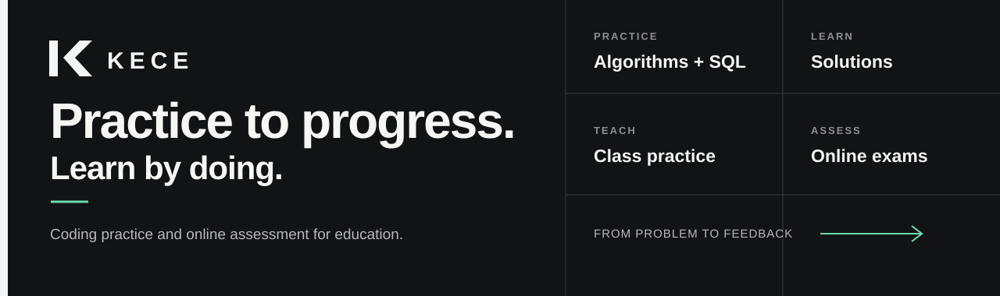
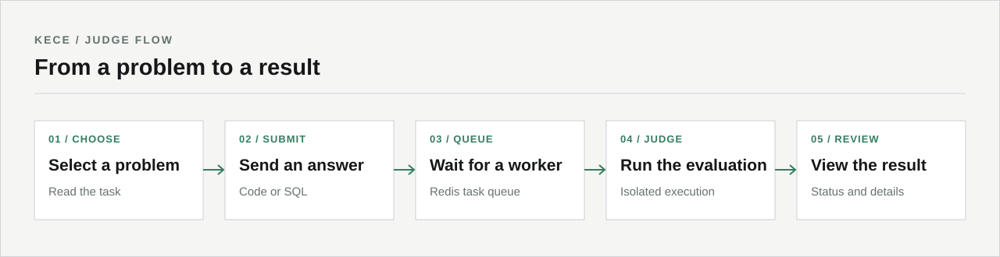
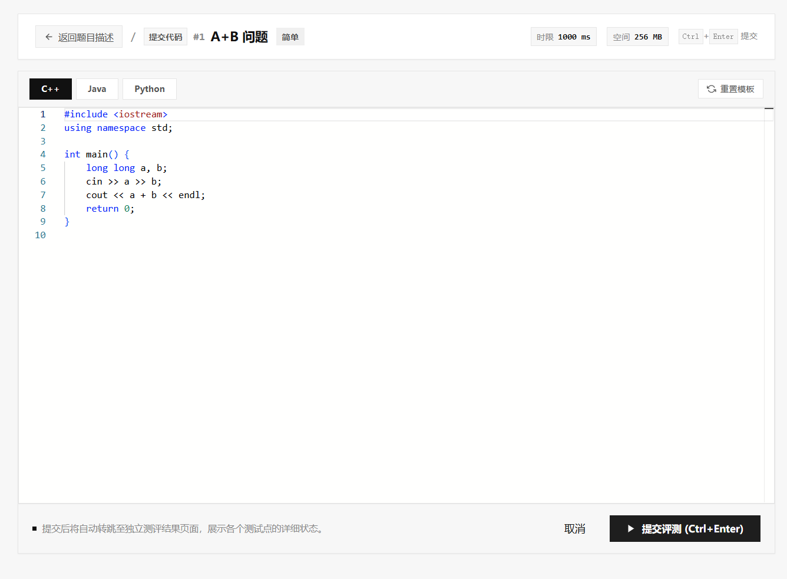
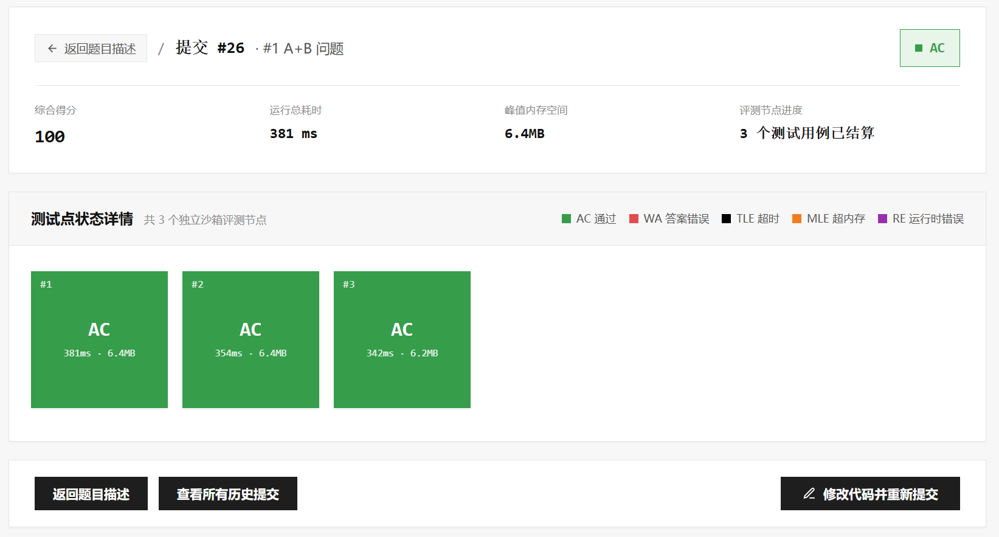
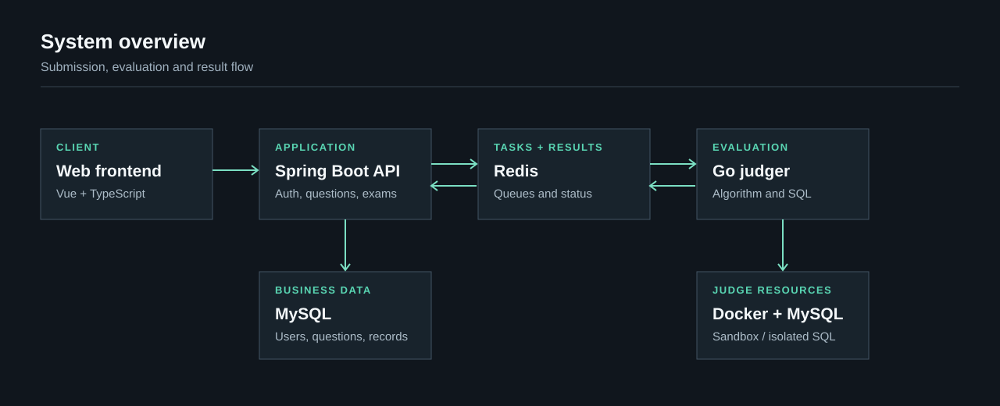

<div align="center">



**Programming practice and assessment for the classroom.**

[简体中文](./README.md) · English · [Live demo](https://kece.zheco68.asia/) · [Changelog](./CHANGELOG.md)

</div>

KECE brings an online judge, question collections, classroom practice, and examinations into one platform. Students can solve programming, SQL, and objective questions; teachers can prepare content, run assessments, and review results.

## What you can do

| For learners | For teachers and administrators |
| --- | --- |
| Submit code to the algorithm judge and inspect the results | Create and manage programming, SQL, and objective questions |
| Practice SQL against isolated test databases | Organize questions into collections and classroom exercises |
| Work through collections and objective questions | Assemble exams with ACM or OI scoring and review submissions |
| Read and publish Markdown solutions | Monitor assessment activity and manage platform content |

The platform also provides rankings, user profiles, and announcements. Available features and access depend on the user's role and the assessment configuration.

## From a question to a result



Choose a question, write a solution, and submit it for evaluation. The submission enters a queue before a judge worker runs it. Once the result is available, the result page presents the verdict and the available test-case details. Students can return to their code or read and publish Markdown solutions.

Teachers can use the same question bank to prepare collections, classroom exercises, and exams. Access and scoring follow the configuration of each activity.

## A look at the workspace

These screenshots show **historical examples from October 14, 2026**. The current interface may differ; visit the [live demo](https://kece.zheco68.asia/) for the latest version.

### Write and submit

Choose an available language and work in the code editor before sending a solution for evaluation.



### Review the verdict

After judging, inspect the overall verdict and test-case results to understand the outcome of a submission.



## Architecture



The Vue frontend talks to the Spring Boot API. Submissions enter Redis-backed queues, where Go judge workers execute programming tasks in Docker containers or assess SQL against a separate MySQL instance. The backend processes results and stores application data in the business database.

| Layer | Technology |
| --- | --- |
| Frontend | Vue 3, TypeScript, Vite, Pinia, Monaco Editor |
| Backend | Java 17, Spring Boot, MyBatis, Flyway |
| Judging | Go, Docker, Redis, dedicated MySQL instance |
| Data | MySQL, Redis |

Queueing and isolated workers help separate submissions from execution; actual throughput and recovery depend on configuration, hardware, and workload. Measure capacity in the target environment before relying on it for an exam.

## Run locally

The scripts below start a **development environment**, not a production deployment. They reuse an existing business MySQL server and start or reuse Redis and a dedicated judge MySQL container. Install Node.js 20.19+ or 22.12+, JDK 17, Go 1.22+, Docker, and MySQL 8 first. On Linux/macOS, the scripts also require `nc` and `pgrep`.

1. Create the business database and a database user with permissions for application and Flyway migrations. Configure `DB_HOST`, `DB_PORT`, `DB_NAME`, `DB_USER`, and `DB_PASSWORD` as needed; see [`application.yml`](./backend/src/main/resources/application.yml). The scripts expect the business MySQL server to be running before startup.
2. Install frontend dependencies:

   ```bash
   cd frontend
   npm ci
   cd ..
   ```

3. Start the services from the repository root:

   ```powershell
   # Windows PowerShell
   $env:SPRING_PROFILES_ACTIVE = "dev"
   .\deploy\start.ps1
   ```

   ```bash
   # Linux / macOS
   export SPRING_PROFILES_ACTIVE=dev
   bash ./deploy/start.sh
   ```

4. Open [localhost:5173](http://localhost:5173). The API is available at `http://localhost:8080/api/v1`; process logs are in `.logs/`.

The `dev` profile enables local demo accounts when initialization succeeds: administrator `admin@kece.local` / `admin123`, and teacher `teacher@kece.local` / `teacher123`. Initialization does not reset existing account passwords. The default profile leaves demo seeding disabled. Existing services may be skipped by the scripts, so restart the relevant process if you need changed environment settings to take effect.

> [!IMPORTANT]
> Keep the SQL judge instance separate from the business database: judging creates and deletes temporary databases. Local scripts and deployment examples contain development defaults; review credentials, JWT secrets, network exposure, Docker access, and isolation before any production use. Never expose seeded development accounts in production.

The stop scripts terminate processes by name or port and leave infrastructure containers running. Review them before use on a machine hosting other services.

## Repository

```text
frontend/   Vue application and administration console
backend/    Spring Boot API, business logic, and database migrations
judger/     Go workers, sandbox execution, and result comparison
deploy/     Local startup scripts and container configuration
docs/       Product, API, architecture, and implementation notes
```

## Documentation

- [Product requirements](./docs/需求文档.md)
- [API conventions](./docs/全局接口规范与公共约定.md)
- [Architecture and resilience proposal](./docs/算法优化与高可用高容错架构方案.md)
- [Frontend refactoring plan](./docs/前端架构重构与去重方案.md)
- [Solution module plan](./docs/题解模块落地方案.md)
- [Changelog](./CHANGELOG.md)

Some documents describe proposals or historical work. Consult the implementation and changelog for current behavior.

## Rights and usage

This project is a private engineering system. Commercial operation, redistribution, or public deployment requires authorization from the rights holder.
