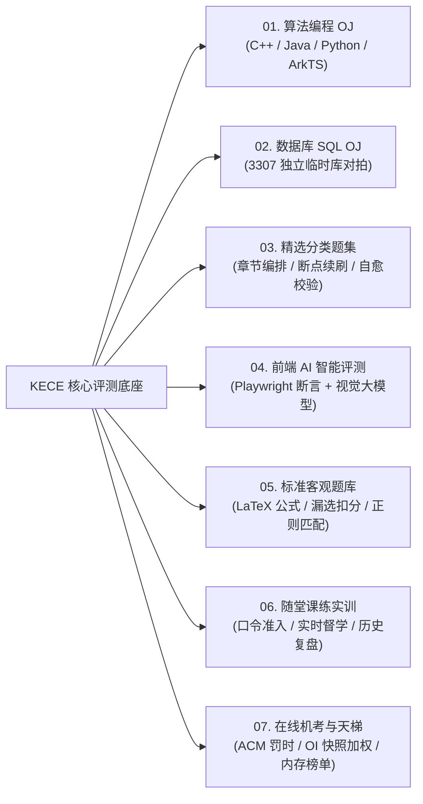
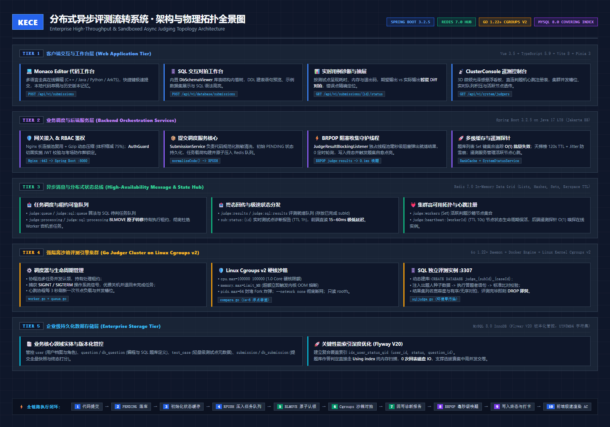
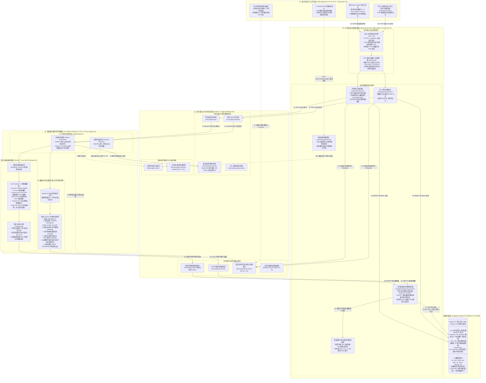
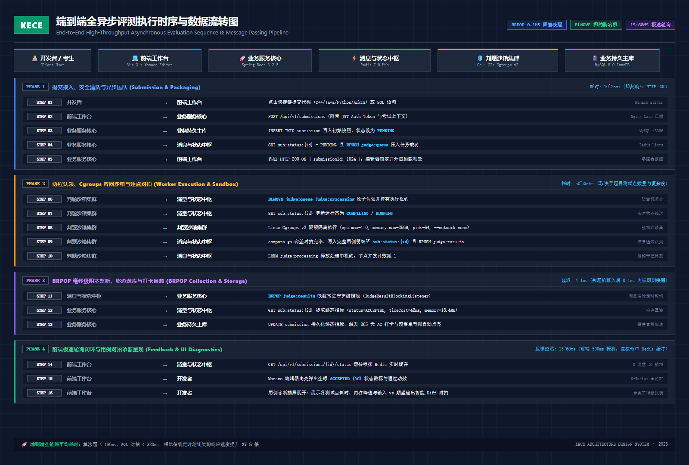
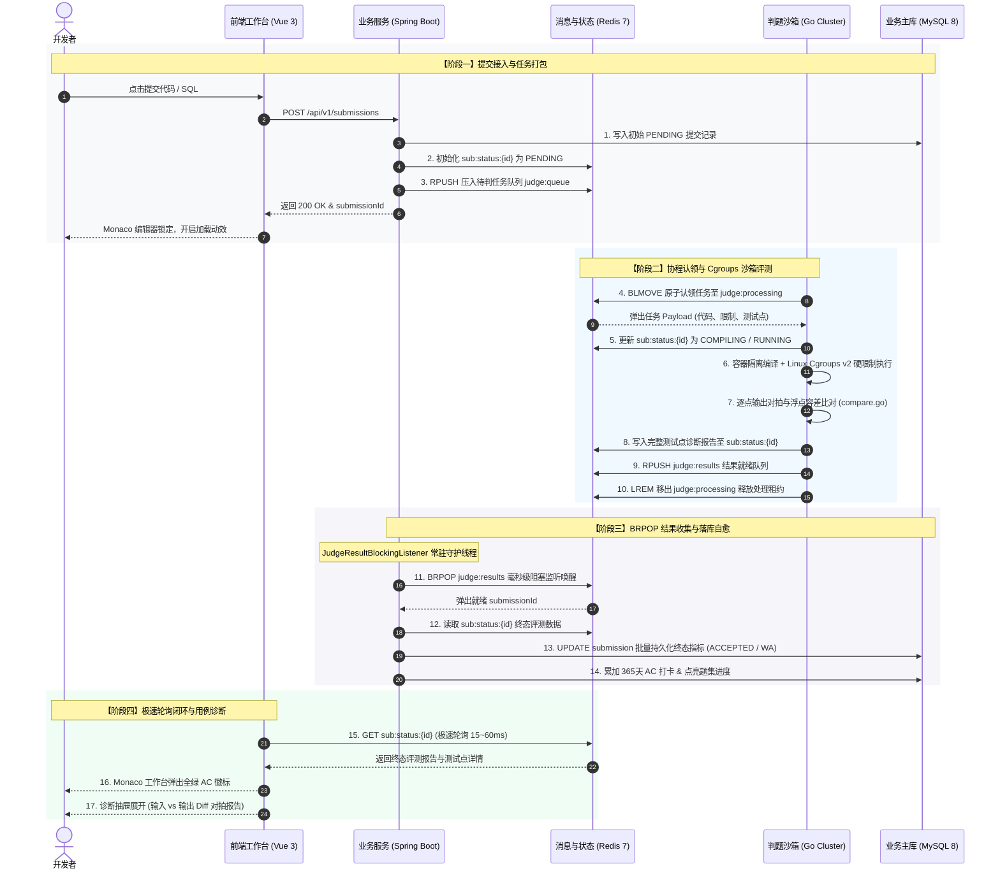
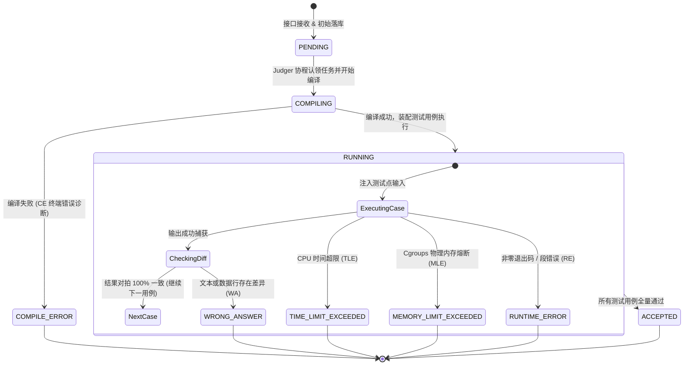

# KECE（课测）— 多维度全真编程与高并发技能评测系统

[](https://vuejs.org/)
[](https://spring.io/projects/spring-boot)
[](https://go.dev/)
[-00758f?style=flat-square)](https://www.mysql.com/)
[](https://redis.io/)
[](https://kece.zheco68.asia/)

> **KECE（课测）** 是面向高校计算机实验教学、全真技术机考与高阶算法/SQL实战的一体化现代评测系统。  
> 平台深度融合 **算法编程 OJ**（含多语言与鸿蒙 ArkTS）、**数据库 SQL OJ**（独立临时库对拍）、**精选进阶题集**、**前端 AI 评测**、**客观理论题库**、**随堂课练实训** 与 **ACM/OI 双赛制机考系统**，并依托 Linux Cgroups v2 强隔离沙箱与 Redis 异步流转引擎，提供毫秒级反馈、高反差直角工业美学与确定性的全真工程体验。

- **官方在线体验站点**：[https://kece.zheco68.asia/](https://kece.zheco68.asia/)
- **生产 API 规范基址**：`/api/v1`（集成 OpenAPI / Swagger 接口文档）

---

## 目录

- [平台核心评测与教学模块](#平台核心评测与教学模块)
- [核心架构亮点与高性能工程实践](#核心架构亮点与高性能工程实践)
- [设计系统与交互哲学](#设计系统与交互哲学)
- [界面全景展示](#界面全景展示)
- [技术栈与系统架构拓扑](#技术栈与系统架构拓扑)
- [项目目录结构](#项目目录结构)
- [本地开发与部署指南](#本地开发与部署指南)
- [关联项目规范与文档](#关联项目规范与文档)

---

## 平台核心评测与教学模块



| 编号 | 模块标识 | 模块名称 | 核心技术底座 | 关键功能与业务机制 |
| :---: | :---: | :--- | :--- | :--- |
| **01** | `ALGO` | **算法编程 OJ** | `Cgroups v2` + `Docker` | • 支持 **C/C++**、**Java 17**、**Python 3** 与 **ArkTS (鸿蒙)** 多语言在线编译；<br>• 内置多级算法标签体系（`#动态规划`、`#基础语法`、`#最短路`、`#BFS` 等）与折叠筛选条；<br>• 毫秒级 CPU 时间片与内存峰值硬限制，全覆盖 `AC/WA/TLE/MLE/RE/CE` 状态机。 |
| **02** | `SQL` | **数据库 SQL OJ** | `MySQL 8.0` 独立隔离实例 | • 单次评测动态创建 `judge_{subId}_{caseId}` 独占临时库，对拍后即刻 `DROP` 销毁；<br>• 内置交互式表结构预览（`DbSchemaViewer`），支持 `SELECT` 结果集对拍与 `DML` 变更校验；<br>• 支持浮点精度容差、字段类型宽容度与有序/无序比对。 |
| **03** | `SET` | **进阶分类题集** | 预聚合表 + 读时自愈 (`Read-Repair`) | • 结构化章节树编排、题集分类筛选与通关进度环；<br>• 智能推荐断点续刷题目，跨模式自动比对全局提交历史并点亮通关状态。 |
| **04** | `WEB AI` | **前端 AI 智能评测** | `Playwright` + 多模态大模型 | • 基于无头浏览器页面渲染快照、DOM 节点计算样式与交互行为断言；<br>• 结合多模态大模型审计前端代码还原度与语义规范性。 |
| **05** | `QUIZ` | **标准客观题库** | `Markdown` + `KaTeX` | • 涵盖单选、多选题（**漏选得一半分、错选得零分**算法）与填空题（精确/大小写忽略/正则）；<br>• 原生支持 Markdown 代码块高亮与 LaTeX 公式渲染，交卷即刻出分并呈现详细解析。 |
| **06** | `LAB` | **随堂课练实训** | 混合题型编排 + 实时督学 | • 面向高校课堂教学，支持算法题、SQL题与客观题混排编排；<br>• 6 位安全准入口令锁定（`[ 🔒 需口令 ]`），教师端提供实时答题进度雷达看板与历史归档。 |
| **07** | `EXAM` | **在线机考系统** | `ACM / OI` 双赛制 + 防作弊快照 | • 支持 **ACM 罚时赛制**（实时出分 + 20分钟错误罚时）与 **OI 考后结算赛制**（考中存快照）；<br>• 开考即固化试卷快照，集成切屏离焦监测、交卷永久锁定、战报分析与全场天梯榜。 |

---

## 核心架构亮点与高性能工程实践

为保证在高校机考与选拔赛等集中洪峰场景下的极速响应与高吞吐稳定性，系统实施了以下全链路性能加固：

### 1. 评测流转零轮询（BRPOP 异步驱动）
- **改造前**：后台采用 `@Scheduled(fixedDelay = 2000)` 定时轮询，导致判题机 20ms 完成的评测结果必须平均白等 1~2 秒才落库。
- **改造后**：自研 [`JudgeResultBlockingListener`](./backend/src/main/java/com/kece/submission/listener/JudgeResultBlockingListener.java)，采用双独立守护线程长轮询 `BRPOP` 监听 Redis 结果队列。判题机完成推入的 **0.1ms 内被即刻唤醒**，端到端延迟从 **2200ms 骤降至 <80ms**。

### 2. 数据库覆盖索引（Covering Index）
- 在 Flyway `V20__performance_indexes.sql` 中为 `submission` 与 `db_submission` 补全核心复合覆盖索引：
  ```sql
  ALTER TABLE `submission` ADD INDEX `idx_user_status_qid` (`user_id`, `status`, `question_id`);
  ```
- 答题状态核对转化为 **Using index** 纯内存扫描，彻底消除主表回表磁盘 IO。

### 3. 多级缓存体系与精准失效
- **题库列表缓存**：对公共查询结果生成 `question:cache:list:*`，结合 Redis Set (`question:cache:list_keys`) 实现出题、改题、删题时的 **O(1) 批量精准失效**，零 `KEYS *` 阻塞风险，列表查询响应由 70ms 压至 15ms。
- **全域排行榜防击穿**：`RankService` 引入带 0~30s 随机 Jitter 的页面级防雪崩缓存，并单点补齐登录用户实时排名卡片，避免全表 CTE 窗口函数频繁计算击穿 MySQL CPU。

### 4. 传输压缩与连接池调优
- **全站 Gzip 压缩**：Spring Boot 与 Nginx 反代开启动态压缩，长 JSON、Markdown 和测试用例传输体积直降 **70%~75%**。
- **JDBC 预编译缓存**：开启 `cachePrepStmts=true`、`rewriteBatchedStatements=true`，结合 HikariCP 连接池生命周期回收，杜绝长连接陈旧断链。

---

## 设计系统与交互哲学

平台完全遵循 **0-Radius Industrial System（直角工业设计系统）**，摒弃当下泛滥的圆角与高斯模糊，回归直观、硬朗、精确的工程美学：

- **核心几何规范**：全站严格遵循 `--radius: 0` 纯直角定义，消除任何圆角与模糊阴影；
- **色彩层级体系**：`#111111` 工业主墨黑（主文字与主框线）/ `#f4f5f7` 工作区浅灰底色 / `#ced4da` 结构分割线 / `#1d4ed8` 科技蓝高反差语义强调；
- **数码排版字体**：优先采用 `JetBrains Mono` 等宽排盘，辅以 `Inter` 与操作系统原生界面字族。

1. **绝对直角规范**：全站所有卡片、按钮、输入框、模态窗与头像均严格执行 `--radius: 0`。
2. **纯色语义标识体系**：
   - **用户角色**：管理员纯紫（`#7048e8`）、出题教师纯绿（`#2b8a3e`）、答题学生纯黑（`#1e1e1e`）；
   - **题目难度**：简单实心绿（`#2b8a3e`）、中等实心橙（`#e67700`）、困难实心红（`#c92a2a`）；
   - **算法标签**：高反差科技蓝纯色实心标（`#1d4ed8`，文字纯白），默认折叠收起，点击任意标签自动展开筛选条；
   - **SQL 题型**：`SELECT` 查询纯黑（`#1e1e1e`）、`DML` 变更钛金灰（`#495057`）。
3. **官网三大全宽对齐交互模块 (`1072px` 栅格)**：
   - **遥测控制台 (`ClusterConsole`)**：支持 3D 俯仰微倾与镜面高光，直连 Go 判题机心跳注册表，实时显示集群并发槽位与队列负载；
   - **扑克扇形能力矩阵 (`Poker Fan Matrix`)**：`1072px` 5 槽位扇形叠放舞台，从左后方到右前方由灰到白逐级递进，点击流畅切牌直达六大系统；
   - **实时沙箱体验终端 (`Judge Runner #01`)**：基于 `IntersectionObserver` 惰性加载，仅当用户翻阅至视野内触发打字动效，配有逐字打字音律节奏、PrismJS 实时语法高亮、实时行号与判题通过指标弹出（`ACCEPTED (AC)`）。

---

## 界面全景展示

### 1. 官网核心看板与交互矩阵
| 沙箱集群实时遥测控制台 (`ClusterConsole`) | 全栈能力扑克扇形矩阵 (`Poker Fan`) |
| :---: | :---: |
|  |  |

| 真实沙箱体验终端 (实时打字机高亮) |
| :---: |
|  |

---

### 2. 考试系统：锁定战报与作答快照
| 考试归档战报与 Bento 四大指标方块 | 逐题 64×64px 评测状态方块与代码快照抽屉 |
| :---: | :---: |
|  |  |

---

### 3. 在线编程工作台与开发者主页
| 算法编程 Monaco 工作台与测试点诊断 | 数据库 SQL 独立临时库对拍工作台 |
| :---: | :---: |
|  |  |

| 客观题作答与解析工作台 | 开发者主页与 365 天代码打卡热力图 |
| :---: | :---: |
|  |  |

---

## 技术栈与系统架构拓扑

### 核心技术清单

| 分层领域 | 技术选型 | 版本/规范 | 关键职责 |
| :--- | :--- | :--- | :--- |
| **前端应用** | Vue 3 + TypeScript + Vite | `Vue 3.5`, `Vite 8`, `TS 5.9` | `<script setup>` 组合式架构、0-Radius 样式体系与路由鉴权 |
| **编辑器与高亮** | Monaco Editor + PrismJS + KaTeX | 最新稳定版 | 工业级在线代码编写、终端动态高亮与 LaTeX 渲染 |
| **状态与通信** | Pinia + Vue Router + Axios | `Pinia 3`, `Router 5` | JWT 自动静默续签、考场锁定态与全局状态同步 |
| **后端核心** | Spring Boot + Java 17 | `Spring Boot 3.2.5` | 领域驱动设计、JWT RBAC、评测任务编排与结果回调处理 |
| **持久化与迁移** | MyBatis + Flyway + MySQL 8.0 | `Flyway V20` | 业务数据持久化、自动版本化数据库 Schema 迁移 |
| **缓存与消息中继** | Redis 7.0 (Spring Data Redis) | `Redis 7.0` | `judge:queue` 任务解耦、`BRPOP` 阻塞收集与多级缓存 |
| **沙箱判题引擎** | Go + Docker Cgroups v2 | `Go 1.22+` | 多协程并发认领、容器资源硬限制、信号捕获与优雅退出 |
| **SQL 隔离环境** | 独立 MySQL 8.0 实例 | 端口 `:3307` | 单次评测动态创建 `judge_{subId}_{point}` 临时库，对拍后即焚 |

### 异步评测流转系统架构与拓扑详解

KECE 采用**全异步解耦、强物理隔离、确定性对拍**的分布式高可用架构。从答题者在 Monaco Editor 中点击提交代码或 SQL，到最终在控制台查阅评测报告，系统通过**五层架构拓扑**、**15 步端到端异步时序**与**严谨状态机流转**保证高吞吐与毫秒级反馈：

#### 1. 分布式系统五层协同拓扑 (System Topology Map)



<details>
<summary>▶ 点击展开查看五层拓扑 Mermaid 源码结构</summary>



</details>

#### 2. 端到端全异步评测执行时序 (End-to-End Sequence Diagram)



<details>
<summary>▶ 点击展开查看异步时序 Mermaid 源码结构</summary>



</details>

#### 3. 评测沙箱核心状态机生命周期 (State Machine Lifecycle)



---

## 项目目录结构

### 模块全景与工程划分

| 顶级目录 | 核心分层 / 子模块 | 语言与技术栈 | 职责边界与关键业务编排 |
| :--- | :--- | :--- | :--- |
| **`frontend/`** | `src/views/` | Vue 3.5 + TS 5.9 | 答题工作台、实时诊断抽屉、全真机考、课练督学、开发者主页与管理后台 |
| | `src/components/` | Vite 8 + CSS Vars | 0-Radius 直角工业风组件（`ClusterConsole`, `DbSchemaViewer`, `HeatmapCalendar`） |
| | `src/api/` & `stores/` | Axios + Pinia 3 | 模块化 REST API 通信、JWT 自动静默续签与全局答题草稿缓存 |
| **`backend/`** | `submission/` | Spring Boot 3.2.5 | 提交任务构建调度与常驻守护线程 `JudgeResultBlockingListener`（BRPOP 结果收集） |
| | `database/` | MyBatis 3 + MySQL | SQL OJ 题库管理、测试点元数据内省与独立库对拍生命周期管理 |
| | `question/` & `rank/` | Redis 7 + HikariCP | 算法题库标签检索、测试用例管理、天梯榜防雪崩缓存（120s TTL + Jitter） |
| | `exam/` & `practice/` | Java 17 (LTS) | 考场快照组卷、防作弊切屏监测、ACM 罚时 / OI 快照加权评分、随堂课练准入 |
| | `db/migration/` | Flyway V20 | 生产级数据库版本化迁移脚本（含 `idx_user_status_qid` 复合覆盖索引） |
| **`judger/`** | `cmd/judger/` | Go 1.22+ | 评测守护进程常驻主入口、OS 信号捕获（`SIGINT/SIGTERM` 优雅关机） |
| | `internal/sandbox/` | Docker + Cgroups v2 | 容器硬件限额（`cpu.max`, `memory.max`, `pids.max`）、无网络（`--network none`）与只读镜像 |
| | `internal/sandbox/` | MySQL 8.0 (:3307) | 独立专用评测实例，动态创建 `judge_{subId}_{caseId}` 临时库，执行比对后即焚 |
| | `internal/compare/` | 算法/SQL 对拍器 | 空白过滤对拍、1e-6 浮点容差比对与纳秒级时间/内存峰值精准测量 |
| | `internal/queue/` | go-redis v9 | `BLMOVE` 原子认领防止宕机丢任务、3秒周期节点心跳上报 |
| **`deploy/`** | 协同脚本 | PowerShell / Bash | 跨平台一键环境自检、容器拉起、Go 判题编译与服务协同启停（`start` / `stop`） |
| **`docs/`** | 规范文档 | Markdown | 产品需求规格 (PRD)、设计系统规范、全局接口契约与后端性能优化落地手册 |

---

## 本地开发与部署指南

### 1. 前置依赖环境
- **Node.js**：`20.19+` 或 `22.12+`（推荐使用 `pnpm` 或 `npm`）
- **Java**：`JDK 17+`（推荐 Eclipse Temurin 17 / OpenJDK 17）
- **Go**：`1.22+`
- **Docker**：Docker Desktop（Windows / macOS）或 Docker Engine（Linux）
- **MySQL 8.0**：业务主库（端口 `3306`，首次启动由 Flyway 自动完成 Schema 迁移与种子数据填充）

---

### 2. 一键协同拉起（推荐）

项目在 `deploy/` 目录下提供了跨平台协同自动化脚本，会自动检查环境、启动 Redis 与独立判题 MySQL 容器、编译 Go 判题引擎，并在后台拉起所有服务：

```powershell
# Windows PowerShell
.\deploy\start.ps1

# 停止所有服务
.\deploy\stop.ps1
```

```bash
# Linux / macOS
chmod +x ./deploy/start.sh ./deploy/stop.sh
./deploy/start.sh

# 停止所有服务
./deploy/stop.sh
```

---

### 3. 分步手动启动

#### 步骤一：启动 Redis 与独立判题 MySQL 容器
```bash
# 启动 Redis 7 消息中间件与缓存
docker run -d --name kece-redis --restart unless-stopped \
  -p 6379:6379 redis:7-alpine

# 启动 SQL 评测专用独立临时库实例（注意端口为 3307，切勿占用业务主库 3306）
docker run -d --name kece-judge-mysql --restart unless-stopped \
  -p 3307:3306 -e MYSQL_ROOT_PASSWORD=judge123 mysql:8.0 \
  --character-set-server=utf8mb4 --collation-server=utf8mb4_unicode_ci
```

#### 步骤二：启动后端 Spring Boot 核心服务
```powershell
cd backend
$env:SPRING_PROFILES_ACTIVE = "dev"   # Linux/macOS: export SPRING_PROFILES_ACTIVE=dev
.\mvnw.cmd spring-boot:run            # Linux/macOS: ./mvnw spring-boot:run
```
- 后端服务端口：`http://localhost:8080/api/v1`
- 交互式接口文档：`http://localhost:8080/api/v1/swagger-ui.html`
- 预置测试账号（Flyway 自动播种）：
  - **平台管理员**：`admin` / `admin123`
  - **出题教师**：`teacher` / `teacher123`
  - **示例学生**：`student` / `student123`

#### 步骤三：启动 Go 判题沙箱 Worker
```powershell
cd judger
go build -o judger.exe ./cmd/judger

$env:REDIS_ADDR = "127.0.0.1:6379"
$env:JUDGE_MYSQL_HOST = "127.0.0.1"
$env:JUDGE_MYSQL_PORT = "3307"
$env:JUDGE_MYSQL_USER = "root"
$env:JUDGE_MYSQL_PASSWORD = "judge123"
.\judger.exe
```
> **提示**：沙箱首次判题时会自动通过 Docker API 下载对应编译环境镜像（`gcc:13`, `eclipse-temurin:17-jdk`, `python:3.12-slim`），可提前执行 `docker pull` 预热镜像。

#### 步骤四：启动前端开发服务器
```bash
cd frontend
npm install
npm run dev
```
- 前端开发站点：`http://localhost:5173`

---

## 关联项目规范与文档

- [产品需求规格说明书 (PRD)](./docs/需求文档.md) — 平台功能边界、用户角色模型与全场景用例
- [产品规格与设计原则 (PRODUCT.md)](./docs/PRODUCT.md) — 0-Radius 设计系统、视觉规范与技术指标
- [全局接口规范与公共约定](./docs/全局接口规范与公共约定.md) — RESTful API 契约、响应结构与状态机枚举
- [后端性能优化与工程落地手册](./docs/后端性能深度优化与工程落地手册.md) — BRPOP 异步流转、ZSET 排行榜与覆盖索引实战
- [工程推进与里程碑计划 (WBS)](./docs/开发计划.md) — 历史版本迭代规划与里程碑记录
- [版本变更日志 (CHANGELOG.md)](./CHANGELOG.md) — 详细记录版本演进、修复与加固记录

---

## 许可证

本项目为私有工程项目，未经授权许可不得用于商业运营。
