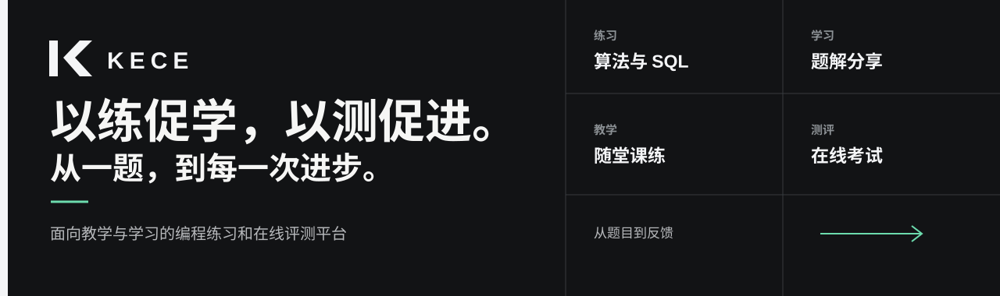
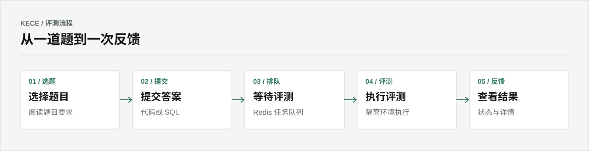
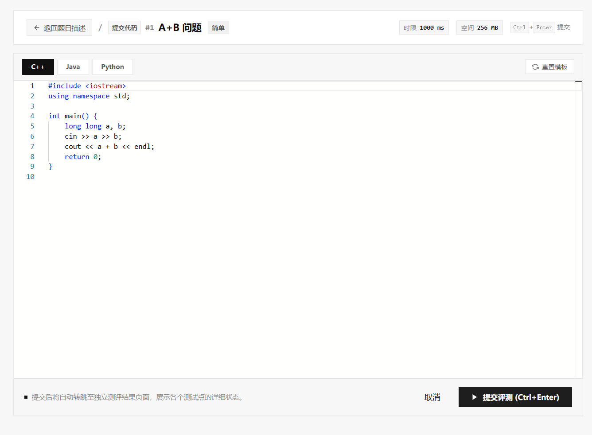
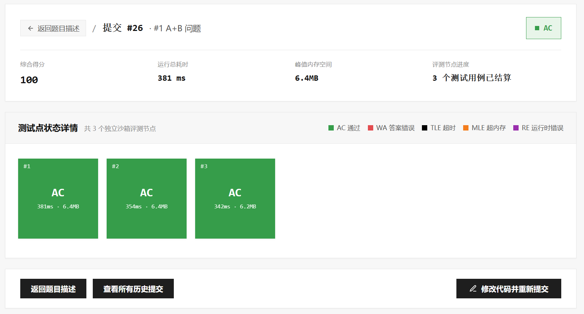
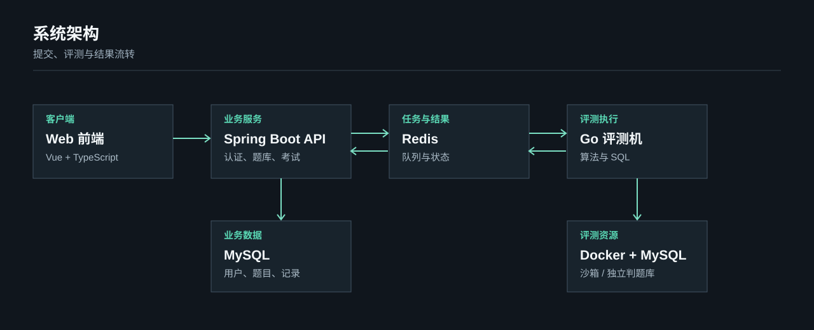

<p align="center">
  
</p>

<p align="center"><strong>练习、评测与考试，在同一个平台完成。</strong></p>
<p align="center">简体中文 · <a href="./README.en.md">English</a></p>
<p align="center"><a href="https://kece.zheco68.asia/">在线体验</a> &nbsp; / &nbsp; <a href="#快速开始">快速开始</a> &nbsp; / &nbsp; <a href="#文档">项目文档</a></p>

---

## 认识 KECE

KECE（课测）是面向编程教学、日常练习和在线考试的评测平台。学生可以在题库中练习算法和 SQL、作答客观题并分享题解；教师可以组织题集、随堂课练与考试，查看作答和评测结果。

| 学习与练习 | 教学与管理 |
| :--- | :--- |
| 算法编程题、SQL 题与客观题 | 题目、测试数据与题集管理 |
| 按章节练习，查看提交和判题结果 | 组卷、随堂课练与考试管理 |
| 使用 Markdown 编写、阅读题解 | 查看成绩、提交记录与逐题统计 |

## 核心能力

- **算法评测**：在线编写代码，提交到隔离的容器环境执行，并查看评测状态与测试点结果。支持的语言以题目配置为准。
- **SQL 评测**：在独立的判题 MySQL 实例中创建临时数据库，执行用户 SQL 并比较结果或数据变更。
- **客观题与题集**：支持客观题作答、解析以及按章节组织的单题型题集。
- **课练与考试**：教师可组织随堂课练和在线考试；考试支持 ACM 与 OI 计分模式。
- **题解与成长记录**：登录用户可直接发布 Markdown 题解，管理员可管理已发布内容；用户还可查看提交记录与排名。

> 首页终端里的打字和评测动画是展示效果，实际判题以提交后的评测结果为准。

## 从一道题到一次反馈

选题、编写代码、提交和查看结果构成一次完整练习。题目和题集为学习提供路径，课练和考试则让教师可以围绕同一套题库组织教学。

<p align="center"></p>

### 编写与提交

选择题目允许的语言，在在线编辑器中编写代码并提交。评测在后台执行，结果页展示状态和测试点信息，帮助定位问题。



### 查看评测结果

结果页汇总评测状态与测试点结果；实际可见的诊断信息取决于题目配置及当前用户权限。



<sub>以上截图来自 2026-10-14 的历史版本，用于展示主要工作流程；界面及功能以当前版本为准。</sub>

## 系统如何工作

<p align="center"></p>

前端通过 API 向业务后端提交请求；评测任务经 Redis 队列交给 Go 评测机，评测结果再回到业务服务。算法代码在 Docker 沙箱中运行，SQL 使用独立的判题数据库实例。具体容量与可靠性受硬件、配置和题目负载影响，需要通过实际压测验证。

| 组件 | 技术 |
| :--- | :--- |
| 前端 | Vue 3、TypeScript、Vite、Pinia、Monaco Editor |
| 后端 | Java 17、Spring Boot、MyBatis、Flyway |
| 评测 | Go、Docker、Linux Cgroups、Redis |
| 数据 | MySQL 业务库、独立 MySQL 判题实例、Redis |

## 快速开始

以下步骤用于**本地开发**。启动脚本会复用已有的业务 MySQL，并启动或复用 Redis 和 SQL 判题 MySQL 容器；它不会自动创建业务数据库，也不会替你安装前端依赖。

### 1. 准备环境

- Node.js 20.19+ 或 22.12+、npm、JDK 17、Go 1.22+、Docker。
- 已启动的 MySQL 8，默认地址为 `localhost:3306`。预先创建 `kece` 数据库，并为后端准备可访问该库的账号。
- 默认后端数据库账号为 `kece`；如需使用其他连接参数，可设置 `DB_HOST`、`DB_PORT`、`DB_NAME`、`DB_USER` 和 `DB_PASSWORD`，以 [后端配置](./backend/src/main/resources/application.yml) 为准。
- Linux/macOS 脚本还需要 `nc` 和 `pgrep`。Docker 必须可从当前用户访问。

确保 `3307` 和 `6379` 可供判题数据库与 Redis 使用。**不要把 SQL 判题连接指向业务 MySQL 实例**：判题过程会创建并清理临时库及账号。

### 2. 安装前端依赖

在仓库根目录执行：

```bash
cd frontend
npm ci
cd ..
```

### 3. 启动开发环境

如需演示数据，启动前设置 `SPRING_PROFILES_ACTIVE=dev`；默认配置不会启用演示数据。

```powershell
# Windows PowerShell，仓库根目录
$env:SPRING_PROFILES_ACTIVE = 'dev'
.\deploy\start.ps1
```

```bash
# Linux / macOS，仓库根目录
export SPRING_PROFILES_ACTIVE=dev
bash ./deploy/start.sh
```

前端默认访问 [localhost:5173](http://localhost:5173)，后端 API 位于 `http://localhost:8080/api/v1`，日志位于 `.logs/`。接口文档位于 `http://localhost:8080/api/v1/swagger-ui.html`。首次启动需要下载依赖和容器镜像；请查看日志确认各服务实际就绪。

开发模式在账号不存在时会初始化本地演示账号：管理员 `admin@kece.local` / `admin123`、教师 `teacher@kece.local` / `teacher123`。如果账号已存在，不会保证密码被重置。

停止由脚本管理的本地进程，使用 `deploy/stop.ps1` 或 `deploy/stop.sh`。运行前请先阅读脚本，确认停止范围。

> 开发 profile 的演示账号仅供本地测试，默认密码及演示数据的启用方式以代码为准。生产环境必须更换所有默认凭据和 JWT 密钥，并独立配置数据库、Redis 和评测隔离。仓库中的 Compose 判题机使用 `privileged` 与 Docker socket，标注为本地开发用途，不应直接作为生产安全配置。

## 项目结构

```text
KECE/
├── frontend/   Vue 前端：题库、作答、题解与管理界面
├── backend/    Spring Boot 业务 API 与数据库迁移
├── judger/     Go 评测服务、沙箱与结果比较
├── deploy/     本地启动、停止与容器配置
└── docs/       产品、接口、架构和专项方案
```

## 文档

- [产品需求与功能范围](./docs/需求文档.md)
- [全局接口规范与公共约定](./docs/全局接口规范与公共约定.md)
- [题解模块落地方案](./docs/题解模块落地方案.md)
- [前端架构重构与去重方案](./docs/前端架构重构与去重方案.md)
- [算法优化与高可用高容错架构方案](./docs/算法优化与高可用高容错架构方案.md)
- [版本变更记录](./CHANGELOG.md)

方案文档可能包含历史设计或尚未实施的建议，实际功能以当前代码和版本记录为准。

## 授权说明

本项目为私有工程系统，未经授权许可不得擅自用于商业运营、二次分发或公开部署。
