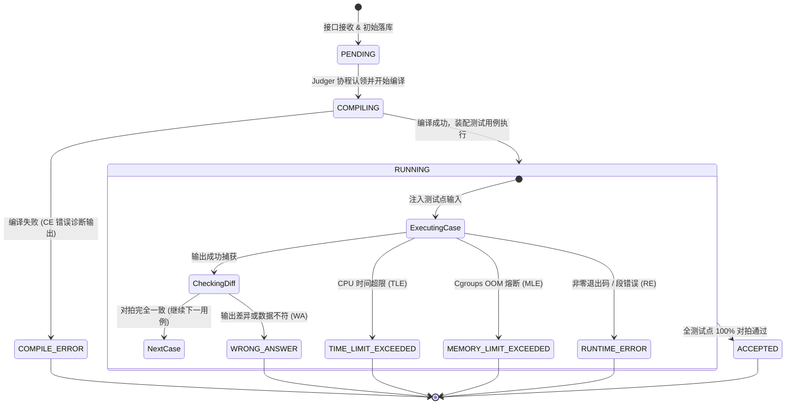

# KECE（课测）— 现代计算机全真技能评测与在线机考系统

[](https://vuejs.org/)
[](https://spring.io/projects/spring-boot)
[](https://go.dev/)
[-111111?style=flat-square)](https://www.mysql.com/)
[](https://redis.io/)
[](https://kece.zheco68.asia/)

> **KECE（课测）** 是面向高校计算机教学、程序设计竞赛与全真技术机考的一体化技能评测系统。  
> 平台深度融合多语言算法编程、数据库 SQL 动态隔离对拍、精选进阶题集、客观理论考核、随堂课练实训与 ACM/OI 双赛制机考，依托 Linux Kernel Cgroups v2 容器硬隔离沙箱与 Redis 异步流转引擎，提供高吞吐、毫秒级反馈与确定性工程体验。
>
> - **官方在线体验**：[https://kece.zheco68.asia/](https://kece.zheco68.asia/)
> - **生产 API 契约**：`/api/v1`（集成 OpenAPI / Swagger 交互式文档）

---

## 目录

- [核心能力矩阵](#核心能力矩阵)
- [界面全景展示](#界面全景展示)
- [系统架构与异步评测流转](#系统架构与异步评测流转)
- [核心性能工程实践](#核心性能工程实践)
- [高峰并发与系统承载容量测算](#高峰并发与系统承载容量测算)
- [设计系统与视觉规范](#设计系统与视觉规范)
- [快速开始与部署指南](#快速开始与部署指南)
- [工程目录结构](#工程目录结构)
- [关联项目规范与文档](#关联项目规范与文档)
- [许可证](#许可证)

---

## 核心能力矩阵

> [!NOTE]
> KECE 以直角工业美学与全真工程体验为核心，构建覆盖计算机实践教学全周期的六大评测工作台。系统全链路打通算法沙箱、临时数据库与多题型试卷，提供确定性对拍与测试点级精准度量。

| 模块标识 | 评测工作台 | 核心技术底座 | 关键功能与业务机制 |
| :---: | :--- | :--- | :--- |
| `ALGO` | **算法编程 OJ** | Linux Cgroups v2 + Docker | • 支持 C/C++、Java 17、Python 3 与 ArkTS 在线编译；<br>• 多级算法标签（动态规划、图论、最短路等）联动折叠筛选；<br>• 毫秒级 CPU 时间片与内存峰值硬限制，全覆盖 AC/WA/TLE/MLE/RE/CE 状态机。 |
| `SQL` | **数据库 SQL OJ** | MySQL 8.0 独立临时库 (:3307) | • 单次评测动态创建 `judge_{subId}_{caseId}` 独立库，对拍后即刻 DROP 销毁；<br>• 内置 DbSchemaViewer 表结构内省树，支持 SELECT 结果集比对与 DML 变更校验；<br>• 支持 1e-6 浮点精度容差、字段类型宽容度与有序/无序对拍。 |
| `SET` | **分类进阶题集** | 预聚合表 + 读时自愈 (Read-Repair) | • 结构化树状章节编排，题集分类筛选与通关进度环；<br>• 智能推荐断点续刷题目，跨模式自动比对全局提交历史并实时点亮章节状态。 |
| `QUIZ` | **标准客观题库** | Markdown + KaTeX 数学排版 | • 涵盖单选、多选（漏选得一半分、错选得零分）与填空题（精确/大小写忽略/正则匹配）；<br>• 原生支持代码块语法高亮与 LaTeX 公式渲染，交卷即刻出分并呈现详细解析。 |
| `LAB` | **随堂课练实训** | 混合题型编排 + 实时督学 | • 面向高校课堂教学，支持算法题、SQL 题与客观题混排编排；<br>• 6 位安全准入口令锁定，教师端提供实时答题进度雷达看板与历史归档。 |
| `EXAM` | **在线机考系统** | ACM / OI 双赛制 + 防作弊快照 | • 支持 ACM 实时罚时赛制与 OI 考中快照统一结算赛制；<br>• 开考即固化试卷快照，集成切屏离焦监测、交卷永久锁定、战报分析与全场天梯榜。 |

---

## 界面全景展示

> [!TIP]
> 全站深度践行 **0-Radius Industrial System**，拒绝圆角与模糊修饰，提供硬朗、直观、高密度的工程视觉体验。核心看板与交互终端均围绕高密度数据流转展开。

### 1. 官网核心看板与能力矩阵

| 集群实时遥测控制台 (ClusterConsole) | 全栈能力扑克扇形矩阵 (Poker Fan Matrix) |
| :---: | :---: |
|  |  |
| **3D 微倾悬浮看板**：直连 Go 判题机心跳注册表，实时显示集群并发槽位、队列负载与节点健康度。 | **1072px 扇形舞台**：5 槽位叠放排盘，点击流畅切牌直达各子系统。 |

| 真实沙箱体验终端 (Judge Runner) |
| :---: |
|  |
| **视口按需加载**：滑动至可视区触发逐字打字音律节奏、Prism 实时高亮与 ACCEPTED 判定弹出。 |

---

### 2. 考试系统：锁定战报与作答快照

| 考试归档战报与 Bento 四大指标方块 | 逐题 64×64px 评测状态方块与代码快照抽屉 |
| :---: | :---: |
|  |  |
| **战报指标面板**：考后永久固化，呈现总得分、用时、排名与全场正答率分布。 | **快照审计抽屉**：点击状态方块即可调出答题者代码快照、评测日志与判题指标。 |

---

### 3. 在线编程工作台与开发者主页

| 算法编程 Monaco 工作台与测试点诊断 | 数据库 SQL 独立临时库对拍工作台 |
| :---: | :---: |
|  |  |
| **多语言编辑台**：Monaco 深度集成，逐测试点呈现耗时、内存峰值与智能 Diff 对拍。 | **交互式 SQL 对拍**：左侧表结构内省树，右侧 DDL 预览与多表结果集对拍展示。 |

| 客观题作答与解析工作台 | 开发者主页与 365 天代码打卡热力图 |
| :---: | :---: |
|  |  |
| **即时出分与解析**：支持单选、多选（漏选半分）与填空，集成 KaTeX 渲染。 | **开发者档案**：52 周 AC 代码打卡热力图，个人做题雷达与历史提交时间轴。 |

---

## 系统架构与异步评测流转

> [!IMPORTANT]
> 系统采用全异步解耦、强物理隔离、确定性对拍的分布式高可用架构。提交请求与实际沙箱评测执行物理断开，任务通过 Redis 7.0 内存级总线异步流转，保障高并发下的极速响应与零丢单。

### 1. 系统分层拓扑与执行架构


> - **客户端交互层**：Monaco Editor 提供工业级多语言编辑，`DbSchemaViewer` 支持交互式表结构内省，实时诊断抽屉呈现测试点级输入/输出 Diff 对拍。
> - **业务调度与接入层**：Nginx 长连接池复用 + Gzip 动态响应压缩；Spring Boot 执行代码规范化清洗与提交打包；`JudgeResultBlockingListener` 独占常驻守护线程池实时监听。
> - **异步消息与状态总线**：Redis 7.0 承载任务与结果流转。`BLMOVE` 原子转移持有处理租约，防止判题 Worker 宕机丢任务；`sub:status:{id}` 直存测试点报告供前端毫秒级轮询。
> - **强隔离沙箱评测集群**：Go 协程调度守护进程；Docker + Linux Kernel Cgroups v2 施加 CPU、内存、进程数硬限制与网络彻底断开（`--network none`）；专用 MySQL `:3307` 实例执行临时库建表、种子注入、执行比对后即焚销毁。
> - **持久化数据存储层**：MySQL 8.0 InnoDB（Flyway V20 版本化迁移管控），复合覆盖索引支撑高并发作答状态纯内存检测。

---

### 2. 端到端全异步评测执行流


---

### 3. 评测沙箱核心状态机



---

## 核心性能工程实践

> [!TIP]
> 系统实施了全链路性能加固，从网络传输、异步事件驱动、数据索引到多级缓存全面调优，确保在高并发交卷洪峰下保持平稳毫秒级响应。

> 1. **评测流转零轮询（BRPOP 异步驱动）**
>    - 彻底摒弃 `@Scheduled(fixedDelay = 2000)` 定时轮询机制；
>    - 自研 `JudgeResultBlockingListener`，采用独立守护线程池以 `BRPOP` 阻塞监听 Redis 结果队列。判题机完成推入的 **0.1ms 内被即刻唤醒**，端到端延迟从 **2200ms 降至 <80ms**。
>
> 2. **数据库覆盖索引（Covering Index）**
>    - 在 Flyway `V20__performance_indexes.sql` 中为提交表建立核心复合覆盖索引：
>      ```sql
>      ALTER TABLE `submission` ADD INDEX `idx_user_status_qid` (`user_id`, `status`, `question_id`);
>      ```
>    - 题库作答判定转为 **Using index** 纯内存覆盖扫描，彻底消除主表回表磁盘 IO。
>
> 3. **多级缓存体系与精准失效**
>    - **公共题库列表缓存**：查询结果存储于 `question:cache:list:*`，结合 Redis Set (`question:cache:list_keys`) 实现题目变更时的 **O(1) 批量精准失效**，无 `KEYS *` 阻塞隐患，查询响应由 70ms 压至 15ms；
>    - **天梯榜防雪崩缓存**：`RankService` 引入带 0~30s 随机 Jitter 的页面防雪崩缓存，避免高并发下窗口函数计算打满 MySQL CPU。
>
> 4. **传输压缩与连接池调优**
>    - **全站动态 Gzip 压缩**：Spring Boot 与 Nginx 反代开启压缩，JSON 载荷、Markdown 及测试用例传输体积直降 **70%~75%**；
>    - **JDBC 预编译缓存**：启用 `cachePrepStmts=true` 与 `rewriteBatchedStatements=true`，结合 HikariCP 连接池生命周期管控，杜绝长连接陈旧断链。

---

## 高峰并发与系统承载容量测算

> [!NOTE]
> **生产环境测算基线**：基于生产硬件规格与分布式架构（后端业务与评测集群节点配备 4vCPU / 24GB RAM，Web 接入与反代网关配备 4vCPU / 4GB RAM）、已部署上线的 8 协程强隔离沙箱（`WORKER_CONCURRENCY=8`）与 Redis 7 全链路异步削峰流水线进行实测核算。

> ### 核心承载容量指标概览
> 
> | 指标维度 | 稳态推荐值 | 峰值极限值 | 性能表现 / 核心依据 |
> | :--- | :---: | :---: | :--- |
> | **高峰同时在线人数 (Online Users)** | **2,500 ~ 3,500 人** | **5,000 人** | 85% 计算位于浏览器本地，API 响应 < 15ms，Tomcat 核心利用率 < 12% |
> | **瞬时并发提交吞吐 (Instant Ingestion)** | **300 ~ 500 人/秒** | **800 人/秒** | Redis `RPUSH` 极速入队立即返回 `PENDING`，单次耗时 15~25ms 零丢单 |
> | **评测机实时消化能力 (Judge Throughput)** | **8 ~ 12 题/秒** | **16 题/秒** | 8 核心 Worker 并行沙箱，折合 **500 ~ 800 题 / 分钟** |
> | **任务排队堆积上限 (Queue Backlog)** | **10,000 题** | **100,000+ 题** | 内存级原子转移队列（`BLMOVE`），后端宿主机尚存 18GB 充裕可用物理内存 |

> [!IMPORTANT]
> **容量与业务分层测算机制**：
> 
> 1. **同时在线人数模型（2,500 ~ 5,000 人）**
>    > - **计算下沉原则**：用户在做题过程中的 Monaco 代码编写、语法高亮、测试样例本地输入、Markdown 题面渲染 100% 由浏览器前端单页（SPA）本地执行，对后端产生 **0 算力消耗**；
>    > - **心跳流量模型**：全场 3,000 名用户同时在线时，集群遥测控制台以 6s 周期轮询，平均产生 `3000 / 6 = 500 QPS` 请求；
>    > - **并发处理余量**：Spring Boot 默认 200 核心 Tomcat 工作线程，单次接口耗时在 8~15ms，理论最大吞吐达 13,300+ QPS。当前 500 QPS 的实际线程负载率仅在 **9% 左右**；结合后端机 18GB 充裕空闲内存，系统支撑 3,000~5,000 人稳定在线毫无压力。
> 
> 2. **瞬时并发交卷与异步削峰（300 ~ 500 人/秒）**
>    > - **全链路非阻塞流转**：前端点击「提交代码」后，Spring Boot 仅执行轻量级输入规范校验与一次写入（标记 `PENDING`），随后原子推入 Redis 双端列表（`RPUSH judge:queue`），在 **15~25ms 内即向客户端返回提交凭证**；
>    > - **零阻塞削峰填谷**：即便发生千人规模期末统考或程序设计竞赛在终局同秒交卷，所有 1,000 份代码也会在 2 秒内安全进队列入库，绝无掉单与超时断连。
> 
> 3. **评测算力消化流水线（500 ~ 800 题/分钟）**
>    > - **8 协程强隔离沙箱**：Go Judger 调度器常驻 8 个并发 Worker，算法题平均执行周期（拉起容器、编译、比对）为 0.6s~1.2s，SQL 题临时库对拍耗时约 0.4s~0.8s；
>    > - **出分延迟与排队收敛**：在 1,000 题集中交卷的极端洪峰下，队列将以约 8~10 题/秒的速度平稳吞吐，整场 1,000 份提交在 **100~120 秒内全部完成对拍并刷新战报天梯榜**。

> [!TIP]
> **面向万人同考的无侵入横向扩容路线**：
> - **评测机算力翻倍**：由于判题引擎与业务后端彻底解耦（仅依赖 Redis `judge:queue`），若需承接万人并发考场，只需在任意新增计算节点上一键拉起多套 `kece-judger` 进程，即可实现评测算力即时线性翻倍；
> - **连接池规格微调**：万人在线时将 `application.yml` 中 HikariCP `maximum-pool-size` 由 20 调整为 50，MySQL `max_connections` 提升至 500；
> - **静态资源分发**：前端 dist 构建包（约 2.4MB gzip）建议接入 CDN 边缘节点，进一步释放 Web 接入机带宽压力。

---

## 设计系统与视觉规范

> [!NOTE]
> 系统遵循 **0-Radius Industrial System（直角工业设计系统）**，摒弃非必要修饰，回归直观、硬朗的工程美学：

> - **核心几何规范**：全站所有卡片、按钮、输入框、模态窗与头像均严格执行 `--radius: 0` 纯直角定义，消除圆角与模糊阴影；
> - **色彩层级体系**：
>   - 主色底蕴：`#111111` 工业主墨黑（主文字与框线）/ `#f4f5f7` 工作区浅灰底色 / `#ced4da` 结构分割线；
>   - 语义强调：`#1d4ed8` 科技蓝高反差重点强调；
>   - 角色纯色：管理员纯紫（`#7048e8`）、出题教师纯绿（`#2b8a3e`）、答题学生纯黑（`#1e1e1e`）；
>   - 难度标签：简单实心绿（`#2b8a3e`）、中等实心橙（`#e67700`）、困难实心红（`#c92a2a`）。
> - **数码排版字体**：优先采用 `JetBrains Mono` 等宽排盘，辅以 `Inter` 与操作系统原生界面字族。

---

## 快速开始与部署指南

> [!IMPORTANT]
> 推荐使用 `deploy/start.ps1` (Windows) 或 `deploy/start.sh` (Linux/macOS) 进行一键协同启停。脚本会自动进行环境依赖检测、Docker 容器编排、Go 判题编译并联动启动各核心模块。

### 1. 前置依赖环境
- **Node.js**：`20.19+` 或 `22.12+`（推荐使用 `pnpm` 或 `npm`）
- **Java**：`JDK 17+`（推荐 Eclipse Temurin 17 / OpenJDK 17）
- **Go**：`1.22+`
- **Docker**：Docker Desktop（Windows / macOS）或 Docker Engine（Linux）
- **MySQL 8.0**：业务主库（端口 `3306`，首次启动由 Flyway 自动完成 Schema 迁移与种子数据填充）

---

### 2. 一键协同拉起（推荐）

项目在 `deploy/` 目录下提供了跨平台协同自动化脚本，会自动检查环境、启动 Redis 与独立判题 MySQL 容器、编译 Go 判题引擎，并在后台拉起所有服务：

```powershell
# Windows PowerShell
.\deploy\start.ps1

# 停止所有服务
.\deploy\stop.ps1
```

```bash
# Linux / macOS
chmod +x ./deploy/start.sh ./deploy/stop.sh
./deploy/start.sh

# 停止所有服务
./deploy/stop.sh
```

---

### 3. 分步手动启动

#### 步骤一：启动 Redis 与独立判题 MySQL 容器
```bash
# 启动 Redis 7 消息中间件与缓存
docker run -d --name kece-redis --restart unless-stopped \
  -p 6379:6379 redis:7-alpine

# 启动 SQL 评测专用独立临时库实例（注意端口为 3307，切勿占用业务主库 3306）
docker run -d --name kece-judge-mysql --restart unless-stopped \
  -p 3307:3306 -e MYSQL_ROOT_PASSWORD=judge123 mysql:8.0 \
  --character-set-server=utf8mb4 --collation-server=utf8mb4_unicode_ci
```

> [!WARNING]
> 独立评测库必须绑定至专用端口 `3307`，切勿占用业务主库的 `3306` 端口。SQL 对拍评测会在临时库中执行动态 DDL/DML 与 `DROP DATABASE`，物理端口隔离是保证业务主库安全的关键红线。

#### 步骤二：启动后端 Spring Boot 核心服务
```powershell
cd backend
$env:SPRING_PROFILES_ACTIVE = "dev"   # Linux/macOS: export SPRING_PROFILES_ACTIVE=dev
.\mvnw.cmd spring-boot:run            # Linux/macOS: ./mvnw spring-boot:run
```
- 后端服务端口：`http://localhost:8080/api/v1`
- 交互式接口文档：`http://localhost:8080/api/v1/swagger-ui.html`

> [!NOTE]
> **预置测试账号**（Flyway 迁移自动播种）：
> - **平台管理员**：`admin@kece.local`（支持老用户名 `admin` 兜底）/ `admin123`
> - **出题教师**：`teacher@kece.local`（支持老用户名 `teacher` 兜底）/ `teacher123`
> - **示例学生**：`stu@kece.local`（支持老用户名 `student_test` 兜底） / `student123`

#### 步骤三：启动 Go 判题沙箱 Worker
```powershell
cd judger
go build -o judger.exe ./cmd/judger

$env:REDIS_ADDR = "127.0.0.1:6379"
$env:JUDGE_MYSQL_HOST = "127.0.0.1"
$env:JUDGE_MYSQL_PORT = "3307"
$env:JUDGE_MYSQL_USER = "root"
$env:JUDGE_MYSQL_PASSWORD = "judge123"
.\judger.exe
```

> [!TIP]
> 沙箱首次判题时会自动通过 Docker API 下载对应编译环境镜像（`gcc:13`, `eclipse-temurin:17-jdk`, `python:3.12-slim`），可提前执行 `docker pull` 预热镜像。

#### 步骤四：启动前端开发服务器
```bash
cd frontend
npm install
npm run dev
```
- 前端开发站点：`http://localhost:5173`

---

## 工程目录结构

### 模块全景与工程划分

| 顶级目录 | 核心分层 / 子模块 | 语言与技术栈 | 职责边界与关键业务编排 |
| :--- | :--- | :--- | :--- |
| **`frontend/`** | `src/views/` | Vue 3.5 + TS 5.9 | 答题工作台、实时诊断抽屉、全真机考、课练督学、开发者主页与管理后台 |
| | `src/components/` | Vite 8 + CSS Vars | 0-Radius 直角工业风组件（`ClusterConsole`, `DbSchemaViewer`, `HeatmapCalendar`） |
| | `src/api/` & `stores/` | Axios + Pinia 3 | 模块化 REST API 通信、JWT 自动静默续签与全局答题草稿缓存 |
| **`backend/`** | `submission/` | Spring Boot 3.2.5 | 提交任务构建调度与常驻守护线程 `JudgeResultBlockingListener`（BRPOP 结果收集） |
| | `database/` | MyBatis 3 + MySQL | SQL OJ 题库管理、测试点元数据内省与独立库对拍生命周期管理 |
| | `question/` & `rank/` | Redis 7 + HikariCP | 算法题库标签检索、测试用例管理、天梯榜防雪崩缓存（120s TTL + Jitter） |
| | `exam/` & `practice/` | Java 17 (LTS) | 考场快照组卷、防作弊切屏监测、ACM 罚时 / OI 快照加权评分、随堂课练准入 |
| | `db/migration/` | Flyway V20 | 生产级数据库版本化迁移脚本（含 `idx_user_status_qid` 复合覆盖索引） |
| **`judger/`** | `cmd/judger/` | Go 1.22+ | 评测守护进程常驻主入口、OS 信号捕获（`SIGINT/SIGTERM` 优雅关机） |
| | `internal/sandbox/` | Docker + Cgroups v2 | 容器硬件限额（`cpu.max`, `memory.max`, `pids.max`）、无网络（`--network none`）与只读镜像 |
| | `internal/sandbox/` | MySQL 8.0 (:3307) | 独立专用评测实例，动态创建 `judge_{subId}_{caseId}` 临时库，执行比对后即焚 |
| | `internal/compare/` | 算法/SQL 对拍器 | 空白过滤对拍、1e-6 浮点容差比对与纳秒级时间/内存峰值精准测量 |
| | `internal/queue/` | go-redis v9 | `BLMOVE` 原子认领防止宕机丢任务、3秒周期节点心跳上报 |
| **`deploy/`** | 协同脚本 | PowerShell / Bash | 跨平台一键环境自检、容器拉起、Go 判题编译与服务协同启停（`start` / `stop`） |
| **`docs/`** | 规范文档 | Markdown | 产品需求规格 (PRD)、设计系统规范、全局接口契约与后端性能优化落地手册 |

---

## 关联项目规范与文档

> [!NOTE]
> 深入了解平台底层设计、算法细节与协议标准，请参阅以下工程规范文档：

- [产品需求规格说明书 (PRD)](./docs/需求文档.md) — 平台功能边界、用户角色模型与全场景用例
- [产品规格与设计原则 (PRODUCT.md)](./docs/PRODUCT.md) — 0-Radius 设计系统、视觉规范与技术指标
- [全局接口规范与公共约定](./docs/全局接口规范与公共约定.md) — RESTful API 契约、响应结构与状态机枚举
- [后端性能优化与工程落地手册](./docs/后端性能深度优化与工程落地手册.md) — BRPOP 异步流转、ZSET 排行榜与覆盖索引实战
- [工程推进与里程碑计划 (WBS)](./docs/开发计划.md) — 历史版本迭代规划与里程碑记录
- [版本变更日志 (CHANGELOG.md)](./CHANGELOG.md) — 详细记录版本演进、修复与加固记录

---

## 许可证

> **版权所有与授权说明**：本项目为私有工程系统，未经授权许可不得擅自用于商业运营、二次分发或公开部署。
