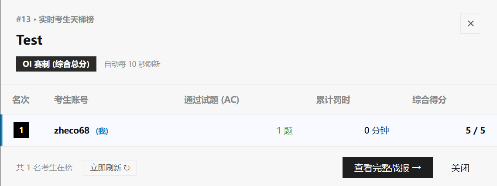
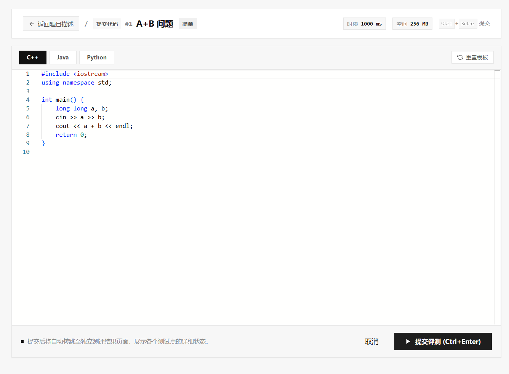
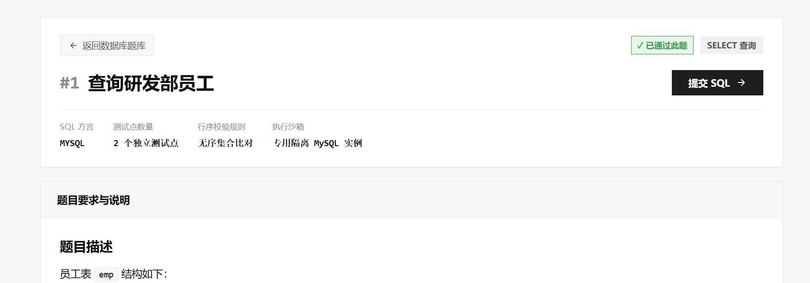
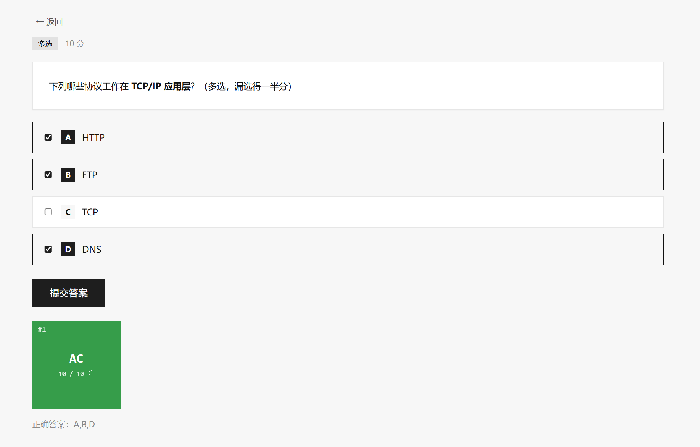
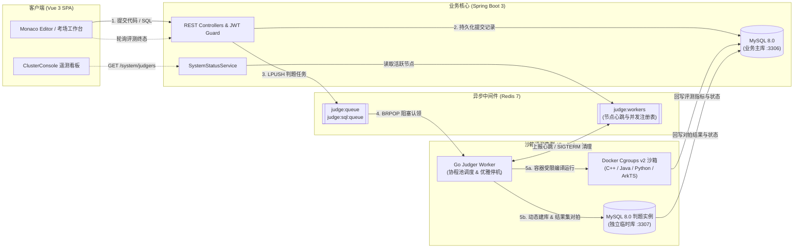

# KECE（课测）— 多维度编程与全真技术技能评测平台

[](https://vuejs.org/)
[](https://spring.io/projects/spring-boot)
[](https://go.dev/)
[](https://www.mysql.com/)
[](https://kece.zheco68.asia/)

> **面向高校实验教学、日常算法/SQL 刷题实训与正规技术机考的开源综合评测平台**。无缝集成 **算法编程 OJ**、**数据库 SQL OJ**、**前端 AI 智能评测**、**标准客观题库**、**随堂课练实训** 与 **在线机考/天梯系统** 六大核心引擎，基于高可用强隔离容器沙箱与独立临时库，提供毫秒级、防作弊、确定性的全真技术考核体验。

- **在线体验地址**：https://kece.zheco68.asia/

---

## 目录

- [六大核心评测与实训模块](#六大核心评测与实训模块)
- [设计体系与交互亮点](#设计体系与交互亮点)
- [界面全景展示](#界面全景展示)
- [技术栈与系统架构](#技术栈与系统架构)
- [项目目录结构](#项目目录结构)
- [本地快速启动](#本地快速启动)
- [关联项目文档](#关联项目文档)

---

## 六大核心评测与实训模块

| 编号 | 模块代号 | 模块名称 | 核心技术底座 | 功能与机制概述 |
| :---: | :---: | :--- | :--- | :--- |
| **01** | `ALGO` | **算法编程 OJ** | `Cgroups v2` + `Docker` | 支持 **C/C++**、**Java 17**、**Python 3**、**ArkTS** 等多语言在线编译与流式测试点对拍；基于 Linux Cgroups v2 实施毫秒级 CPU 时间片与内存峰值硬限制，完整覆盖 `AC` · `WA` · `TLE` · `MLE` · `RE` · `CE` · `SE` 判题状态机。 |
| **02** | `SQL` | **数据库 SQL OJ** | `MySQL 8.0` 独立临时库 | 每次提交在独立判题 MySQL 实例（端口 `3307`）动态创建独占临时 Schema `judge_{提交号}_{测试点号}`，内置交互式表结构预览（`DbSchemaViewer`），支持复杂 `SELECT` 查询与 `DML` 数据变更结果集精准比对（支持列类型宽容度、浮点容差与有序/无序比对），评测完毕即刻销毁（`DROP DATABASE`）。 |
| **03** | `WEB AI` | **前端 AI 智能评测** | `Playwright` + 多模态 LLM | 基于无头浏览器页面渲染快照、DOM 交互行为断言与多模态大模型代码质量审计，自动完成前端界面还原度与交互逻辑校验。 |
| **04** | `QUIZ` | **标准客观题库** | `Markdown` + `KaTeX` | 涵盖单选题、多选题（内置**漏选得半分、错选零分**算法）与填空题（精确/忽略大小写/正则匹配），原生支持 Markdown 代码块与 LaTeX 数学公式渲染，提交即刻生成判分结果与详尽解析。 |
| **05** | `LAB` | **随堂课练实训** | 混合题型编排 + 实时督学 | 面向高校日常课堂教学的算法、SQL 与客观题混排实训；支持 6 位受控入场暗号（`[ 🔒 需口令 ]` / `[ 🔓 已解锁 ]`），提供教师端实时完成率统计、督学监控看板与课后历史复盘。 |
| **06** | `EXAM` | **在线考试系统** | `ACM / OI` 双赛制 + 快照防作弊 | 支持 **ACM 罚时赛制**（实时判分 + 20 分钟错误罚时）与 **OI 按点计分赛制**（考中存快照、交卷后统一加权判分）；开考即固化题面与分值快照，内置浏览器切屏监测预警、防重入交卷锁定、归档战报与全场实时天梯榜。 |

---

## 设计体系与交互亮点

### 1. 纯粹硬朗直角工业美学 (0-Radius Industrial System)
- **全站零圆角规范**：严格采用 `--radius: 0` 直角几何语言、高反差黑白灰层级（`#111111` 主墨色 / `#f4f5f7` 工业浅灰表层 / `#ced4da` 结构线）与等宽数码排盘。
- **纯色语义标识体系**：
  - **身份角色**：管理员纯紫（`#7048e8`）、教师纯绿（`#2b8a3e`）、学生纯黑（`#1e1e1e`）。
  - **题目难度**：简单实心绿（`#2b8a3e`）、中等实心橙（`#e67700`）、困难实心红（`#c92a2a`）。
  - **SQL 题型**：`SELECT` 查询纯黑（`#1e1e1e`）、`DML` 操作钛金深灰（`#495057`）。

### 2. 官网首页三大全宽对齐交互模块 (`1072px` Grid Alignment)
- **首屏 Hero 与沙箱集群遥测控制台 (`ClusterConsole`)**：
  - 左侧主标语配备动量驱动（`mousemove`）+ `130ms` 防抖静止收敛的 **Trae 风格故障切片动效 (Glitch Slicing)**，滑动时呈现阶梯切片位移，静止时稳定如初。
  - 右侧配备支持 3D 俯仰微倾与跟随光标径向镜面高光的实时遥测控制台，直连 `/api/v1/system/judgers` 与 Go 判题机 Redis 心跳注册表，实时展示算法评测机、数据库评测机、前端 AI 评测机的在线状态、并发槽位与等待队列。
- **由灰到白扑克牌扇形能力矩阵 (Poker Fan Matrix)**：
  - 基于左下旋转基点（`transform-origin: bottom left`）构建 `1072px` 全宽对齐的 5 槽位扇形叠放舞台，从左后方底层（`slot-0` 深灰 `#d4d8df`）到右前方主牌（`slot-4` 纯白 `#ffffff` + 深黑边框）由灰到白逐级递进，点击牌面即可丝滑抽牌轮转六大核心模块并一键直达对应系统。
- **实时沙箱评测闭环终端 (Live Sandbox Runner)**：
  - 全宽暗色评测终端，自动拉取后端 `/api/v1/system/demo-snippet` 每日轮换的随机算法模板（内置离线高可用回退），集成 **PrismJS** 语法与关键字高亮（支持 `Java 算法 OJ`、`SQL 数据库 OJ`、`ACM 考试结算` 三种模式切换及评测指标实时呈现）。

### 3. 开发者公开主页与 52 周打卡热力图 (`Developer Portfolio`)
- **硬朗个人名片**：`128×128px` 直角大头像（支持 5MB 本地上传与静态资源映射）、个性签名引用框、UID、注册时间与 GitHub 主页认证直达。
- **52 周代码打卡热力图 (`HeatmapCalendar`)**：真实聚合过去 365 天每日 AC 提交量，配备「年度 AC 题数」、「当前连击天数」与「历史最长连击」三大指标方块。
- **三合一提交历史与跨用户互访**：集中整合算法代码、数据库 SQL、客观题作答记录与机考归档战报，支持弹窗高亮回溯代码与一键复制；支持 `/profile/:id` 公开访问任意开发者主页，访客视角自动隔离编辑权限。

---

## 界面全景展示

### 1. 全真隔离考场工作台


---

### 2. 考试归档战报与 Bento 四大指标方块
- 考卷提交后即刻生成永久锁定归档战报，顶部呈现 **综合总分、全场名次、AC 通过题数、ACM 罚时** 四大直角指标块，下方聚合全场实时天梯榜。


---

### 3. 逐题 64×64px 评测状态方块与作答快照回溯
- 每道考题配备 **64×64px 直角评测状态方块**（`AC` 翡翠绿、`WA` 猩红、`未答` 石板灰），点击即可展开原始提交代码/SQL 快照抽屉并支持一键复制。


---

### 4. 考试大厅卡片与外部实时天梯榜
- 清晰展示赛制标记（`ACM` / `OI`）、起止时间与交卷锁定状态；支持在卡片外部直接呼出实时天梯榜弹窗（10 秒静默轮询刷新）。



---

### 5. 算法编程：Monaco 工作台与测试点评测结果




---

### 6. 数据库 SQL：编写工作台与独立临时库对拍结果




---

### 7. 标准客观题与开发者个人主页





---

## 技术栈与系统架构

### 核心技术选型

| 架构分层 | 核心技术栈 | 关键职责与说明 |
| :--- | :--- | :--- |
| **前端应用 (`frontend`)** | **Vue 3.5** + **Vite 8** + **TypeScript 5.9** | `<script setup>` 组合式架构、路由守卫与响应式工业 UI |
| **代码编辑与渲染** | **Monaco Editor** + **PrismJS** + **KaTeX** + **Marked** | 在线 IDE 编辑器、终端语法高亮、LaTeX 公式与 Markdown 渲染 |
| **状态与网络通信** | **Pinia 3** + **Vue Router 5** + **Axios** | JWT 令牌自动续签注入、角色权限拦截与考场状态同步 |
| **后端服务 (`backend`)** | **Spring Boot 3.3** + **Java 17** | 领域模块化分层、JWT 鉴权、组卷快照计算、评测结果回调聚合 |
| **数据持久化与迁移** | **MyBatis 3** + **Flyway** + **MySQL 8.0** | 业务主库持久化、`V1`~`V24` 全版本自动化 Schema 演进与种子题库灌入 |
| **异步队列与注册表** | **Redis 7** (Spring Data Redis / go-redis) | `judge:queue` / `judge:sql:queue` 任务解耦队列、`judge:workers` 心跳注册表 |
| **沙箱判题机 (`judger`)** | **Go 1.22+** + **Docker Engine** (Cgroups v2) | 协程池高并发消费、容器资源硬限制、超时熔断与信号优雅停机 |
| **SQL 判题隔离库** | 独立 **MySQL 8.0 实例** (端口 `3307`) | 单次评测动态创建 `judge_{subId}_{point}` 临时库，对拍完毕立即销毁 |

### 异步多模态判题链路拓扑



---

## 项目目录结构

```text
KECE/
├── frontend/                        # 前端 Vue 3 + TypeScript + Vite 单页应用
│   ├── src/
│   │   ├── api/                     # REST API 模块化封装（题目、SQL、客观题、课练、考试、集群遥测）
│   │   ├── components/              # 核心组件（ClusterConsole、HeatmapCalendar、DbSchemaViewer、AppNavbar 等）
│   │   ├── router/                  # 路由表定义与角色权限守卫
│   │   ├── stores/                  # Pinia 状态管理（用户认证态等）
│   │   ├── utils/                   # HTTP 客户端拦截器、格式化与辅助工具
│   │   ├── views/                   # 页面视图（首页、算法/SQL/客观题库、随堂课练、机考系统、个人主页、管理后台）
│   │   └── style.css                # 0-Radius 直角工业设计系统全局样式与 CSS 变量
├── backend/                         # 后端 Spring Boot 3 (Java 17) 服务
│   ├── src/main/java/com/kece/
│   │   ├── admin/                   # 管理员后台管理（用户管理、全量提交审计、考卷检视）
│   │   ├── auth/                    # 登录注册、JWT 签发与校验
│   │   ├── common/                  # 统一响应包装、全局异常处理、权限拦截器、静态资源映射
│   │   ├── database/                # 数据库 SQL OJ 题库、测试用例与提交管理
│   │   ├── exam/                    # 在线考试场次、题目快照组卷、ACM/OI 判分结算、实时天梯榜
│   │   ├── objective/               # 标准客观题题库與自动判分引擎
│   │   ├── practice/                # 随堂课练实训编排、口令校验与实时督学看板
│   │   ├── question/                # 算法编程题库与评测点管理
│   │   ├── rank/                    # 全站综合天梯排行榜服务
│   │   ├── submission/              # 算法代码提交调度与异步结果收集
│   │   ├── system/                  # 评测集群心跳遥测与首页每日动态代码模板服务
│   │   └── user/                    # 开发者个人档案、365 天 AC 热力图统计与头像上传
│   └── src/main/resources/
│       ├── db/migration/            # Flyway 版本化数据库迁移脚本 (V1 ~ V24)
│       ├── mapper/                  # MyBatis XML 映射文件
│       └── application.yml          # 多环境应用配置
├── judger/                          # Go 语言高并发沙箱判题引擎
│   ├── cmd/judger/                  # 判题机守护进程入口（含信号捕获与心跳清理）
│   └── internal/
│       ├── compare/                 # 算法标准输出比对器与 SQL 结果集智能对拍器
│       ├── config/                  # 环境变量与判题参数配置
│       ├── judge/                   # 算法题与 SQL 题判题主流程编排
│       ├── model/                   # 任务载荷与评测结果数据模型
│       ├── queue/                   # Redis 队列消费者与 Worker 心跳上报器
│       └── sandbox/                 # Docker Cgroups v2 容器沙箱运行器与 MySQL 临时库执行器
├── deploy/                          # 跨平台一键启停脚本 (start.ps1 / start.sh / stop.ps1 / stop.sh)
└── docs/                            # 产品需求文档 (PRD)、接口契约、开发计划与界面截图资产
```

---

## 本地快速启动

### 1. 前置环境要求
- **Node.js**：`20.19+` 或 `22.12+`
- **Java**：`JDK 17+`（推荐 Eclipse Temurin 17）
- **Go**：`1.22+`
- **Docker**：Docker Desktop（Windows / macOS）或 Docker Engine（Linux），用于运行隔离沙箱与判题数据库
- **MySQL 8.0**：本地业务主库（默认端口 `3306`，库名 `kece`，账号 `root` / `kece123`，首次启动由 Flyway 自动完成建表与种子数据初始化）

---

### 2. 一键协同启动（推荐）

`deploy/` 目录下内置了跨平台自动化拉起脚本，会自动检查并启动 Redis 与独立判题 MySQL 容器、编译 Go 判题机，并后台拉起后端、判题 Worker 与前端开发服务器：

```powershell
# Windows PowerShell
.\deploy\start.ps1

# 停止所有服务
.\deploy\stop.ps1
```

```bash
# Linux / macOS
chmod +x ./deploy/start.sh ./deploy/stop.sh
./deploy/start.sh

# 停止所有服务
./deploy/stop.sh
```

---

### 3. 手动分步启动

#### 第一步：启动基础中间件容器（Redis 7 & 独立判题 MySQL 3307）
```bash
docker run -d --name kece-judge-mysql --restart unless-stopped \
  -p 3307:3306 -e MYSQL_ROOT_PASSWORD=judge123 mysql:8.0 \
  --character-set-server=utf8mb4 --collation-server=utf8mb4_unicode_ci

docker run -d --name kece-redis --restart unless-stopped \
  -p 6379:6379 redis:7-alpine
```

#### 第二步：启动后端 Spring Boot 服务
```powershell
cd backend
$env:SPRING_PROFILES_ACTIVE = "dev"   # Linux/macOS: export SPRING_PROFILES_ACTIVE=dev
.\mvnw.cmd spring-boot:run            # Linux/macOS: ./mvnw spring-boot:run
```
- **后端 API 根路径**：`http://localhost:8080/api/v1`
- **Swagger 接口文档**：`http://localhost:8080/api/v1/swagger-ui.html`
- **预置测试账号**（Flyway 自动初始化）：
  - **管理员**：`admin` / `admin123`
  - **出题教师**：`teacher` / `teacher123`

#### 第三步：启动 Go 沙箱判题引擎
```powershell
cd judger
go build -o judger.exe ./cmd/judger

$env:REDIS_ADDR = "127.0.0.1:6379"
$env:JUDGE_MYSQL_HOST = "127.0.0.1"
$env:JUDGE_MYSQL_PORT = "3307"
$env:JUDGE_MYSQL_USER = "root"
$env:JUDGE_MYSQL_PASSWORD = "judge123"
.\judger.exe
```
> **提示**：判题机首次执行算法评测时会自动拉取 `gcc:13`、`eclipse-temurin:17-jdk`、`python:3.12-slim` 等沙箱基础镜像，建议提前执行 `docker pull` 以加速首次判题。

#### 第四步：启动前端开发服务器
```bash
cd frontend
npm install
npm run dev
```
- **本地访问地址**：`http://localhost:5173`

---

## 关联项目文档

- [需求文档 (PRD)](./docs/需求文档.md) — 完整功能模块规划与角色用例说明
- [产品规格说明 (PRODUCT.md)](./docs/PRODUCT.md) — 平台设计原则、视觉规范与技术指标
- [全局接口规范与公共约定](./docs/全局接口规范与公共约定.md) — REST 响应契约、错误码体系与判题状态机定义
- [工程实施计划 (WBS)](./docs/开发计划.md) — 迭代里程碑拆解与架构演进记录
- [更新日志 (CHANGELOG.md)](./CHANGELOG.md) — 历次版本功能特性与工程加固记录

---

## 许可证

本项目为私有工程项目，未经授权许可不得用于商业运营。
