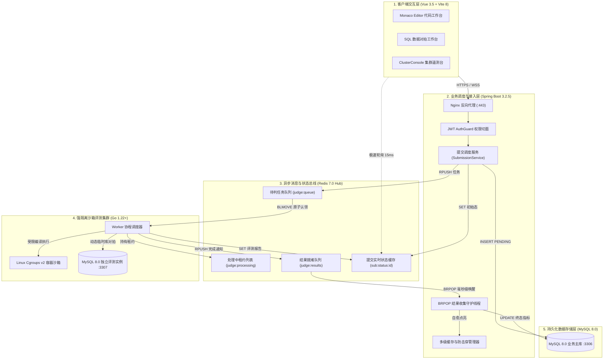
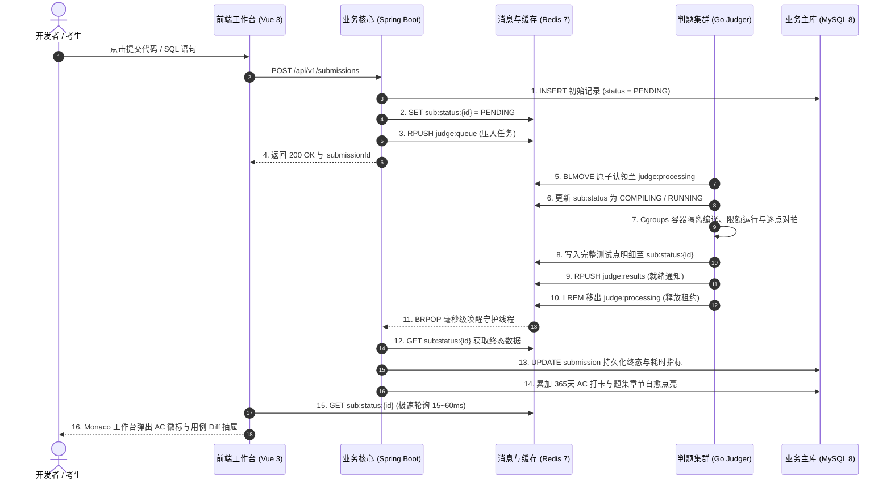
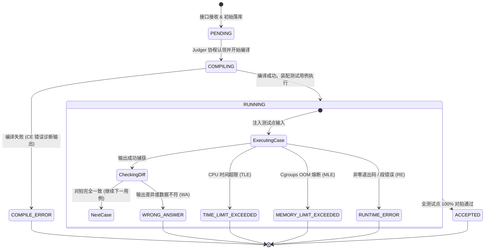

# KECE（课测）— 现代计算机全真技能评测与在线机考系统

[](https://vuejs.org/)
[](https://spring.io/projects/spring-boot)
[](https://go.dev/)
[-00758f?style=flat-square)](https://www.mysql.com/)
[](https://redis.io/)
[](https://kece.zheco68.asia/)

> **KECE（课测）** 是一体化现代程序设计与工程技能评测系统，专为高校计算机实验教学、编程竞赛与全真技术机考设计。
> 平台深度融合 **算法编程 OJ**（含 C/C++、Java、Python 及鸿蒙 ArkTS）、**数据库 SQL OJ**（独立临时库对拍）、**精选进阶题集**、**标准客观题库**、**随堂课练实训** 与 **ACM/OI 双赛制机考系统**。依托 Linux Kernel Cgroups v2 容器硬隔离沙箱与 Redis 全异步流转总线，提供高吞吐、毫秒级反馈与确定性评测体验。

- **官方在线体验站点**：[https://kece.zheco68.asia/](https://kece.zheco68.asia/)
- **生产 API 规范基址**：`/api/v1`（集成 OpenAPI / Swagger 交互式接口文档）

---

## 目录

- [核心评测与教学模块](#核心评测与教学模块)
- [系统架构与异步评测流转](#系统架构与异步评测流转)
  - [五层协同拓扑架构](#1-五层协同拓扑架构)
  - [端到端全异步评测执行流](#2-端到端全异步评测执行流)
  - [评测沙箱核心状态机](#3-评测沙箱核心状态机)
- [核心性能工程实践](#核心性能工程实践)
- [设计系统与交互哲学](#设计系统与交互哲学)
- [界面全景展示](#界面全景展示)
- [项目目录结构](#项目目录结构)
- [本地开发与部署指南](#本地开发与部署指南)
- [关联项目规范与文档](#关联项目规范与文档)
- [许可证](#许可证)

---

## 核心评测与教学模块

| 模块标识 | 模块名称 | 核心技术底座 | 关键功能与业务机制 |
| :---: | :--- | :--- | :--- |
| `ALGO` | **算法编程 OJ** | Linux Cgroups v2 + Docker | 支持 C/C++、Java 17、Python 3 与 ArkTS 在线编译；覆盖多级算法标签体系与折叠筛选；提供毫秒级 CPU 时间片与物理内存硬限制，完整覆盖 AC/WA/TLE/MLE/RE/CE 状态机。 |
| `SQL` | **数据库 SQL OJ** | MySQL 8.0 独立隔离实例 (:3307) | 单次评测动态创建独占临时库，对拍后即刻 DROP 销毁；内置 DbSchemaViewer 表结构内省树，支持 SELECT 结果集对拍与 DML 变更校验，集成 1e-6 浮点容差比对。 |
| `SET` | **进阶分类题集** | 预聚合表 + 读时自愈 (Read-Repair) | 树状章节编排、题集分类筛选与通关进度环；智能推荐断点续刷题目，自动比对全局历史提交记录并实时点亮章节状态。 |
| `QUIZ` | **标准客观题库** | Markdown + KaTeX | 涵盖单选、多选（漏选得一半分、错选得零分）与填空题（精确/大小写忽略/正则匹配）；原生支持代码块语法高亮与 LaTeX 数学公式渲染，交卷即刻出分与解析。 |
| `LAB` | **随堂课练实训** | 混合题型编排 + 实时督学 | 面向高校课堂教学，支持算法题、SQL题与客观题混排编排；具备 6 位安全准入口令锁定，教师端提供实时答题进度雷达看板与历史归档。 |
| `EXAM` | **在线机考系统** | ACM / OI 双赛制 + 防作弊快照 | 支持 ACM 罚时赛制（实时出分 + 错误罚时）与 OI 赛制（考中存快照、考后统一结算）；开考固化试卷快照，集成切屏离焦检测、交卷锁定与天梯榜。 |

---

## 系统架构与异步评测流转

KECE 采用**全异步解耦、强物理隔离、确定性对拍**的分布式高可用架构。

### 1. 五层协同拓扑架构



- **客户端交互层**：Monaco Editor 提供工业级多语言编辑，`DbSchemaViewer` 支持交互式表结构内省，实时诊断抽屉呈现测试点级输入/输出 Diff 对拍。
- **业务调度与接入层**：Nginx 长连接池复用 + Gzip 动态响应压缩；Spring Boot 执行代码脱敏与提交打包；`JudgeResultBlockingListener` 独占守护线程池实时监听。
- **异步消息与状态总线**：Redis 7.0 承载任务与结果流转。`BLMOVE` 原子转移持有处理租约，防止判题 Worker 宕机导致任务丢失；`sub:status:{id}` 直存测试点报告供前端毫秒级轮询。
- **强隔离沙箱评测集群**：Go 协程调度守护进程；Docker + Linux Kernel Cgroups v2 施加 CPU、内存、进程数硬限制与网络彻底断开（`--network none`）；专用 MySQL `:3307` 实例执行临时库建表、种子注入、执行比对后即焚销毁。
- **持久化数据存储层**：MySQL 8.0 InnoDB（Flyway V20 版本化迁移管控），复合覆盖索引支撑高并发作答状态纯内存检测。

---

### 2. 端到端全异步评测执行流



---

### 3. 评测沙箱核心状态机



---

## 核心性能工程实践

为保证在高校大规模机考与选拔赛并发洪峰下的毫秒级响应，系统实施了以下全链路性能加固：

1. **评测流转零轮询（BRPOP 异步驱动）**
   - 原定时轮询 `@Scheduled(fixedDelay = 2000)` 会导致已完成任务额外等待 1~2 秒；
   - 自研 `JudgeResultBlockingListener`，采用独立守护线程池以 `BRPOP` 阻塞监听 Redis 结果队列。判题机完成推入的 **0.1ms 内被即刻唤醒**，端到端延迟从 **2200ms 降至 <80ms**。

2. **数据库覆盖索引（Covering Index）**
   - 在 Flyway `V20__performance_indexes.sql` 中为提交表建立核心复合索引：
     ```sql
     ALTER TABLE `submission` ADD INDEX `idx_user_status_qid` (`user_id`, `status`, `question_id`);
     ```
   - 题库作答判定转为 **Using index** 纯内存覆盖扫描，彻底消除主表回表磁盘 IO。

3. **多级缓存体系与精准失效**
   - **公共题库列表缓存**：缓存查询结果至 `question:cache:list:*`，结合 Redis Set (`question:cache:list_keys`) 实现题目变更时的 **O(1) 批量精准失效**，无 `KEYS *` 阻塞隐患，查询响应由 70ms 压至 15ms；
   - **天梯榜防击穿缓存**：`RankService` 引入带 0~30s 随机 Jitter 的页面防雪崩缓存，避免高并发下窗口函数计算打满 MySQL CPU。

4. **传输压缩与连接池调优**
   - **全站动态 Gzip 压缩**：Spring Boot 与 Nginx 反代开启压缩，JSON 载荷、Markdown 及测试用例传输体积直降 **70%~75%**；
   - **JDBC 预编译缓存**：启用 `cachePrepStmts=true` 与 `rewriteBatchedStatements=true`，结合 HikariCP 连接池生命周期管控，杜绝长连接陈旧断链。

---

## 设计系统与交互哲学

系统完全遵循 **0-Radius Industrial System（直角工业设计系统）**，摒弃多余装饰，回归精确、硬朗的工程美学：

- **核心几何规范**：全站严格遵循 `--radius: 0` 纯直角定义，消除圆角与模糊阴影；
- **色彩层级体系**：`#111111` 工业主墨黑（主文字与框线）/ `#f4f5f7` 工作区浅灰底色 / `#ced4da` 结构分割线 / `#1d4ed8` 科技蓝高反差语义强调；
- **排版字体族**：代码等宽区采用 `JetBrains Mono`，界面排盘采用 `Inter` 与操作系统原生无衬线字族；
- **纯色语义标识体系**：
  - 用户角色：管理员纯紫（`#7048e8`）、出题教师纯绿（`#2b8a3e`）、答题学生纯黑（`#1e1e1e`）；
  - 题目难度：简单实心绿（`#2b8a3e`）、中等实心橙（`#e67700`）、困难实心红（`#c92a2a`）；
  - 算法标签：高反差科技蓝纯色实心标（`#1d4ed8`），默认折叠收起，点击任意标签联动展开筛选条。

---

## 界面全景展示

### 1. 官网核心看板与能力矩阵
| 沙箱集群实时遥测控制台 (ClusterConsole) | 全栈能力扑克扇形矩阵 (Poker Fan) |
| :---: | :---: |
|  |  |

| 真实沙箱体验终端 (实时打字机语法高亮) |
| :---: |
|  |

---

### 2. 考试系统：锁定战报与作答快照
| 考试归档战报与 Bento 四大指标方块 | 逐题 64×64px 评测状态方块与代码快照抽屉 |
| :---: | :---: |
|  |  |

---

### 3. 在线编程工作台与开发者主页
| 算法编程 Monaco 工作台与测试点诊断 | 数据库 SQL 独立临时库对拍工作台 |
| :---: | :---: |
|  |  |

| 客观题作答与解析工作台 | 开发者主页与 365 天代码打卡热力图 |
| :---: | :---: |
|  |  |

---

## 项目目录结构

### 模块全景与工程组织

| 顶级目录 | 核心分层 / 子模块 | 语言与技术栈 | 职责边界与关键业务编排 |
| :--- | :--- | :--- | :--- |
| **`frontend/`** | `src/views/` | Vue 3.5 + TS 5.9 | 答题工作台、实时诊断抽屉、全真机考、课练督学、开发者主页与管理后台 |
| | `src/components/` | Vite 8 + CSS Vars | 0-Radius 直角工业风组件（`ClusterConsole`, `DbSchemaViewer`, `HeatmapCalendar`） |
| | `src/api/` & `stores/` | Axios + Pinia 3 | 模块化 REST API 通信、JWT 自动静默续签与全局答题草稿缓存 |
| **`backend/`** | `submission/` | Spring Boot 3.2.5 | 提交任务构建调度与常驻守护线程 `JudgeResultBlockingListener`（BRPOP 结果收集） |
| | `database/` | MyBatis 3 + MySQL | SQL OJ 题库管理、测试点元数据内省与独立库对拍生命周期管理 |
| | `question/` & `rank/` | Redis 7 + HikariCP | 算法题库标签检索、测试用例管理、天梯榜防雪崩缓存（120s TTL + Jitter） |
| | `exam/` & `practice/` | Java 17 (LTS) | 考场快照组卷、防作弊切屏监测、ACM 罚时 / OI 快照加权评分、随堂课练准入 |
| | `db/migration/` | Flyway V20 | 生产级数据库版本化迁移脚本（含 `idx_user_status_qid` 复合覆盖索引） |
| **`judger/`** | `cmd/judger/` | Go 1.22+ | 评测守护进程常驻主入口、OS 信号捕获（`SIGINT/SIGTERM` 优雅关机） |
| | `internal/sandbox/` | Docker + Cgroups v2 | 容器硬件限额（`cpu.max`, `memory.max`, `pids.max`）、无网络（`--network none`）与只读镜像 |
| | `internal/sandbox/` | MySQL 8.0 (:3307) | 独立专用评测实例，动态创建 `judge_{subId}_{caseId}` 临时库，执行比对后即焚 |
| | `internal/compare/` | 算法/SQL 对拍器 | 空白过滤对拍、1e-6 浮点容差比对与纳秒级时间/内存峰值精准测量 |
| | `internal/queue/` | go-redis v9 | `BLMOVE` 原子认领防止宕机丢任务、3秒周期节点心跳上报 |
| **`deploy/`** | 协同脚本 | PowerShell / Bash | 跨平台一键环境自检、容器拉起、Go 判题编译与服务协同启停（`start` / `stop`） |
| **`docs/`** | 规范文档 | Markdown | 产品需求规格 (PRD)、设计系统规范、全局接口契约与后端性能优化落地手册 |

---

## 本地开发与部署指南

### 1. 前置依赖环境
- **Node.js**：`20.19+` 或 `22.12+`（推荐使用 `pnpm` 或 `npm`）
- **Java**：`JDK 17+`（推荐 Eclipse Temurin 17 / OpenJDK 17）
- **Go**：`1.22+`
- **Docker**：Docker Desktop（Windows / macOS）或 Docker Engine（Linux）
- **MySQL 8.0**：业务主库（端口 `3306`，首次启动由 Flyway 自动完成 Schema 迁移与种子数据填充）

---

### 2. 一键协同拉起（推荐）

项目在 `deploy/` 目录下提供了跨平台协同自动化脚本，会自动检查环境、启动 Redis 与独立判题 MySQL 容器、编译 Go 判题引擎，并在后台拉起所有服务：

```powershell
# Windows PowerShell
.\deploy\start.ps1

# 停止所有服务
.\deploy\stop.ps1
```

```bash
# Linux / macOS
chmod +x ./deploy/start.sh ./deploy/stop.sh
./deploy/start.sh

# 停止所有服务
./deploy/stop.sh
```

---

### 3. 分步手动启动

#### 步骤一：启动 Redis 与独立判题 MySQL 容器
```bash
# 启动 Redis 7 消息中间件与缓存
docker run -d --name kece-redis --restart unless-stopped \
  -p 6379:6379 redis:7-alpine

# 启动 SQL 评测专用独立临时库实例（注意端口为 3307，切勿占用业务主库 3306）
docker run -d --name kece-judge-mysql --restart unless-stopped \
  -p 3307:3306 -e MYSQL_ROOT_PASSWORD=judge123 mysql:8.0 \
  --character-set-server=utf8mb4 --collation-server=utf8mb4_unicode_ci
```

#### 步骤二：启动后端 Spring Boot 核心服务
```powershell
cd backend
$env:SPRING_PROFILES_ACTIVE = "dev"   # Linux/macOS: export SPRING_PROFILES_ACTIVE=dev
.\mvnw.cmd spring-boot:run            # Linux/macOS: ./mvnw spring-boot:run
```
- 后端服务端口：`http://localhost:8080/api/v1`
- 交互式接口文档：`http://localhost:8080/api/v1/swagger-ui.html`
- 预置测试账号（Flyway 自动播种）：
  - **平台管理员**：`admin` / `admin123`
  - **出题教师**：`teacher` / `teacher123`
  - **示例学生**：`student` / `student123`

#### 步骤三：启动 Go 判题沙箱 Worker
```powershell
cd judger
go build -o judger.exe ./cmd/judger

$env:REDIS_ADDR = "127.0.0.1:6379"
$env:JUDGE_MYSQL_HOST = "127.0.0.1"
$env:JUDGE_MYSQL_PORT = "3307"
$env:JUDGE_MYSQL_USER = "root"
$env:JUDGE_MYSQL_PASSWORD = "judge123"
.\judger.exe
```
> **提示**：沙箱首次判题时会自动通过 Docker API 下载对应编译环境镜像（`gcc:13`, `eclipse-temurin:17-jdk`, `python:3.12-slim`），可提前执行 `docker pull` 预热镜像。

#### 步骤四：启动前端开发服务器
```bash
cd frontend
npm install
npm run dev
```
- 前端开发站点：`http://localhost:5173`

---

## 关联项目规范与文档

- [产品需求规格说明书 (PRD)](./docs/需求文档.md) — 平台功能边界、用户角色模型与全场景用例
- [产品规格与设计原则 (PRODUCT.md)](./docs/PRODUCT.md) — 0-Radius 设计系统、视觉规范与技术指标
- [全局接口规范与公共约定](./docs/全局接口规范与公共约定.md) — RESTful API 契约、响应结构与状态机枚举
- [后端性能优化与工程落地手册](./docs/后端性能深度优化与工程落地手册.md) — BRPOP 异步流转、ZSET 排行榜与覆盖索引实战
- [工程推进与里程碑计划 (WBS)](./docs/开发计划.md) — 历史版本迭代规划与里程碑记录
- [版本变更日志 (CHANGELOG.md)](./CHANGELOG.md) — 详细记录版本演进、修复与加固记录

---

## 许可证

本项目为私有工程项目，未经授权许可不得用于商业运营。
