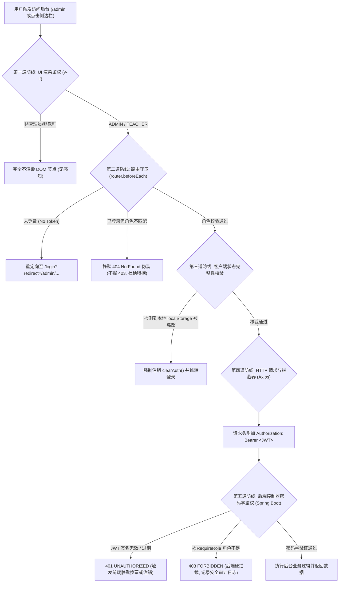

# KECE 前台侧边栏「方案 C」与后台管理全链路鉴权体系方案

> **交互原型 Demo**：可在浏览器中打开 [`docs/sidebar_redesign_demo.html`](file:///c:/Users/zco/Desktop/KECE/docs/sidebar_redesign_demo.html) 体验方案 C 的实际排布与折叠表现。  
> **方案状态**：鉴权设计与工程落地规范（待确认）

---

## 一、 方案 C 视觉结构蓝图（侧边栏独立系统组）

用户最终选定 **方案 C**：在左侧边栏导航的最底部，开辟独立的 `ADMINISTRATION // 控制台` 模块。

### 1.1 侧边栏垂直视觉层次

```
+------------------------------------+
| [K KECE 课测]                  [«] |  <-- 顶部：Logo + 侧边栏折叠收缩按钮
| ---------------------------------- |
| WORKSPACE // 练习与考核            |
| [ 01 首页 ]                        |
| [ 02 题库 ▾ ] (手风琴/Flyout)      |
| [ 03 题集 ]                        |
| [ 04 课练 ]                        |
| [ 05 考试 ]                        |
|                                    |
| COMMUNITY // 社区与个人            |
| [ 06 排名 ]                        |
| [ 07 公告栏 ]                      |
| [ 08 个人主页 ]                    |
| ---------------------------------- |
| ADMINISTRATION // 控制台 (特权组)  |  <-- ⭐ 方案 C 专属：用分割线隔离，仅管理员/教师可见
| [ ⚙ 后台管理系统                → ]|      直角浅紫底/深紫边/悬浮变纯黑，醒目严谨
| ---------------------------------- |
| [ 👤 头像 (点击进主页) ]           |  <-- 底部：用户卡片（头像+名字直达主页）
| [ zheco68  管理员 ]                |
| [ ⎋ 退出登录 ]                     |
+------------------------------------+
```

### 1.2 折叠态（68px）表现规范
- 当侧边栏折叠至 `68px` 紧凑态时，`ADMINISTRATION` 文本标题隐藏，保留独立的齿轮/盾牌图标；
- 鼠标悬停该图标时，向右侧滑出独立的 Flyout 浮层气泡：`⚙ 后台管理系统 - 题目与评测控制台`；
- **普通学生即使折叠后也绝对看不到此图标**。

---

## 二、 后台管理全链路鉴权体系（五层纵深防御）

> [!IMPORTANT]
> 「搞好鉴权」的核心原则：**零信任（Zero Trust）、纵深防御（Defense in Depth）、故障安全（Fail-Secure）**。  
> 前端视觉隐藏仅是改善体验，真正的安全防线由路由守卫、状态校验与后端密码学签名层层兜底。



---

### 第一道防线：UI 渲染层鉴权（真实节点销毁）

#### 1.1 严禁使用 CSS 隐藏
任何以 `display: none`、`v-show` 形式隐藏的后台菜单，都可以被懂浏览器的用户通过 F12 审查元素直接强制修改显示。

#### 1.2 严格使用 `v-if` 条件挂载
在 [`AppSidebar.vue`](file:///c:/Users/zco/Desktop/KECE/frontend/src/components/AppSidebar.vue) 中：
```vue
<template>
  <!-- 仅当用户已登录，且角色包含 ADMIN 或 TEACHER 时才挂载 DOM -->
  <div 
    v-if="userStore.isLoggedIn && (userStore.hasRole('ADMIN') || userStore.hasRole('TEACHER'))"
    class="admin-nav-group"
  >
    <div class="nav-group-title">ADMINISTRATION // 控制台</div>
    <RouterLink to="/admin" class="admin-nav-item">
      <div class="nav-item-left">
        <svg class="nav-icon" viewBox="0 0 24 24" fill="none" stroke="currentColor">
          <circle cx="12" cy="12" r="3"></circle>
          <path d="M19.4 15a1.65 1.65 0 0 0 .33 1.82l.06.06a2 2 0 0 1 0 2.83 2 2 0 0 1-2.83 0l-.06-.06a1.65 1.65 0 0 0-1.82-.33 1.65 1.65 0 0 0-1 1.51V21a2 2 0 0 1-2 2 2 2 0 0 1-2-2v-.09A1.65 1.65 0 0 0 9 19.4a1.65 1.65 0 0 0-1.82.33l-.06.06a2 2 0 0 1-2.83 0 2 2 0 0 1 0-2.83l.06-.06a1.65 1.65 0 0 0 .33-1.82 1.65 1.65 0 0 0-1.51-1H3a2 2 0 0 1-2-2 2 2 0 0 1 2-2h.09A1.65 1.65 0 0 0 4.6 9a1.65 1.65 0 0 0-.33-1.82l-.06-.06a2 2 0 0 1 0-2.83 2 2 0 0 1 2.83 0l.06.06a1.65 1.65 0 0 0 1.82.33H9a1.65 1.65 0 0 0 1-1.51V3a2 2 0 0 1 2-2 2 2 0 0 1 2 2v.09a1.65 1.65 0 0 0 1 1.51 1.65 1.65 0 0 0 1.82-.33l.06-.06a2 2 0 0 1 2.83 0 2 2 0 0 1 0 2.83l-.06.06a1.65 1.65 0 0 0-.33 1.82V9a1.65 1.65 0 0 0 1.51 1H21a2 2 0 0 1 2 2 2 2 0 0 1-2 2h-.09a1.65 1.65 0 0 0-1.51 1z"></path>
        </svg>
        <span class="nav-label">后台管理系统</span>
      </div>
      <svg class="chevron-arrow" viewBox="0 0 12 12" fill="none" stroke="currentColor">
        <path d="M4 2l4 4-4 4" stroke-width="1.8"></path>
      </svg>
    </RouterLink>
  </div>
</template>
```

---

### 第二道防线：路由守卫静默 404 伪装（Fail-Secure）

当用户绕过界面直接在浏览器地址栏手动输入 `/admin` 或 `/admin/questions` 时，前端路由守卫必须实施防御：

```ts
// frontend/src/router/index.ts
router.beforeEach((to) => {
  const userStore = useUserStore();

  // 1. 递归检索整条匹配路径链中是否存在 roles 或 requiresAuth 限制
  const requiresAuth = to.matched.some(record => record.meta.requiresAuth);
  const requiredRoles = to.matched
    .map(record => record.meta.roles as string[] | undefined)
    .filter(Boolean)
    .flat() as string[];

  // 2. 未登录时一律重定向至登录页
  if ((requiresAuth || requiredRoles.length > 0) && !userStore.isLoggedIn) {
    return { name: 'login', query: { redirect: to.fullPath } };
  }

  // 3. 核心安全机制：角色权限不符时，直接伪装为 404 (NotFound)！
  // 杜绝返回 403：403 明确告知攻击者“后台页面存在”，而 404 让扫描器与越权者误认为路径不存在
  if (requiredRoles.length > 0) {
    const hasPermission = requiredRoles.some(r => userStore.hasRole(r));
    if (!hasPermission) {
      return { name: 'not-found' };
    }
  }

  return true;
});
```

---

### 第三道防线：客户端状态防篡改校验（Anti-Tampering）

即便有用户打开 DevTools 手动执行 `localStorage.setItem('userInfo', JSON.stringify({roles: ['ADMIN']}))` 欺骗前端渲染：
1. **真实身份校验**：在 [`AdminLayout.vue`](file:///c:/Users/zco/Desktop/KECE/frontend/src/layouts/AdminLayout.vue) 的 `onMounted` 钩子中，必须静默调用一次 `/api/auth/me`；
2. **状态校准**：服务端返回真实的登录用户身份；如果服务端返回的角色不包含管理员/教师，立即触发 `userStore.clearAuth()` 清空本地伪造缓存，并跳转回首页。

---

### 第四道防线：HTTP 请求拦截器与自动纠错

在 [`frontend/src/api/request.ts`](file:///c:/Users/zco/Desktop/KECE/frontend/src/api/request.ts) 中：
1. **自动注入 JWT**：每笔请求通过请求拦截器自动塞入 `Authorization: Bearer ${token}`；
2. **响应拦截 401（Token 无效/过期）**：尝试调用 `/api/auth/refresh` 进行无感换票；若换票失败，立即清除用户会话并优雅降级跳回登录；
3. **响应拦截 403（越权硬拦截）**：触发统一弹窗提示“操作被拒绝：权限不足”，并强行将页面推离管理后台。

---

### 第五道防线：后端 Zero-Trust 密码学校验（Spring Boot）

> [!NOTE]
> 前端一切判断皆可绕过，**后端才是绝对的最终真理**。

KECE 后端架构已在底层实现了严密拦截（见 [`AuthInterceptor.java`](file:///c:/Users/zco/Desktop/KECE/backend/src/main/java/com/kece/common/security/AuthInterceptor.java)）：
1. **无状态 HMAC-SHA256 签名校验**：每次请求后端通过 `JwtUtil.parseToAuthUser(token)` 使用服务端强密钥验证签名，任何客户端篡改的 Payload 都会直接抛出 `SignatureException` 并返回 `4002 UNAUTHORIZED`；
2. **控制器注解 `@RequireRole`**：
   ```java
   @RestController
   @RequestMapping("/api/admin")
   @RequireRole({Role.ADMIN, Role.TEACHER})
   public class AdminQuestionController {
       // 任何进入此 Controller 的请求都必须满足 ADMIN 或 TEACHER
   }
   ```
3. **特权细分（Role.ADMIN 专属）**：用户管理（`/api/admin/users`）等特权路由在方法上标注 `@RequireRole(Role.ADMIN)`，教师身份即便进入后台，调用用户管理接口也会被后端以 `4003 FORBIDDEN` 彻底阻断。

---

## 三、 落地执行计划清单

1. **模板与样式落地**：
   - 在 [`frontend/src/components/AppSidebar.vue`](file:///c:/Users/zco/Desktop/KECE/frontend/src/components/AppSidebar.vue) 中接入 `v-if="userStore.isLoggedIn && (userStore.hasRole('ADMIN') || userStore.hasRole('TEACHER'))"`，写入方案 C 专属紫黑色直角卡片；
2. **路由守卫安全加固**：
   - 检查并加固 [`frontend/src/router/index.ts`](file:///c:/Users/zco/Desktop/KECE/frontend/src/router/index.ts)，确保 `/admin` 根路由与子路由全部递归继承 `meta: { roles: ['ADMIN', 'TEACHER'] }`，角色不符静默伪装 404；
3. **单元测试与安全验证**：
   - 验证学生账号访问 `/admin` 时是否正确展示 404 伪装页面；
   - 验证管理员账号访问 `/admin` 时是否正常进入控制台。

