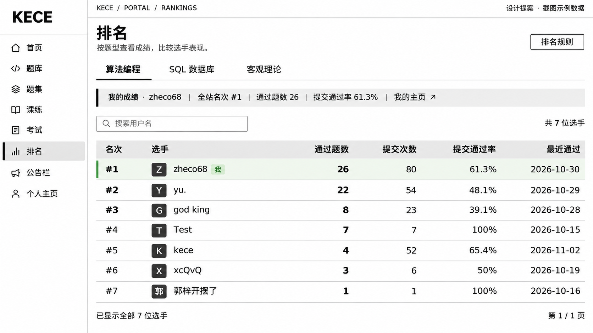

# KECE 排名页视觉与交互重构方案

日期：2026-11-04。状态：方案已确认，主要布局与交互已实现并发布。下文保留设计依据，实际实现差异见说明。

落地说明：已实现通栏榜单、个人摘要、URL 筛选状态、请求竞态保护及窄屏条目；根据后续反馈恢复逐行掉落动画。当前移动端直接展示最近通过时间，规则说明采用页内展开；尚未拆分独立子组件。首页最终采用横向标题带与通栏题目列表，取代第 8 节的过渡方案。浏览器预览工具连接超时，实机视觉验收仍待完成。



效果稿用于评审信息层级与布局，采用内置 imagegen 生成；字体大小、间距和响应式以本文规格为准。图中侧栏是示意，实施时复用现有侧栏。生成提示词见 [效果稿提示词](design/rankings-desktop-prompt.txt)。

## 1. 目标与方向

优先服务「查排名、比较选手」。进入页面后依次完成：选题型 → 找选手 → 对照成绩 → 查看选手主页。个人成绩是辅助信息，独立成一条摘要，不与标题争抢空间。

沿用 KECE 的白底、黑字、直角和细线，调整信息层级与密度。推荐「通栏榜单 + 横向个人摘要」：相比前三名大卡片，它让更多选手在首屏可见；相比右侧个人面板，它给成绩列留出完整宽度。暂不增加领奖台、趋势图、等级称号或独立对比工作台。

## 2. 桌面布局

```text
现有侧栏 │ 排名                                      排名规则
         │ 按题型查看成绩，比较选手表现。
         │
         │ 算法编程       SQL 数据库       客观理论
         │ ────────
         │ 我的成绩 · 用户名 │ 全站名次 │ 通过题数 │ 提交通过率 │ 我的主页 ↗
         │
         │ [ 搜索用户名                         × ]       共 N 位选手
         │ 名次   选手             通过题数   提交次数   提交通过率   最近通过
         │  1    头像 用户名          26        80        61.3%     2026-10-30
         │  2    头像 用户名          22        54        48.1%     2026-10-29
         │ …
         │ 第 1–20 位 / 共 N 位       上一页  1 2 …  下一页  跳至 [ ] 页
```

### 比例与尺寸

以 1703 × 871、100% 缩放为主要验收窗口，同时覆盖 1515 × 968 和 1280 × 800。

| 项目 | 建议规格 | 用途 |
| --- | --- | --- |
| 内容区域 | 主区域内居中，最大 1360px；两侧留白 32–48px | 解除当前榜单偏窄、文字偏小的问题 |
| 页面标题 | 32px / 40px，700 字重 | 单一主标题，无过量英文装饰 |
| 描述与次级文字 | 14px / 22px | 解释内容，不承担主要操作 |
| 标签页 | 16px，48px 高 | 黑色底线与字重同时表示当前题型 |
| 个人摘要 | 72–80px 高 | 数值 22px，标签 13–14px |
| 搜索及按钮 | 44px 高，搜索框约 320–360px | 可操作面积充足 |
| 表头 / 行 | 表头 44px；数据行 60–64px | 871px 高度首屏目标看见约 6–7 行 |
| 用户名 / 主要数值 | 16px / 24px；通过题数加粗 | 一眼定位人与成绩 |
| 头像 | 36px 正方形 | 无头像时显示首字符 |
| 区块距离 | 标题到标签 24px；摘要到工具栏 24px | 保持连续阅读，避免大块无效留白 |

白色数据行配细分割线；悬停浅灰。当前用户只用很浅的绿色底、左边标记和「我」标签提示身份。前三名使用更强的名次字重，不额外占据竖向空间。角色徽标降为次级小标签，签名移至个人主页，不在每行重复「无个性签名」。

数值右对齐并使用等宽数字。通过率直接显示百分比，移除每行短进度条，减少视觉噪声。日期显示完整日期，悬停和键盘聚焦时提供时分；移动端详情直接显示完整时间。

## 3. 数据含义与排序规则

以下根据当前实现核对，设计不得擅自改变排名算法。

| 内容 | 现有真实含义 | 设计处理 |
| --- | --- | --- |
| 算法 / SQL 通过题数 | 至少通过一次的不同题目数 | 表格主要数值 |
| 提交通过率 | 通过提交次数 ÷ 总提交次数 | 标签写「提交通过率」，不能用通过题数计算 |
| 客观题答对题数 | 至少答对一次的不同题目数 | 对应算法榜的通过题数列 |
| 客观题累计得分 | 每题最高分的总和 | 增加一列，不能解释成所有答题分数相加 |
| 最近通过 | 最近一条通过提交的创建时间 | 替换误导性的「最后活跃时间」 |
| 排名 | ROW_NUMBER 唯一序号 | 不显示并列名次；搜索结果保留全站原名次 |
| 人数 | 当前类型中正常状态且有提交的用户数；搜索后为匹配人数 | 搜索时显示「匹配 N 位」，不要伪装成平台总人数 |

算法 / SQL 排序依次比较：通过题数降序 → 通过提交次数降序 → 总提交次数升序 → 最近通过时间升序 → 用户 ID 升序。

客观题排序依次比较：答对题数降序 → 每题最高分合计降序 → 正确提交次数降序 → 总作答次数升序 → 最近正确提交时间升序 → 用户 ID 升序。

「排名规则」按钮打开可关闭的说明层，包含上面的顺序、通过率定义和更新说明。只有通过率不代表排序依据；不添加未经后端支持的列排序箭头。

无关键词列表缓存为 120–150 秒；个人成绩单独查询，可能短暂与列表不同。说明文案使用「榜单可能有约 2–3 分钟延迟，个人成绩与列表可能暂时不同」。现有接口没有快照生成时间，不能显示虚构的「更新于刚刚」或称为全量实时。

## 4. 交互细节

1. **切换题型**：采用可键盘操作的标签页。回到第 1 页，保留用户名关键词，便于查看同一个选手的不同能力。个人摘要、列名、列表同步切换，旧类别内容不能挂在新标签下面。
2. **搜索**：300ms 防抖，Enter 立即提交并取消等待中的定时任务；清空按钮恢复列表。搜索时保留全站名次，例如结果可为 #2、#17，不重新编成 #1、#2。
3. **个人摘要**：登录且有成绩时显示；未上榜显示「本题型暂无提交记录」和相应练习入口；游客使用一行登录提示。移除「我的档位」称呼，因为系统并没有档位模型。
4. **选手主页**：用户名使用真正的链接，支持键盘、新标签打开和复制地址。表格背景点击不是唯一入口。
5. **分页**：复用现有 Pagination，每页 20 条，支持页码按钮、前后页及输入跳转。输入仅接受合法整数，越界给出提示。搜索结果人数变少时回到合法页。
6. **列表比较**：先提供清晰的同列对照；不在第一版增加多选、雷达图或综合分。不同题型的指标不合并成虚假的总能力评分。
7. **页面状态**：题型、关键词和页码建议写入 URL query；刷新和浏览器返回可恢复。解析参数时校验类型与边界。

不承诺「定位我的行」第一版实现：虽然排名是连续序号，个人成绩与缓存列表并非同一快照，简单用名次除以每页条数可能跳到错误位置。保留个人成绩摘要即可满足当前目标。

## 5. 窄屏布局

- 主内容宽度 900–1199px：边距降至 24px；个人摘要允许两行，搜索独占一行；保持数据文字至少 14px。
- 主内容宽度低于 900px：榜单变为紧凑条目。首行「名次 + 头像 + 用户名 + 我」；第二行三项指标「通过题数 / 提交次数 / 提交通过率」。客观题增加累计得分。最近通过放在可展开详情内。
- 手机约 390px：边距 16px，触控目标至少 44px，三个分类标签同排；个人摘要用 2 × 2 网格；分页保留前后页和跳转输入。
- 桌面保持语义化 table；手机条目使用带可读标签的结构。不能把六列表格缩成极小文字，也不能让整页横向滚动。

## 6. 必须设计和验证的状态

| 状态 | 表现 |
| --- | --- |
| 首次加载 | 固定表头与 6 行骨架；隐藏尚未知晓的数量，避免先显示 0 |
| 翻页 / 搜索更新 | 标记加载状态；保留布局高度，不先闪空白；避免重复请求 |
| 首次请求失败 | 错误说明 + 重试；不同时显示「没有选手」 |
| 已有结果后更新失败 | 明确提示更新失败和旧结果所属筛选条件；不能将旧结果当新结果 |
| 搜索无结果 | 展示当前关键词 + 清空搜索按钮 |
| 分类确实无数据 | 说明本分类暂无提交，并提供练习入口 |
| 用户无头像 / 长名字 | 首字符回退；名字可截断但完整信息可访问 |
| 无通过记录 | 最近通过显示「尚未通过」，空比例显示「—」，真实 0 显示 0% |
| 大数据与大页码 | 7、20、21、1000+ 位选手；100% 与 200% 缩放检查 |

请求处理需要单一入口，使用请求序号或取消机制阻止旧响应覆盖新类别。切换分类不得同时触发关键词 watcher 和显式请求造成重复加载。卸载时清理定时器与请求。屏幕阅读器只播报稳定结果数量，骨架和装饰不重复朗读。

## 7. 实施范围与验收

第一版修改 RankingsView.vue；按职责拆出个人摘要、榜单展示、规则说明和请求状态管理。数据类型与 API 层继续复用。清除被替代的头部卡片、进度条、逐行入场动画和旧响应式样式，不留双套组件。

排名页前端已按确认方向实现；排名接口、排序规则和数据库未改动。效果稿采用用户截图中的示例数据，不能当作当前线上数据证明。

验收重点：

- 100% 窗口下正文与操作可读，表格不横向溢出；长名、五位数题数不挤占其他列。
- 用户可在首屏完成分类选择和搜索，看见主要成绩列。
- 快速切换分类、连续搜索和后退，结果始终与当前条件一致。
- 分页可直接跳转，错误、空结果和加载不会互相混淆。
- 所有主要操作可键盘完成；当前用户和选中分类不只靠颜色识别。
- 通过率、日期、累计得分和缓存说明符合现有后端定义。

## 8. 首页空白调整（初始方案，已由通栏布局取代）

首页练习介绍卡改为按内容自然高度排列，不再被右侧题目列表拉成等高；统计与题库链接与步骤区保留 24px 间距，移除自动贴底形成的大片空白。保留整个模块自动解码、真实题库检索及现有分页，不恢复重放按钮。

## 实现依据

- `frontend/src/views/RankingsView.vue`：当前布局、搜索、类别与异步加载。
- `frontend/src/api/rank.ts`：可用数据字段与查询参数。
- `backend/src/main/resources/mapper/RankMapper.xml`：统计、排序与搜索范围。
- `backend/src/main/java/com/kece/rank/service/RankService.java`：缓存期限、分页边界与个人成绩回填。
