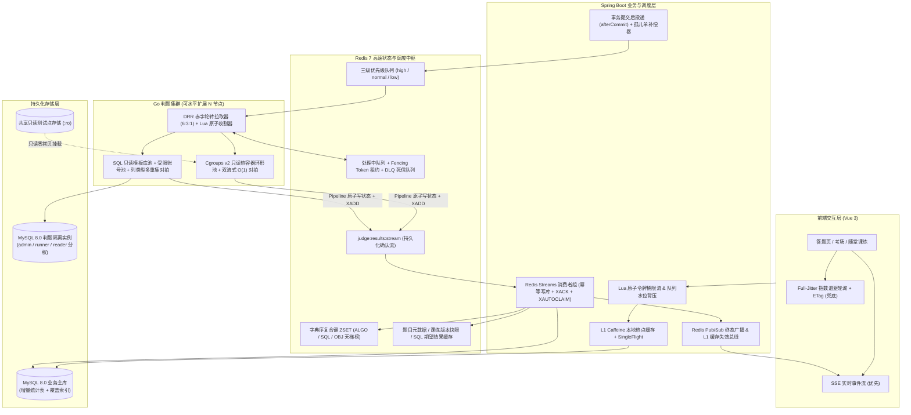
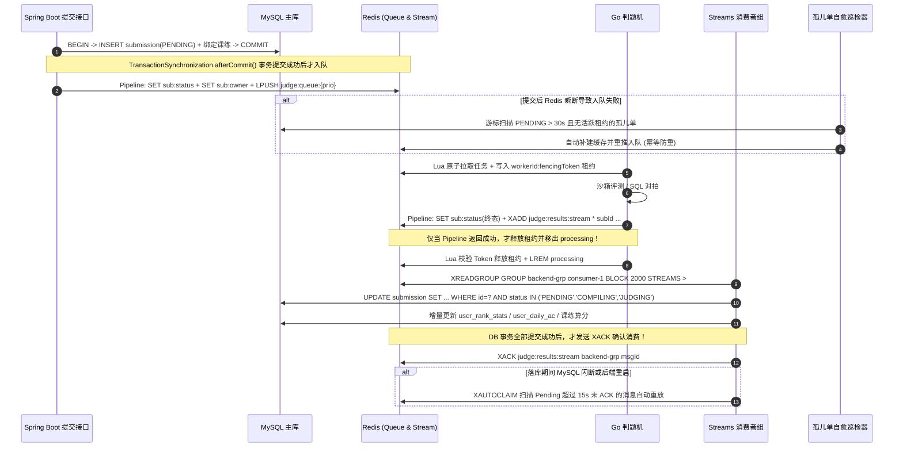

# KECE 算法优化与高可用高容错架构方案

> **文档版本**：v1.0  
> **适用基线**：`main` 分支（已完成 Flyway V20 覆盖索引、V23 课练追踪、单次提交容器会话复用与 `BRPOP` 监听改造）  
> **技术栈范围**：Spring Boot 3.2.5 (Java 17) + MyBatis + MySQL 8.0 + Redis 7.0 + Go 判题集群 (Docker Cgroups v2) + Vue 3  
> **核心目标**：在不引入重型外部中间件（如 Kafka / Zookeeper）的前提下，依托现有 MySQL + Redis + Go + Spring Boot 底座，实现**核心算法复杂度降维、百人考场洪峰稳态削峰、全链路评测零丢单与故障自愈**。

---

## 目录

1. [全景目标与核心 SLA 指标对比](#一全景目标与核心-sla-指标对比)
2. [现状全链路瓶颈与容错缺口清单（代码级定位）](#二现状全链路瓶颈与容错缺口清单代码级定位)
3. [高效率核心算法优化方案（复杂度降维）](#三高效率核心算法优化方案复杂度降维)
   - [3.1 字典序复合键 ZSET 天梯算法（消除全表 CTE 窗口扫描与浮点精度损失）](#31-字典序复合键-zset-天梯算法消除全表-cte-窗口扫描与浮点精度损失)
   - [3.2 随堂课练榜单 Hash-Join 一次归并与版本号快照（83 条 SQL 降至 0~3 条）](#32-随堂课练榜单-hash-join-一次归并与版本号快照83-条-sql-降至-03-条)
   - [3.3 沙箱热容器环形池、零拷贝挂载与双流式 O(1) 内存对拍算法](#33-沙箱热容器环形池零拷贝挂载与双流式-o1-内存对拍算法)
   - [3.4 SQL 判题内容寻址缓存、只读模板库与列类型多重集对拍算法](#34-sql-判题内容寻址缓存只读模板库与列类型多重集对拍算法)
   - [3.5 个人战绩终态冻结归档与防作弊 Pipeline 批量遥测](#35-个人战绩终态冻结归档与防作弊-pipeline-批量遥测)
4. [高可用弹性架构方案（削峰、隔离与实时推送）](#四高可用弹性架构方案削峰隔离与实时推送)
   - [4.1 三级赤字轮转队列（DRR 优先级公平调度算法）](#41-三级赤字轮转队列drr-优先级公平调度算法)
   - [4.2 L1 Caffeine + L2 Redis 多级缓存与进程内 SingleFlight 防击穿](#42-l1-caffeine--l2-redis-多级缓存与进程内-singleflight-防击穿)
   - [4.3 SSE 实时结果流推送 + 全抖动指数退避轮询兜底](#43-sse-实时结果流推送--全抖动指数退避轮询兜底)
   - [4.4 Redis Lua 原子令牌桶限流与队列水位自适应背压](#44-redis-lua-原子令牌桶限流与队列水位自适应背压)
5. [高容错与自愈工程方案（零丢单闭环与故障隔离）](#五高容错与自愈工程方案零丢单闭环与故障隔离)
   - [5.1 零丢单端到端闭环：事务后投递 + Redis Streams ACK + 孤儿单自愈](#51-零丢单端到端闭环事务后投递--redis-streams-ack--孤儿单自愈)
   - [5.2 Fencing Token 代际原子租约与毒丸死信队列（DLQ）熔断](#52-fencing-token-代际原子租约与毒丸死信队列dlq熔断)
   - [5.3 依赖故障熔断降级与判题机排空式优雅停机（Drain Shutdown）](#53-依赖故障熔断降级与判题机排空式优雅停机drain-shutdown)
   - [5.4 SQL 判题最小权限隔离与服务端执行时限双保险](#54-sql-判题最小权限隔离与服务端执行时限双保险)
6. [分阶段落地路线图与混沌故障注入验收标准](#六分阶段落地路线图与混沌故障注入验收标准)

---

## 一、全景目标与核心 SLA 指标对比

| 核心场景 / 指标 | 当前架构表现（现状基线） | 目标架构表现（优化后） | 核心优化手段 |
| :--- | :--- | :--- | :--- |
| **全域天梯榜查询（含个人排名）** | 缓存命中仍扫全表 CTE（`120ms ~ 1800ms`） | **`< 2ms`**（纯内存 $O(\log U)$） | `user_rank_stats` 增量表 + 字典序复合键 ZSET |
| **60 人 10 题随堂课练拉榜** | 单次触发 **83 条 SQL**，峰值近千 QPS | 变更时 **3 条 SQL**，未变更 **0 SQL（304）** | 内存 Hash-Join 一次归并 + 单调版本号快照 + `ETag` |
| **单次代码提交沙箱开销** | 每次提交冷启容器（`350ms ~ 600ms`）+ 拷盘 | 容器借用 **`< 5ms`**，测试点零拷贝只读挂载 | 预启动只读热容器环形池 + `:ro` 测试点挂载 |
| **大输出测试点对拍内存** | 全量读入切分，峰值 $O(\|Out\| + \|Ans\|)$ | 恒定 **`64KB` 栈/堆缓冲**，首差异字节短路 | 双 `bufio.Reader` 流式行尾归一化状态机 + ACM 早停 |
| **SQL 题单次判题耗时** | 逐用例重复建库 + 跑标准答案（DML 重建两次） | SELECT 题 **0 DDL**；DML 题省去 50% 重建开销 | SHA-256 期望结果缓存 + SELECT 只读模板库池 |
| **考场百人交卷状态轮询** | 考试入队漏写状态缓存，100% 穿透 MySQL | **0 次 MySQL 读穿透**，SSE 毫秒级推终态 | 补齐考试 Redis 状态缓存 + SSE 推送 + 退避兜底 |
| **后台批量重判对考场影响** | 单一 FIFO 队列，1000 单重判阻塞考场数分钟 | 考场单题 **`< 1s` 优先调度**，低优任务不饿死 | 三级队列赤字轮转调度算法（DRR 6:3:1） |
| **评测结果可靠性（RPO）** | 存在 3 处静默丢单窗口（事务前/回写错/落库错） | **RPO = 0（零丢单）**，幂等重放自愈 | `afterCommit` + Streams `XACK` + 孤儿单补偿器 |
| **多判题机重投与滚动发布** | 并发 `reap` 可重复入队；停机 `sleep(1s)` 杀在途单 | **Fencing Token 严格单次重投**；滚动发布零中断 | Lua 原子租约校验重投 + `WaitGroup` 排空停机 |

### 目标全链路架构拓扑



---

## 二、现状全链路瓶颈与容错缺口清单（代码级定位）

通过对当前仓库 `backend`、`judger`、`frontend` 全量源码逐行核查，梳理出以下 **12 个真实瓶颈与容错缺口**（已排除 V20 覆盖索引、`BRPOP` 改造等已落地项）：

| # | 维度 | 代码位置 | 现状实现逻辑 | 复杂度 / 风险暴露 |
| :-: | :---: | :--- | :--- | :--- |
| **1** | 高容错 | `backend/.../SubmissionService.java:134`<br>`backend/.../DbSubmissionService.java:123` | `@Transactional` 方法未提交前直接执行 `redis.rightPush` 入队 | 若判题机极速拉走任务并在事务提交前回调，查无此单被静默丢弃；若事务回滚则产生幽灵评测任务 |
| **2** | 高容错 | `judger/internal/judge/judge.go:244`<br>`judger/internal/judge/sqljudge.go:371`<br>`judger/cmd/judger/main.go:105` | `_ = j.queue.PushResult(...)` 忽略 Redis 网络错误，随后外层无条件 `RemoveProcessing` | Redis 瞬时抖动 100ms 即可导致终态写入失败且 `processing` 备份被删，提交永远卡在 `PENDING/JUDGING` |
| **3** | 高容错 | `backend/.../JudgeResultBlockingListener.java:151` | `leftPop` 弹出 `submissionId` 后再调 `persistResult`，异常仅 `log.warn` | MySQL 连接池满或网络闪断时，消息已从 Redis 队列消失，评测结果无法落库，TTL 过期后永久丢失 |
| **4** | 高容错 | `judger/cmd/judger/main.go:195-218`<br>`judger/internal/queue/queue.go:62-90` | `reap` 先 `Exists(lease)` 再非原子 `LPush + LRem`；租约无代际 Token | 多判题机实例同时扫描时会将同一超时任务重复入队多次；慢任务恢复后 `ClearLease` 会误删接管者租约 |
| **5** | 高可用 | `backend/.../ExamSubmissionService.java:424, 475` | 考试交卷/单题提交入队时只推了 `queue`，未写 `sub:status:{id}` 与 `sub:owner:{id}` | 考场内所有考生轮询评测进度全部绕过 Redis 穿透查 MySQL，百人同时交卷易打满数据库连接池 |
| **6** | 高效率 | `backend/.../RankService.java:58`<br>`backend/.../RankMapper.xml:66, 157, 255` | 页面虽有 120s 缓存，但登录用户每次刷新仍调 `fetchUserRank` 执行全表 CTE `ROW_NUMBER()` | 复杂度仍为 $O(S \log U)$；提交表涨至十万行后，任何登录用户看榜单都会触发全表聚合排序 |
| **7** | 高效率 | `backend/.../LessonPracticeService.java:1277-1305, 1449, 1863` | `buildScoreboardInternal` 按题循环统计通过率、按人循环查提交；`listPractices` 读前先写库归档 | 60 人 10 题班级单次拉榜触发 $2\times10 + 60 + 3 = 83$ 条 SQL，前端每 5s 轮询产生高频慢查询风暴 |
| **8** | 高效率 | `judger/internal/judge/sqljudge.go:104-197`<br>`judger/internal/compare/sqlresult.go:77-164` | 每次提交逐用例建库并重跑教师参考 SQL（DML 重建两次）；全格转 `float64` 且按原串排序比对 | MySQL 元数据锁竞争重；`VARCHAR '001'=='1'`、`BIGINT` 精度丢失误判、`NULL` 与 `"NULL"` 混淆、无序浮点误杀 |
| **9** | 高效率 | `judger/internal/sandbox/sandbox.go:235`<br>`judger/internal/judge/judge.go:149`<br>`judger/internal/compare/compare.go:13` | 每次提交新建 Docker 容器；逐用例把输入输出文件全量读入内存再写盘；`strings.Split` 全量切分比对 | 容器冷启动损耗 `350ms+`；大测试点造成双倍磁盘/内存拷贝，多个 Worker 同时比对 50MB 输出易 OOM |
| **10** | 高可用 | `backend/.../SubmissionService.java:51`<br>`judger/internal/queue/queue.go:42` | 全站共用单一 FIFO `judge:queue`（普通刷题、考试单题、OI 批交卷、后台批量重判混排） | 教师触发百条重判或一场 OI 集中交卷，会导致正在进行的 ACM 考场与随堂课练发生严重队头阻塞 |
| **11** | 高可用 | `frontend/src/views/QuestionResultView.vue:68-78`<br>`frontend/src/views/PracticeDetailView.vue:340` | 固定 `1000ms` 轮询且 `catch` 块一遇网络异常立即 `stopPolling()`；无页面可见性降频 | 偶发网络抖动或网关 502 后前端进度永远卡死；后台挂机标签页持续消耗服务端 QPS |
| **12** | 高效率 | `backend/.../ProfileService.java:244`<br>`backend/.../ExamAntiCheatService.java:87` | 个人主页遍历 $E$ 场历史考试逐场实时重算整场排名；切屏统计按考生循环单条 `GET` | 随历史考试场次增长呈 $O(E \cdot S \log S)$ 退化；考场排名组装产生 $N$ 次串行 Redis RTT |

---

## 三、高效率核心算法优化方案（复杂度降维）

### 3.1 字典序复合键 ZSET 天梯算法（消除全表 CTE 窗口扫描与浮点精度损失）

#### 1) 为什么不能直接用 IEEE 754 `double` 编码分数？
在 `RankMapper.xml` 中，KECE 真实的算法榜/SQL 榜排序规则有 **5 个严格优先级**：
1. `solvedCount DESC`（攻克题数越多越靠前）
2. `acSubmissions DESC`（通过提交数越多越靠前）
3. `totalSubmissions ASC`（总提交次数越少越靠前）
4. `lastAcceptedAt ASC`（达成时间越早越靠前）
5. `userId ASC`（账号 ID 越小越靠前）
（客观题榜甚至有 6 个维度：还包含 `totalScore DESC`）。

而 Redis ZSET 的 `score` 是 64 位 IEEE 754 双精度浮点数，有效二进制尾数仅 **53 bit（约 15~17 位十进制有效数字）**。一旦将题数、积分、提交数与 10 位秒级时间戳拼接进单个 `double`，低位字段必然被浮点舍入截断，导致同题数考生的先后顺序错乱。

#### 2) 目标算法：同分字典序复合键编码（Lexicographical Composite Key in ZSET）
Redis 原生保证：**当 ZSET 中所有元素的 `score` 全部固定为 `0` 时，所有元素严格按 Member 字符串的二进制字节字典序（Byte-wise Lexicographical Order）排列**，并支持 $O(\log U + K)$ 的 `ZRANGEBYLEX` 与 $O(\log U)$ 的 `ZRANK`。

我们对需要**降序（越大越靠前）**的指标做定长补零反转（`INV = MAX_VAL - val`），对需要**升序（越小越靠前）**的指标直接定长补零（`FMT = val`）：

```text
MAX_INT_6  = 999999
MAX_INT_8  = 99999999

ALGO / SQL 榜 Member 编码格式（总长固定，字典序越小排名越靠前）：
"{999999 - solvedCount :06d}:{99999999 - acSub :08d}:{totalSub :08d}:{lastAcEpochMs :013d}:{userId :010d}|{userId}"

OBJECTIVE 榜 Member 编码格式：
"{999999 - solvedCount :06d}:{99999999 - totalScore :08d}:{99999999 - acSub :08d}:{totalSub :08d}:{lastAcEpochMs :013d}:{userId :010d}|{userId}"
```

- **示例对比**：
  - 用户 A（解 25 题，AC 30 次，总交 40 次，时间戳 `1730000001000`，ID `12`）：
    `999974:99999969:00000040:1730000001000:0000000012|12`
  - 用户 B（解 25 题，AC 30 次，总交 42 次，时间戳 `1730000000500`，ID `8`）：
    `999974:99999969:00000042:1730000000500:0000000008|8`
  - 字节逐位比较到第 3 段 `00000040 < 00000042`，用户 A 在 `ZRANGE` 中精准排在用户 B 前面，**零精度损失，完美等价于 SQL `ROW_NUMBER() OVER (...)`**！

#### 3) 增量预聚合表与 $O(\log U)$ 原子更新流程
新增 Flyway 迁移 `V24__user_rank_stats.sql` 维护单行增量统计，作为 Redis 重建的持久化真源：

```sql
CREATE TABLE `user_rank_stats` (
    `user_id`            BIGINT NOT NULL,
    `rank_type`          VARCHAR(16) NOT NULL COMMENT 'ALGO / SQL / OBJECTIVE',
    `solved_count`       INT NOT NULL DEFAULT 0,
    `total_score`        INT NOT NULL DEFAULT 0,
    `ac_submissions`     INT NOT NULL DEFAULT 0,
    `total_submissions`  INT NOT NULL DEFAULT 0,
    `last_accepted_at`   DATETIME(3) DEFAULT NULL,
    `lex_member`         VARCHAR(96) DEFAULT NULL COMMENT '上次写入 ZSET 的复合键，用于 O(log U) 替换旧键',
    `updated_at`         DATETIME NOT NULL DEFAULT CURRENT_TIMESTAMP ON UPDATE CURRENT_TIMESTAMP,
    PRIMARY KEY (`user_id`, `rank_type`),
    INDEX `idx_type_rank_order` (`rank_type`, `solved_count` DESC, `total_score` DESC, `ac_submissions` DESC, `total_submissions` ASC, `last_accepted_at` ASC, `user_id` ASC)
) ENGINE=InnoDB DEFAULT CHARSET=utf8mb4;
```

- **写入路径（判题终态落库时）**：
  1. 增量更新 `user_rank_stats` 对应行（单主键操作 `< 1ms`）；
  2. 通过 Lua 脚本原子执行：`ZREM rank:lex:{type} oldLexMember` $\to$ `ZADD rank:lex:{type} 0 newLexMember` $\to$ `HSET rank:user:lex:{type} {userId} newLexMember`；
- **读取路径（`RankService.getRankings`）**：
  - **无搜索词分页列表**：`ZRANGE rank:lex:{type} offset (offset + size - 1)` 直接拿到排好序的 `userId` 列表，再批量读取用户基础信息（$O(\log U + \text{size})$）；
  - **登录用户个人排名 `myRank`**：`HGET rank:user:lex:{type} {userId}` 取当前 `lexMember`，再调 `ZRANK rank:lex:{type} {lexMember}`，耗时 **`< 0.3ms`**，彻底消灭 `RankMapper.xml:66` 的全表 CTE 扫描！
  - **带 `keyword` 搜索词降级**：直接走 `user_rank_stats` 的 `idx_type_rank_order` 索引关联 `user` 表，无需再扫描庞大的原始 `submission` 表。

---

### 3.2 随堂课练榜单 Hash-Join 一次归并与版本号快照（83 条 SQL 降至 0~3 条）

#### 1) 现状根因分析
在 `LessonPracticeService.java:1277-1305` 中：
- 第 1277 行遍历每道题 $q \in Q$，分别执行 `countSubmitByPracticeQuestionId` 和 `countPassByPracticeQuestionId`（产生 $2Q$ 次 `COUNT(DISTINCT user_id)` 查询）；
- 第 1295 行遍历每位参练学生 $m \in M$，分别执行 `listByPracticeAndUser(practiceId, m.getUserId())`（产生 $M$ 次独立查询）；
- 同样的问题在后台大盘 `getOverview`（第 1449 行）再次重演；
- 此外 `listPractices`（第 1863 行）在每次普通学生打开课练列表时都会先执行一次 `UPDATE lesson_practice SET status='ENDED' ...` 写库操作。

#### 2) 目标算法：单趟内存 Hash-Join 折叠 + 单调版本号快照缓存
1. **将 $2Q + M + 3$ 条 SQL 压缩为恒定 3 条批量查询**：
   - 查询 1：`questionMapper.listByPracticeId(practiceId)`（取题目列表 $Q$）；
   - 查询 2：`memberMapper.listScoreboard(practiceId)`（利用现有 `idx_pm_practice_score` 索引一次取出排好序的成员 $M$，并 `userMapper.findByIds` 一次取齐用户信息）；
   - 查询 3：在 `LessonPracticeSubmissionMapper` 新增单条批量查询：
     ```sql
     SELECT practice_question_id, user_id, status, score, attempt_count,
            created_at, updated_at, best_achieved_at
     FROM `lesson_practice_submission`
     WHERE practice_id = #{practiceId}
     ```
     *（注：不拉取大字段 `answer` 与 `result_json`，网络传输量减少 90%）*
2. **内存 $O(|M| + |Q| + |Sub|)$ 单趟归并算法**：
   在 JVM 内存中一次遍历上述轻量记录，同时构建两个哈希表：
   - `Map<Long, Map<Long, LessonPracticeSubmission>> matrix`：`userId -> (practiceQuestionId -> sub)`，直接填充每位学生的 `cellStates`；
   - `Map<Long, BitSet/Set<Long>> submitUsers & passUsers`：顺带统计每道题的提交人数与通过人数，**0 额外 SQL 生成 `benchmarks` 与 `questionAccuracies`**。
3. **基于单调版本号（Monotonic Version）的零脏读缓存与 HTTP 304 协商**：
   - 每当发生 `join`、`submitObjective`、`onPracticalJudgeCompleted`、`submitPractice`、`extendDuration`、`endPractice` 时，执行 `INCR practice:ver:{practiceId}`；
   - 记分板公共骨架缓存于 `practice:board:{practiceId}:v{ver}`（TTL 60s），服务端拼装 `isCurrentUser` 仅需复制轻量布尔标记；
   - 接口响应头返回 `ETag: "p-{practiceId}-v{ver}"`；前端每 5s 轮询携带 `If-None-Match`，若全班过去 5s 无新评测完成，后端仅做一次 Redis `GET practice:ver:{id}` 比对即返回 **`304 Not Modified`（0 SQL、0 JSON 序列化、0 带宽浪费）**。
4. **读写分离收口**：删除 `listPractices` 第 1863 行的写库调用，过期状态收口完全交由后台 `@Scheduled` 任务（第 72 行）与读取时的纯内存时间推导（`endTime <= now ? "ENDED" : status`）完成。

---

### 3.3 沙箱热容器环形池、零拷贝挂载与双流式 O(1) 内存对拍算法

#### 1) 预启动只读热容器环形池（Warm Container Ring Pool）
当前 `sandbox.go:235` 已实现“单次提交内多个测试点复用同一容器”，但每次新提交仍需执行 `docker run -d` 创建并启动新容器（耗时 `350ms ~ 600ms`），考场并发提交时宿主机 `containerd` 创建风暴明显。

**优化设计**：
- 按语言维护固定容量的常驻热容器池（如 C++ 4 个、Python 2 个、Java 2 个、ArkTS 1 个，通过 `chan *WarmContainer` 无锁环形队列管理）：
  ```bash
  docker run -d --network none --read-only \
    --tmpfs /work:rw,exec,nosuid,nodev,size=64m \
    --pids-limit 64 --cpus 1 --cap-drop ALL \
    --security-opt no-new-privileges \
    -v /host/testcases:/testcases:ro \
    <image> sleep infinity
  ```
- **借用与动态限额（`< 5ms`）**：Worker 领到任务后从对应语言 `chan` 非阻塞弹出热容器（池空时自动降级走单次 `StartSession`），若题目内存限制与默认池规格不同，通过 `docker update --memory {limit}m --memory-swap {limit}m {cid}` 毫秒级调整 cgroup 限额；
- **安全归还与隔离清洗**：根文件系统 `--read-only` 保证用户代码无法篡改系统目录；单次提交评测完毕后，清理 `/work/*` 并校验容器内无残留子进程（检查 `cgroup.procs` 仅剩 `sleep` PID 1），洁净则放回热池，若曾发生超时/OOM 污染则异步销毁并后台补齐新热容器。

#### 2) 测试点零拷贝只读挂载（消除双倍文件读写）
当前 `judge.go:149-175` 每个测试点都要在宿主机把 `srcIn` 全量读入 Go 内存再写入 `ws/input.txt`，并把 `srcOut` 全量读入 `expectedOutput` 字符串。
- **优化**：沙箱容器直接只读挂载宿主机测试点根目录 `-v {TestcaseDir}:/testcases:ro`（容器内普通非特权用户仅对当前命令重定向传入的标准输入可读，或通过宿主机侧打开文件句柄经 `docker exec -i` 标准输入管道流式喂入 `cmd.Stdin`），**彻底省去逐用例磁盘复制**。

#### 3) 双流式 $O(1)$ 空间对拍状态机（Streaming Output Comparator）
当前 `compare.go:13` 使用 `strings.Split(strings.ReplaceAll(...), "\n")` 对整份文本分配切片并拼接，若题目输出为 32MB，单次比对会产生上百 MB 的临时内存分配。

**算法重构（双游标行流式归一化比较器）**：
- 使用两个固定 `32KB` 缓冲区的 `bufio.Reader`（一个读容器 `Stdout` 管道/临时文件，一个直接读标准答案文件 `srcOut`）：
  1. `nextLogicalLine(r)`：流式读取一行，去除末尾 `\r`、空格与 `\t`；
  2. 跳过双方前导空行；
  3. 逐行流式比对：遇到空行时记入“待定空行计数 `pendingBlankLines`”（用于忽略文件末尾多余空行，同时严格保留中间空行差异）；一旦下一行非空且双方 `pendingBlankLines` 不等或当前行字节不同，**立即在首个差异行短路终止读取并返回 `WRONG_ANSWER`**！
- **复杂度收益**：空间复杂度从 $O(|Out| + |Ans|)$ 严格降为 **$O(1)$（固定 `64KB`）**；当用户代码第 1 行就输出错误时，无需读完后续几十 MB 标准答案即可在微秒级判定 WA。

#### 4) 赛制感知早停算法（ACM Fail-Fast vs OI Full-Eval）
在任务模型 `model.Task` 中新增布尔字段 `FailFast`：
- **ACM 赛制考试提交**：设置 `FailFast = true`（因为 ACM 只要有任意一个测试点非 `ACCEPTED` 即整题不得分并计 1 次罚时），`judge.go:109` 循环中一旦遇到首个非 AC 测试点且非样例，立即跳出循环回写终态，考场错解评测吞吐直接提升 **2~5 倍**；
- **日常刷题 / 随堂课练 / OI 赛制**：保持 `FailFast = false`，跑完全部测试点按 `scoreWeight` 计算部分分。

---

### 3.4 SQL 判题内容寻址缓存、只读模板库与列类型多重集对拍算法

#### 1) 标准答案结果集内容寻址缓存（Content-Addressable Expected Cache）
在 `sqljudge.go:122` 中，同一道 SQL 题有 100 名学生提交时，判题机会重复建表、灌数据并执行 100 遍完全相同的教师 `ReferenceSql`；对于 DML 题（含 `VerifySql`），第 171 行还必须 `resetDatabase` 把刚刚建好的库删掉再重建一遍！

**优化算法**：
- 计算确定性内容指纹：
  $$H = \text{SHA256}(\text{dialect} \parallel \text{schemaSql} \parallel \text{seedSql} \parallel \text{referenceSql} \parallel \text{verifySql})$$
- 在判题机进程内维护带容量上限（如 128MB）的 LRU 缓存（可选同步写入 Redis `sql:expected:{H}`，TTL 2h）：
  - **缓存命中时**：直接拿到标准 `TypedResultSet`，**完全跳过教师参考 SQL 执行**；对于 DML 题，建完临时库灌好数据后直接执行学生 SQL + `VerifySql` 即可，**彻底省去 `resetDatabase` 的第二次删库、建库、建表、灌数据全套开销（单题评测耗时立减 55%）**！
  - 教师后台修改题目 `schemaSql / referenceSql / seedSql` 时，哈希值 $H$ 自动变化，**天然无缓存脏读风险，无需手动失效**。

#### 2) `SELECT` 查询题只读模板库池化（0 DDL 极速评测）
题库中 80% 以上的数据库题是纯 `SELECT` 查询题（`verifySql` 为空）：
- 按模板库名 `tpl_{qId}_{caseId}_{hash8}` 惰性初始化一次数据库并灌入测试点数据；
- 学生提交时，使用仅具备该模板库 `SELECT` 权限的只读连接池 `readerPool`，直接执行 `USE tpl_...; <student_sql>`，**全程 0 次 `CREATE DATABASE`、0 次 `DROP DATABASE`、0 次 `CREATE TABLE`、0 次 `INSERT`**；
- 单次 SQL 评测耗时从 `80ms ~ 300ms` 降至 **`2ms ~ 10ms`**，彻底消除 MySQL 8.0 数据字典（Data Dictionary）元数据锁竞争。

#### 3) 列类型感知规范化多重集对拍算法（Type-Aware Canonical Multiset Comparator）
针对 `sqlresult.go` 当前把所有单元格转成 `string`、混同 `NULL` 与 `"NULL"`、对 `VARCHAR` 和 `BIGINT` 误用 `float64` 容差的问题，重构结果集模型与对拍算法：

```go
type CellKind uint8
const (
    KindNull CellKind = iota
    KindInt64      // TINYINT, SMALLINT, INT, BIGINT -> 64位精确整数
    KindUint64     // BIGINT UNSIGNED -> 无符号64位精确整数
    KindDecimal    // DECIMAL, NUMERIC -> 规范化十进制字符串 (去前导0与小数末尾0，如 "12.30" -> "12.3")
    KindFloat64    // FLOAT, DOUBLE, REAL -> float64 (启用 1e-9 相对/绝对容差)
    KindBytes      // CHAR, VARCHAR, TEXT, DATE, DATETIME -> 原始精确字符串 (保留前导0如 "001")
)

type Cell struct {
    Kind CellKind
    I64  int64
    U64  uint64
    F64  float64
    Str  string
}
```

- **有序列比对（`orderSensitive = true`）**：$O(R \cdot C)$ 逐行逐列按 `CellKind` 精确比对（`KindNull` 仅与 `KindNull` 相等；仅当列类型为浮点族时才走 $|a - b| \le 10^{-9}\max(1, |b|)$）。
- **无序列多重集比对（`orderSensitive = false`）**：
  1. **情形 A（结果集不含 `KindFloat64` 列，占 95% 场景）**：每行生成规范化字节签名 `canonicalKey(row)`，使用 `map[string]int` 哈希多重集计数：期望行 `+1`、实际行 `-1`，时间复杂度从排序的 $O(R \log R \cdot C)$ 进一步降至线性 **$O(R \cdot C)$**，且严格保留重复行重数（Multiset Semantics）！
  2. **情形 B（结果集含 `KindFloat64` 列）**：先按所有**非浮点精确列**的规范化签名分桶 `map[string][][]Cell`；每个桶内按浮点列升序排列，对期望行 $e_i$ 在实际行未匹配窗口内做容差邻域贪心/增广匹配，彻底解决 `9.999999999` 与 `10.0` 因原始字符串字典序不同（`'9' > '1'`）导致的错位误判。

---

### 3.5 个人战绩终态冻结归档与防作弊 Pipeline 批量遥测

1. **考试终态排名冻结快照**：
   - 在 `ExamRankService.ranking(examId)` 中，当考试处于 `ENDED` 且该场考试关联的所有 `submission / db_submission` 均已进入终态时，将计算完的 `List<ExamRankVO>` 写入 Redis 持久化缓存 `exam:rank:final:{examId}`（TTL 7 天）；
   - 同时在 `ProfileService.getExams(userId)`（第 224 行）中改为 `examMapper.findByIds(examIds)` 批量查考试元信息，并优先从冻结排名哈希 `exam:user_summary:{examId}` 直接 $O(1)$ 读取该生得分与名次，消除个人主页的 $O(E)$ 循环全量重算。
2. **防作弊计数批量 `MGET`**：
   - 将 `ExamAntiCheatService.switchCountsOf`（第 85 行）的 `for` 循环逐条 `redis.opsForValue().get(key)` 改为单次 `redis.opsForValue().multiGet(keys)`，将 100 人考场榜单组装的 100 次网络往返压缩为 **1 次 RTT**。

---

## 四、高可用弹性架构方案（削峰、隔离与实时推送）

### 4.1 三级赤字轮转队列（DRR 优先级公平调度算法）

#### 1) 队列分级设计
将算法队列与 SQL 队列各自拆分为 `high`、`normal`、`low` 三个优先级队列：
- **`high`（高优实时级）**：正式考试（ACM 单题实时提交）、随堂课练课堂实时提交；
- **`normal`（标准交互级）**：日常题库刷题、题集闯关单次提交；
- **`low`（后台批处理级）**：管理员/教师触发的批量重判（`rejudge`）、OI 赛制考试结束时的整卷集中批处理入队。

#### 2) 赤字轮转调度算法（Deficit Round-Robin, DRR）
若采用绝对严格优先级（Strict Priority），当考场持续高负载时 `normal/low` 任务会彻底饿死；若采用普通轮询，后台重判又会拖慢考场。判题机拉取层引入 **DRR 无饥饿加权调度**：

```go
// 配额权重：high : normal : low = 6 : 3 : 1
var quantums = [3]int{6, 3, 1}
var queues   = [3]string{"judge:queue:high", "judge:queue:normal", "judge:queue:low"}

// Lua 原子加权拉取：优先按当前轮次配额从非空最高优队列弹出并原子转入 processing
// 当全部队列均为空时，回退至 BLMPOP / 多键阻塞监听 (timeout = 2s)，保持空闲零 CPU 消耗
```

- **调度效果**：当后台同时涌入 500 条 `low` 重判任务且考场有 60 名学生实时提交时，判题机每处理 6 个考场任务、3 个日常任务后处理 1 个重判任务——**考场提交排队延迟保持在百毫秒级，同时重判任务稳步推进永不饥饿**。

---

### 4.2 L1 Caffeine + L2 Redis 多级缓存与进程内 SingleFlight 防击穿

#### 1) 补齐提交热路径缓存与考试状态缓存
1. **题目与测试点元数据双层缓存**：
   - 在 `backend/pom.xml` 引入轻量本地缓存 `com.github.ben-manes.caffeine:caffeine`（Spring Boot 父 POM 原生管理版本）；
   - 对提交与脱敏最高频读取的三类只读数据建立 **L1 Caffeine（最大 1000 条，TTL 15s） + L2 Redis（TTL 30m + 随机抖动 0~5m）**：
     - `question:meta:{id}`（题目时空限制、开放状态、支持语言、创建者 ID）
     - `question:cases:{id}`（测试点轻量列表：`caseId, caseNum, scoreWeight, inputPath, outputPath, isSample`）
     - `question:samples:{id}`（样例测试点 ID 集合，消除 `SubmissionService.sanitize` 每次终态查询查库）
   - 教师编辑题目或测试点时，除清理 L2 Redis 外，通过 Redis Pub/Sub 频道 `cache:evict:question` 广播题目 ID，多实例后端毫秒级同步剔除本地 L1 缓存。
2. **修复考试交卷缓存穿透**：
   - 在 `ExamSubmissionService.enqueueCode`（第 424 行）与 `enqueueDb`（第 475 行）入队时，同步写入 `sub:status:{id}`（初始 `PENDING`）与 `sub:owner:{id}`，使考场内评测进度查询 100% 命中 Redis 快路径。

#### 2) 进程内 SingleFlight 请求合并（防热点缓存击穿）
当某道考题缓存恰好过期的瞬间，200 名考生同时打开题面或提交代码，普通 Cache-Aside 会产生 200 次并发回源查库。引入 `SingleFlight` 合并器：

```java
private final ConcurrentHashMap<String, CompletableFuture<Object>> inflight = new ConcurrentHashMap<>();

@SuppressWarnings("unchecked")
public <T> T loadWithSingleFlight(String key, Supplier<T> loader) {
    CompletableFuture<Object> future = new CompletableFuture<>();
    CompletableFuture<Object> existing = inflight.putIfAbsent(key, future);
    if (existing != null) {
        return (T) existing.join(); // 其余 199 个并发线程直接复用首个线程的回源结果
    }
    try {
        T val = loader.get(); // 仅 1 个线程穿透访问 Redis / MySQL
        future.complete(val);
        return val;
    } catch (Throwable ex) {
        future.completeExceptionally(ex);
        throw ex;
    } finally {
        inflight.remove(key, future);
    }
}
```
同时对不存在的 ID 缓存短 TTL 空值哨兵 `"__NULL__"`（TTL 30s），彻底防御恶意遍历 ID 导致的缓存穿透。

---

### 4.3 SSE 实时结果流推送 + 全抖动指数退避轮询兜底

#### 1) 服务端 SSE 实时推送与判题进度节流
1. **判题机状态写盘节流（Throttling）**：
   - 当前 `judge.go:124` 每跑完 1 个测试点都写一次 Redis。若一道题有 50 个测试点且总耗时 200ms，会产生 52 次高频 Redis 写入；
   - 优化：中间态 `JUDGING` 进度更新限制最小间隔 `250ms`（终态不受限，立即写入并通过 `PUBLISH judge:events "{type}:{subId}"` 广播）。
2. **后端 SSE 端点 `/api/v1/submissions/{id}/stream`**：
   - 鉴权通过后建立 `SseEmitter(timeout = 60_000L)`，注册到进程内 `ConcurrentHashMap<Long, CopyOnWriteArrayList<SseEmitter>>`；
   - 收到 Redis Pub/Sub `judge:events` 通知（或 `JudgeResultBlockingListener` 落库完成回调）时，立即将脱敏后的终态 `SubmissionVO` 推送给前端并关闭连接，**端到端感知延迟压缩至 `< 50ms`**。
   - Nginx 侧对该路径单独配置 `proxy_buffering off; proxy_cache off;`。

#### 2) 前端自适应退避状态机（修复单次报错假死）
改造 `QuestionResultView.vue`、`DatabaseQuestionResultView.vue`、`ExamQuestionResultView.vue`：
- 优先连接 `EventSource`；若连接失败或超 3s 未收到握手，无缝切换至 **Full-Jitter 指数退避轮询**：
  $$\text{delay}_k = \text{random}\Big(400\text{ms},\ \min(4000\text{ms},\ 500\text{ms} \times 1.5^k)\Big)$$
- **网络闪断容错**：轮询 `catch` 不再直接调用 `stopPolling()`，而是累加 `consecutiveErrors`；仅当连续失败超过 8 次或收到明确 `401/403/404` 业务码时才停止并提示手动刷新；
- **可见性感知节流**：监听 `document.visibilitychange`，当标签页切到后台（`document.hidden === true`）时，自动将课练榜单与集群监控轮询周期放宽 4 倍，切回前台时立即触发一次刷新。

---

### 4.4 Redis Lua 原子令牌桶限流与队列水位自适应背压

为防止个别用户脚本恶意刷单或考场集中登录打满 BCrypt CPU，基于 Redis Lua 实现无锁令牌桶（Token Bucket）：

| 受保护入口 | 限流维度 | 桶容量 (Burst) | 补充速率 | 超限响应 |
| :--- | :--- | :---: | :---: | :--- |
| 代码 / SQL 提交接口 | `rate:submit:{userId}` | 3 次 | 1 次 / 3 秒 | `429 提交过于频繁，请稍候再试` |
| 登录 / 修改密码接口 | `rate:auth:{ip}` & `{account}` | 8 次 | 1 次 / 5 秒 | `429 请求过于频繁`（保护 BCrypt CPU） |
| 普通题库背压保护 | 全局待判水位 `LLEN(normal)` | 队列 `> 500` 触发 | 降速至 1 次 / 10 秒 | 优先保障 `high` 队列（考试与课堂不受限） |

---

## 五、高容错与自愈工程方案（零丢单闭环与故障隔离）

### 5.1 零丢单端到端闭环：事务后投递 + Redis Streams ACK + 孤儿单自愈

为彻底消灭第 1、2、3 号丢单窗口，将评测生命周期升级为**“MySQL 事务落底 $\to$ 事务后推队列 $\to$ 判题原子发布 $\to$ Streams 消费组幂等落库后 ACK $\to$ 孤儿单定时巡检兜底”**的完整闭环：



#### 关键幂等保障 SQL
修改 `SubmissionMapper.xml` 与 `DbSubmissionMapper.xml` 中的 `updateResult`，增加**状态机单调跃迁守卫**：
```sql
UPDATE `submission`
SET status = #{status},
    score = #{score},
    time_used_ms = #{timeUsedMs},
    memory_used_kb = #{memoryUsedKb},
    error_log = #{errorLog},
    result_json = #{resultJson}
WHERE id = #{id}
  AND status IN ('PENDING', 'COMPILING', 'JUDGING')
```
判断返回值 `affectedRows == 1` 时才触发 `userDailyAcService.recordAlgoAc`、`problemSetService.onQuestionSolved` 与 `user_rank_stats` 累加——**即使同一条 Stream 消息被重试投递 10 次，也绝对不会重复累加用户的 AC 计数或覆盖重判后的新状态**！

---

### 5.2 Fencing Token 代际原子租约与毒丸死信队列（DLQ）熔断

当前 `main.go:195` 的 `reap()` 在多判题机实例下存在两个经典分布式竞态：
1. 两个判题机的 `reapLoop` 同时发现 `submission 101` 租约过期，双双执行 `LPush + LRem`，导致队列中出现两份 `101`；
2. Worker A 因宿主机 IO 卡顿导致租约超时，Worker B 接管 `101` 并写入新租约，随后 Worker A 恢复执行 `defer ClearLease(101)`，把 Worker B 的新租约误删了！

#### 1) Fencing Token 安全续租与释放 Lua 脚本
每次 Worker 领取任务时生成唯一持有令牌 `ownerVal = workerId + ":" + nanoTimestamp`：

```lua
-- KEYS[1] = leaseKey, ARGV[1] = ownerVal, ARGV[2] = ttlMs (0 表示释放删除)
if redis.call('GET', KEYS[1]) == ARGV[1] then
    if tonumber(ARGV[2]) > 0 then
        return redis.call('PEXPIRE', KEYS[1], ARGV[2])
    else
        return redis.call('DEL', KEYS[1])
    end
end
return 0
```

#### 2) 原子收割与毒丸熔断 Lua 脚本（Atomic Reap & Poison-Pill DLQ）
若某个畸形任务（如触发内核/驱动极端 Bug 导致判题机进程反复崩溃）无限重投，会把整个判题集群逐个击穿。引入原子收割与最大重试上限（`MAX_RETRIES = 3`）：

```lua
-- KEYS[1] = leaseKey, KEYS[2] = processingKey, KEYS[3] = targetQueueKey
-- KEYS[4] = retryHashKey ("judge:retries"), KEYS[5] = dlqKey ("judge:dlq")
-- ARGV[1] = taskJSON, ARGV[2] = submissionId, ARGV[3] = maxRetries (3)

if redis.call('EXISTS', KEYS[1]) == 1 then
    return 0 -- 租约仍存活，跳过
end

-- 原子从 processing 移除：多判题机并发 reap 时，只有一个实例能拿到 removed > 0！
local removed = redis.call('LREM', KEYS[2], 1, ARGV[1])
if removed == 0 then
    return 0
end

local retries = redis.call('HINCRBY', KEYS[4], ARGV[2], 1)
if retries <= tonumber(ARGV[3]) then
    redis.call('LPUSH', KEYS[3], ARGV[1])
    return 1 -- 正常重投
else
    redis.call('RPUSH', KEYS[5], ARGV[1])
    return -1 -- 超过最大崩溃次数，移入死信队列并由调用方直接写 SYSTEM_ERROR 终态
end
```

---

### 5.3 依赖故障熔断降级与判题机排空式优雅停机（Drain Shutdown）

#### 1) Go 判题机排空式优雅停机（修复滚动发布丢单）
当前 `judger/cmd/judger/main.go:70-75` 在收到 `SIGTERM` 后直接调用 `cancel()`，不仅会中断正在运行的 `docker exec` 导致在途评测被误判为错误，而且仅 `time.Sleep(time.Second)` 即强退。

**改造方案（两阶段上下文拆分）**：
- 拆分 `pullCtx`（控制拉取新任务）与 `execCtx`（控制已在途任务的容器运行与 Redis 回写，给足 `45s` 宽限期）；
- 收到 `SIGINT/SIGTERM` 时：
  1. 立即摘除存活心跳 `q.ClearHeartbeat`；
  2. 调用 `stopPull()`，所有空闲 `workerLoop` 在当前 `BLMove` 返回后立即退出，不再拉新单；
  3. 主协程阻塞在 `workerWG.Wait()`，等待在途的几个容器正常跑完并把结果可靠写入 `judge:results:stream` 后，再关闭连接池安全退出，实现 **Docker 滚动更新 0 误判、0 丢单**。

#### 2) Redis 故障快速熔断与业务降级
- 调整 `application.yml` 中 Lettuce 超时配置：命令超时从 `5000ms` 收紧至 `800ms`（避免 Redis 故障时每个请求挂起 5s 瞬间耗尽 Tomcat 200 线程）；
- **读路径降级**：题库列表、题目详情、题集、排行榜的 Redis 操作均捕获异常快速回退至 L1 Caffeine 或 MySQL；
- **写路径降级**：提交代码时若 `afterCommit` 推 Redis 失败，捕获异常仅记告警日志而不回滚主事务（用户依然正常拿到 `submissionId` 与 `PENDING` 状态），待 Redis 恢复后由 **5.1 节孤儿单巡检器**自动补推入队，实现用户侧对瞬时中间件抖动“无感”。

---

### 5.4 SQL 判题最小权限隔离与服务端执行时限双保险

1. **三权分立数据库连接池**：
   在 `judge-mysql` 初始化脚本中创建两个受限账号，替代当前 `sqljudge.go:277` 共用 `root` 的实现：
   - `adminPool`（`root` / `judge_admin`，`multiStatements=true`）：仅用于创建/删除临时库、执行教师 `schemaSql / seedSql / referenceSql / verifySql`；
   - `runnerPool`（`judge_runner`，`multiStatements=false`）：用于 DML 题执行学生 SQL。在创建临时库 `judge_{sub}_{case}` 后，由 `adminConn` 动态授予 `GRANT SELECT, INSERT, UPDATE, DELETE, CREATE TEMPORARY TABLES ON judge_{sub}_{case}.* TO 'judge_runner'@'%'`，测试点结束后随 `DROP DATABASE` 同步 `REVOKE`；
   - `readerPool`（`judge_reader`，`multiStatements=false`）：仅授予 `tpl_*` 只读模板库的 `SELECT` 权限，专门承载高并发 `SELECT` 题评测，天然免疫一切删改与跨库嗅探。
2. **MySQL 服务端硬超时双保险**：
   除了 Go 客户端 `context.WithTimeout` 外，在 `SELECT` 语句中自动注入优化器提示或设置会话变量 `SET SESSION max_execution_time = {timeLimitMs}`，防止慢笛卡尔积查询在客户端断开后仍在 `judge-mysql` 后台空耗 CPU。

---

## 六、分阶段落地路线图与混沌故障注入验收标准

建议分 **P0 $\to$ P1 $\to$ P2** 三个独立可交付阶段推进，每阶段均可独立上线与回滚：

### 阶段 P0：高容错止血与考场穿透修复（预计工作量：1~2 天，最高优先级）
1. **提交事务后投递 + 孤儿单补偿巡检器**：改造 `SubmissionService`、`DbSubmissionService`、`ExamSubmissionService`，使用 `afterCommit` 入队，并补齐考试入队的 `sub:status:{id}` 与 `sub:owner:{id}` 缓存；
2. **结果可靠回写与幂等确认**：升级 `JudgeResultBlockingListener` 为 Redis Streams 消费组（`XREADGROUP` + `XACK` + `XAUTOCLAIM`），落库 SQL 增加非终态条件守卫；Go 端确保 `PublishStatus + XADD` 成功后才清理 `processing`；
3. **Lua 原子租约与排空停机**：上线 Fencing Token 租约校验 Lua、原子 `reap` + DLQ 死信熔断 Lua，以及 `judger/cmd/judger/main.go` 的 `WaitGroup` 排空优雅停机；
4. **前端轮询容错与 SQL 最小权限隔离**：修复前端结果页网络偶发错误即停止轮询的缺陷，拆分 `judge-mysql` 受限作答账号。

### 阶段 P1：核心业务算法复杂度降维（预计工作量：2~3 天）
1. **随堂课练榜单重构**：落地 3-SQL 批量拉取 + 内存 Hash-Join 一次归并 + `practice:ver:{id}` 版本快照与 HTTP `ETag / 304`，剥离 `listPractices` 读中写；
2. **全域天梯榜 ZSET 升级**：新增 `V24__user_rank_stats.sql` 并回填历史存量，上线字典序复合键 ZSET 实时排行与 `< 0.5ms` 个人排名查询；
3. **SQL 判题提速与精准对拍**：上线 SHA-256 标准结果缓存、`SELECT` 题只读模板库池化，以及区分 `NULL` 与列类型的多重集对拍器；
4. **L1 Caffeine + SingleFlight + 批量 `MGET`**：接入题目/测试点本地热点缓存、防击穿合并器与考试终态排名冻结快照。

### 阶段 P2：极致沙箱吞吐与弹性流控（预计工作量：3~4 天）
1. **DRR 三级优先级队列**：上线 `high / normal / low` 赤字轮转公平调度与 ACM 赛制 `FailFast` 早停；
2. **沙箱热容器环形池与双流式 $O(1)$ 对拍**：上线只读预热容器池、测试点 `:ro` 零拷贝挂载与固定 `64KB` 流式输出比对器；
3. **SSE 实时推送与全链路令牌桶背压**：新增 `/api/v1/submissions/{id}/stream` SSE 通道，落地提交与认证接口 Lua 令牌桶及队列水位背压保护。

---

### 混沌故障注入与性能压测验收清单（Chaos & Benchmark Checklist）

| 验收项 | 注入故障 / 压测条件 | 通过标准 |
| :--- | :--- | :--- |
| **MySQL 闪断零丢单测试** | 提交 50 单评测期间，暂停业务 MySQL 容器 8 秒后恢复 | 恢复后 15 秒内，`XAUTOCLAIM` 自动完成全部 50 单落库，0 单卡在 `PENDING`，AC 计数无重复累加 |
| **Redis 闪断自愈测试** | 提交期间暂停 Redis 5 秒后恢复 | 提交接口仍能落库返回 `PENDING`；恢复后 30 秒内孤儿单巡检器自动补推全部滞留任务并完成评测 |
| **判题机强杀与多节点重投** | 启动 2 个 `judger` 实例，评测长耗时任务中途 `kill -9` 其中 1 个实例 | 租约到期后仅被重投 **严格 1 次**，无重复评测；连续模拟 3 次系统级崩溃的任务自动进入 `judge:dlq` 并回写 `SYSTEM_ERROR` |
| **滚动发布零中断测试** | 持续每秒提交 10 单期间，对 `kece-judger` 执行 `docker restart` | 在途任务全部正常回写 `ACCEPTED/WA`，无一单因停机变成 `SYSTEM_ERROR` 或超时 |
| **课堂 60 人高频刷榜压测** | 60 并发每 5 秒请求 `/practices/{code}/scoreboard` 持续 5 分钟 | 无新提交窗口期内 95%+ 请求返回 `304`，MySQL QPS `< 2`；接口 P99 延迟 `< 15ms` |
| **百人考场洪峰混合压测** | 后台同时触发 300 条历史重判 + 100 名考生并发提交考试题 | 考场提交走 `high` 队列平均排队等待 `< 500ms`，MySQL 连接池活跃连接数稳定 `< 10` |
