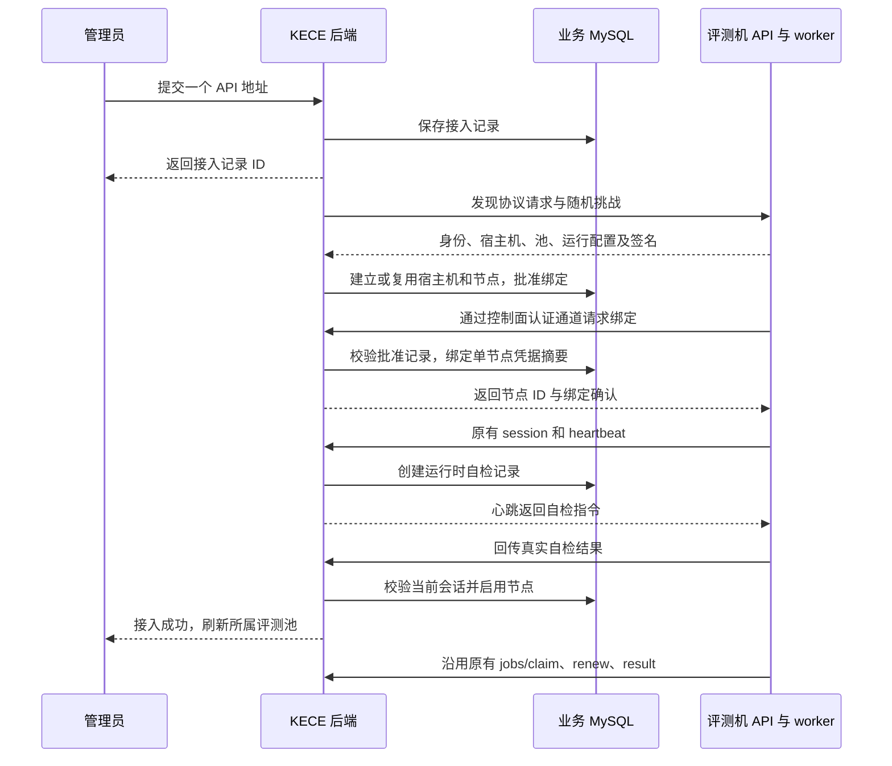
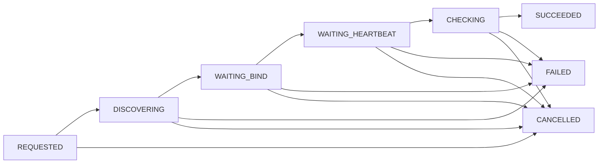

# KECE 评测机 API 唯一接入改造落地方案

> 状态：实施中，唯一 API 接入尚未打通或上线。进度见第 21 节。  
> 编写日期：2026-11-08。核查基线：`80eea18` 与当前工作区中的评测机管理页改版。  
> 产品约束：**新增评测机只有一种方式——管理员粘贴评测机 API 地址，点击「接入」。**

本文承接 [评测机分池与扩容实施方案](./评测机分池与扩容实施方案.md) 和 [评测机代码抽离与分池改造落地方案](./评测机代码抽离与分池改造落地方案.md)。接入相关的后续开发以本文为准，既有任务调度、租约、沙箱、成绩结算仍沿用原方案。

阅读顺序：产品行为 → 协议与状态 → 数据与文件改动 → 开发批次 → 迁移和验收。当前实际部署操作仍以 [现行节点教程](./评测机节点接入与扩容教程.md) 为准，本文通过验收后再切换操作教程。

## 1. 最终交付的使用方式

管理员进入「评测机管理」，点击「接入评测机」，填写一个地址，例如 `http://10.20.0.15:19091`，点击「接入」。系统自动识别池、节点身份、宿主机和运行配置，完成绑定、自检和启用。

| 用户已经明确的要求 | 落地规则 |
| --- | --- |
| API 地址是唯一接入方式 | 页面、后端、部署脚本统一使用这条接入链路 |
| 不复制接入码 | 移除生成、展示、复制、重置接入码的使用流程 |
| 不先创建宿主机组 | 根据稳定宿主机身份自动建立或关联预算组 |
| 不手填语言和池 | 由评测机报告 `pool`，自动进入 `cpp/java/python/mysql/arkts` 中的一个池 |
| 不要求评测机证书 | 接受 HTTP；HTTPS 接受自签名、过期、主机名不匹配的证书 |
| 不要求局域网地址 | 接受后端能够访问的公网和私网 IPv4、IPv6、域名 |
| 自动完成接入 | 自检通过且心跳正常后自动启用，无须再点「自检」「启用」 |
| 已有节点继续使用 | 保留节点 ID、宿主机额度、历史尝试、审计与现有凭据 |

所有 API 输入、失败重试、已有节点地址更新都复用同一个接入模块。宿主机额度调整、排空、停用、撤销仍是日常管理操作。

### 1.1 接入的必要前提

评测机进程必须已经运行，并提供本文定义的 KECE 节点发现协议。Java 节点部署 Java 运行环境，MySQL 节点部署专用判题数据库。一个 API 对应一个专池实例，同一台物理机可以提供多个实例地址。

安装时仍需知道评测机应连接的 KECE 控制面地址。现有部署脚本负责写入这项配置、初始化本机身份及启动监听，完成后输出可复制的 API 地址。管理员在后台不填写这些底层配置，也不预登记节点或公钥。

**API 接入无法代替软件安装、网络路由或运行时准备。** 普通 MySQL TCP 端口、Docker API、其他 OJ 的不兼容接口不能直接当成 KECE 评测节点。遇到不兼容接口时给出明确提示，不要求用户通过手工表单绕过协议。

### 1.2 本次改造范围

| 修改 | 沿用 |
| --- | --- |
| 节点发现、自动绑定、自动分组、自动自检与启用 | 五个专池及每节点单池规则 |
| 管理页唯一接入弹窗、进度与失败处理 | 现有黑白灰配色、直角组件、节点管理页总体布局 |
| 节点未绑定时的常驻 API | worker 主动领单、续租、回传的通信方式 |
| 接入事务、持久状态、身份去重 | `JudgeScheduler` 的持久任务、租约和宿主机行锁 |
| 部署模板、旧入口清理与迁移 | 现有沙箱隔离、SQL 临时库及成绩结算 |

## 2. 代码核查结果与需要改掉的环节

以下是当前源码行为，属于本次实际修改入口。

| 当前文件或位置 | 当前行为 | 修改结果 |
| --- | --- | --- |
| `frontend/src/api/judgers.ts` | `registerNode` 要求名称、池、宿主机、槽位，返回接入码 | 改为 `connectNode({ apiUrl })` 与进度查询 |
| `frontend/src/views/admin/AdminJudgersView.vue` | 登记弹窗、接入码弹窗、重置接入码、创建宿主机表单 | 唯一 URL 表单，显示自动接入的真实进度 |
| `JudgeAdminController.register()` | 处理多字段登记并返回 `Enrollment` | 接收 URL，创建持久接入记录 |
| `JudgeNodes.register()/reset()/join()` | 生成接入码，再换取节点凭据 | 由管理员批准 URL 后自动绑定节点身份与凭据 |
| `JudgeEndpointProbe.approvedEndpoint()` | 仅批准域名、指定网段、HTTPS、443、根路径 | 独立节点发现客户端支持 HTTP/HTTPS、端口和代理路径前缀 |
| `JudgeEndpointProbe.verify()` | 请求 `/healthz`，依赖已登记 `nodeId`、版本和健康状态 | 先发现未登记节点，再通过认证心跳及运行时自检确认就绪 |
| `judger/internal/health/server.go` | 只有 `/healthz`，提供已启动 worker 的状态 | 增加未绑定时也可访问的发现 API |
| `judger/internal/worker/worker.go` | 没有凭据和接入码时，`Authenticate()` 返回错误，`Run()` 退出 | 未绑定时持续等待，完成绑定后进入原 worker 生命周期 |
| `judger/cmd/judger/main.go` | 先准备执行器，再启动健康监听，最终运行 worker | 先启动身份与 API，重型依赖初始化失败时仍能返回诊断 |
| `deploy/sync_judger.py`、`deploy/run_local_judger.py` | 自动建组、登记、获取接入码、自检、启用 | 只安装/启动/升级节点并输出 API，不另建接入通道 |
| `deploy/judger/compose.*.yml` | 健康端口默认映射到回环地址 | 显式分配可达 API 端口，持久化节点身份并共享宿主机身份 |
| `deploy/nginx/internal-judgers.example.conf` | 控制面只允许私网来源 | 支持公网 worker 访问专用控制面，应用层校验机器身份 |

当前数据库最新迁移为 V31。下文暂定 V32 增量建表；实施时若版本号已占用，使用下一个空号。不得修改已执行的 V30、V31 内容。

## 3. 后台页面具体怎么改

### 3.1 唯一接入弹窗

```text
┌ 接入评测机 ────────────────────────────────── × ┐
│                                               │
│ 评测机 API 地址                               │
│ ┌───────────────────────────────────────────┐ │
│ │ http://10.20.0.15:19091                     │ │
│ └───────────────────────────────────────────┘ │
│ 支持 HTTP、HTTPS、公网和局域网地址。            │
│ 系统将自动识别评测池并完成接入。                │
│                                               │
│                             [取消] [接入]     │
└───────────────────────────────────────────────┘
```

只有一个必填业务字段 `apiUrl`。不添加语言、宿主机、并发数、密钥、证书验证开关、接入方式下拉框，也不设置「高级手动登记」。

### 3.2 提交后的反馈

进度由后台接入记录驱动，不使用定时器假进度条。

```text
已识别 Python 评测节点
✓ 连接 API
✓ 识别 Python · python-v1
✓ 关联宿主机 host-71d2 · 共享额度 2
✓ 绑定节点
● 正在执行运行环境自检
○ 加入 Python 评测池
```

成功时显示节点名称、所属池、节点 ID、宿主机、实际槽位及「查看节点」。同宿主机新增实例时明确显示「共享宿主机总额度」，避免误以为节点槽位可以直接相加。

关闭弹窗只停止浏览器轮询，接入任务继续执行。重新打开管理页可从「接入记录」恢复查看。确需停止时使用「取消接入」动作，服务端终止未完成接入；已经启用的节点通过排空/停用管理。

### 3.3 列表与详情

- 页头按钮改成「接入评测机」，空状态同样只提供该按钮。
- 待接入节点显示「绑定中」「自检中」「接入失败」，普通节点继续显示配置态和健康态。
- 详情页展示 API 地址、自动识别的池、宿主机、最近接入记录及可读错误原因。
- 「宿主机分组」改成「宿主机额度」，保留查看及调整，去掉手工新建入口。
- 已有手动自检保留为诊断工具；正常首次接入不依赖它。
- 失败记录提供「重试」和「修改 API 地址」。重试仍走相同接入接口。
- 沿用现有黑白灰、直角、清晰边框；桌面与移动端都不横向溢出。对话框支持键盘、焦点回收、屏幕阅读器状态提示。

## 4. 地址支持与归一化

接收 `apiUrl`，后端统一得到 `normalizedBaseUrl`。前端只做空值和基本格式提示，最终判断在后端。

| 输入 | 处理 |
| --- | --- |
| `http://10.20.0.15:19091` | 接受，使用默认 HTTP 明文发现通道 |
| `http://judge.example.com:19091/` | 去掉末尾斜线，域名规范化为小写 |
| `https://judge.example.com/worker/python-1` | 保留代理前缀，后续拼接 `/v1/node/info` |
| `http://[2001:db8::10]:19091` | 按 IPv6 URL 规则解析；示例地址仅用于文档 |
| `http://10.20.0.15:19091/v1/node/info` | 去掉已知协议后缀，避免重复拼接 |
| `http://10.20.0.15:19091/healthz` | 识别旧健康后缀，再请求新发现协议；不兼容时提示升级 |
| 没有协议的 `10.20.0.15:19091` | 自动补 `http://`，在提交结果中显示规范化地址 |

具体约束如下。

1. 只接受 HTTP/HTTPS，端口范围 1～65535；不得通过 `file/gopher/ftp` 等协议请求目标。
2. 地址长度上限 1024 字符。不接受 URL 用户名密码、查询参数、fragment、控制字符、反斜杠、编码路径穿越或歧义 IP 表达形式。
3. HTTP 的 80、HTTPS 的 443 规范化为默认端口。路径大小写保持不变，不把不同代理前缀合并。
4. 域名解析后固定本次实际连接 IP，关闭跳转、Cookie、系统代理和内容压缩，限制响应体及总耗时。后续请求重新解析后重新检查。
5. 不以公网/私网分类拒绝地址，也不要求管理员配置允许网段或域名清单。拒绝未指定地址、组播、链路本地元数据地址及本应用已知的管理服务目的地址。IPv4 映射 IPv6 使用等价规则。
6. 回环地址在远程接入中提示使用宿主机真实可达 IP，因为它代表后端所在机器。同机评测使用该机实际 IP 和评测 API 端口；不得因同 IP 上有业务服务而整机封禁。
7. HTTPS 的证书链、有效期和域名校验只在这个专用发现客户端中放宽。不修改 JVM 默认 SSL、共享 HTTP 客户端、浏览器 TLS 或其他外部请求。
8. HTTPS 仍需目标能够完成 TLS 握手。目标没有 TLS 服务时使用 `http://`，不做静默协议降级。

这里只保留防止请求被重定向到其他服务的基础约束，不增加管理员接入步骤。网络层隔离、关闭重定向和核查解析结果的设计依据见 [OWASP SSRF 防护指南](https://cheatsheetseries.owasp.org/cheatsheets/Server_Side_Request_Forgery_Prevention_Cheat_Sheet.html)。

## 5. 总体调用关系



浏览器始终只访问 KECE 后端。评测机 HTTP、自签名证书、跨域、私网地址均由后端处理，不在浏览器中发起直连。

## 6. 节点身份与常驻发现 API

### 6.1 四种身份各自的用途

| 字段 | 生成与保存 | 用途 |
| --- | --- | --- |
| `controlPlaneId` | KECE 部署时生成一次并持久化，各后端副本共享 | 防止连接到错误 KECE 部署 |
| `hostId` | 宿主机首次安装时生成随机 UUID，同机各 worker 读取同一文件 | 自动关联同机预算组 |
| `instanceId` | 每个评测进程实例首次安装时生成 UUID，持久保存 | 重启、改 IP、换域名后仍识别同一个节点 |
| `bootId` | 每次进程启动生成，继续沿用当前会话逻辑 | 区分进程代次，拒绝旧会话 |

每个实例另生成 Ed25519 密钥对，`nodeKeyId` 为公钥 SPKI DER 字节的 SHA-256。公钥随发现响应返回，私钥只存本机。密钥、`instanceId`、凭据均不得打包进通用镜像。

建议落盘结构如下。

```text
/etc/kece/judger/host-identity.json           同机共享，只读挂载
/var/lib/kece-judger/python-1/identity.json   实例 UUID 与密钥
/var/lib/kece-judger/python-1/binding.json    尚未完成的绑定及重试资料
/var/lib/kece-judger/python-1/credential.json 已绑定节点凭据
/var/lib/kece-judger/python-1/cache/          沿用现有缓存
```

宿主机安装器以文件锁和原子创建生成 `host-identity.json`，同机后续安装只能读取原值。Compose 将同一宿主文件只读挂入各实例，各实例数据卷独立。Windows 本地启动脚本使用固定的用户级 KECE 宿主身份目录，并为每个实例单独保存身份；开发进程不得各自生成一套宿主身份。

不能以公网 IP、容器 hostname、Docker 容器 ID、`bootId` 推断宿主机。不同机器可以共用出口 IP，同机可以有多个地址。缺失宿主文件时报告安装配置错误，不随机建立另一个预算组。

### 6.2 启动顺序

1. 读取配置、宿主身份，创建或读取实例身份，并获得实例目录独占锁。
2. 启动发现 API；端口绑定失败属于启动失败，不能日志报错后仍继续运行 worker。
3. 初始化本池运行依赖，发现 API 持续报告准备中或具体失败原因。
4. 存在有效旧凭据时恢复原会话；无凭据时进入 `UNBOUND`，持续等待后台批准。
5. 依赖和控制面恢复后自动继续。没有接入码不再是进程退出条件。
6. 绑定完成，原子保存凭据，建立会话，发送心跳，接受自动自检。
7. 节点收到 `ENABLED` 才领取任务。

`/healthz` 保留存活与监控用途。未绑定或依赖异常时，它可以返回未就绪，但 `/v1/node/info` 仍应正常提供协议和诊断资料。

## 7. 评测机发现协议

新增独立文档 `docs/contracts/judger-discovery-v1.openapi.yaml`，与现有任务协议 v1 分开版本化。

### 7.1 发现请求

后端向规范化基址请求 `POST /v1/node/info`。

```json
{
  "discoveryVersion": 1,
  "controlPlaneId": "7cf26574-3858-4e57-a685-8fc947dc4b81",
  "nonce": "一次请求独有的32字节随机值的Base64URL编码"
}
```

这里只传公开身份与挑战，不传管理员 JWT、节点凭据、数据库密码或学生代码。评测机不根据请求里的地址切换控制面，也不接受来自此 API 的任意命令。

### 7.2 响应内容

发现响应使用签名信封，`payload` 是原始 UTF-8 JSON 的 Base64URL 编码，`signature` 是签名字节的 Base64URL 编码。`publicKey` 使用 SPKI DER 的 Base64URL 编码。业务载荷如下，字段示例不代表生产配置。

```json
{
  "discoveryVersion": 1,
  "jobProtocolVersion": 1,
  "controlPlaneId": "7cf26574-3858-4e57-a685-8fc947dc4b81",
  "instanceId": "cb7e8f06-dd79-4b1e-a6f7-9675a01861a5",
  "hostId": "8d7dcbe2-758d-4be2-8c84-b00eddf671d2",
  "nodeKeyId": "公钥SPKI字节的64位小写十六进制SHA256",
  "bootId": "a9de1c9de5b54c729e68f01b51a510ff",
  "pool": "python",
  "runtimeSpec": "python-v1",
  "runtimeVersion": "prod-1.1",
  "displayName": "python-1",
  "localSlots": 2,
  "bindingState": "UNBOUND",
  "dependencyState": "READY",
  "capabilityDigest": "稳定能力字段的SHA256摘要",
  "nonce": "原样返回本次请求的nonce"
}
```

规范必须逐字段约束 UUID、枚举、长度与整数范围。`localSlots` 使用当前 1～256 上限；`pool` 与 `runtimeSpec` 按服务端支持映射匹配，不能根据任意字符串动态新建池。

`capabilityDigest` 仅覆盖 `instanceId/hostId/pool/runtimeSpec/runtimeVersion/localSlots/nodeKeyId`。精确编码为 UTF-8 的 `KECE-CAPABILITY-V1\n` 加上述七个字段按顺序用单个换行符拼接，末尾不加换行；UUID、池与指纹使用规范化小写，`localSlots` 使用无前导零的十进制字符串，运行时字段保持大小写且禁止换行。最终取 SHA-256 小写十六进制。实时健康、`nonce`、`bootId` 不参与稳定能力摘要。能力变化后须重新发现和自检。

签名采用固定域前缀 `KECE-DISCOVERY-V1\n` 加 `payload` 的 ASCII 字节，禁止两端各自重排 JSON 后验签。算法固定为 Ed25519，不接受请求指定的其他算法。先限制长度，再验签，再按严格 DTO 解析载荷并核对 nonce。Java 使用 `Signature`/`KeyFactory`，Go 使用 `crypto/ed25519` 与 `crypto/x509`；通过共享测试向量验证 SPKI、签名和摘要的一致性。[Java 标准算法名称](https://docs.oracle.com/en/java/javase/17/docs/specs/security/standard-names.html#signature-algorithms)、[Go Ed25519](https://pkg.go.dev/crypto/ed25519)。

### 7.3 首次信任规则

本版以管理员提交的 API 地址作为首次信任选择，保存发现公钥后实行身份固定。新 URL 返回已知 `instanceId` 时必须使用同一公钥；相同地址换成其他公钥时拒绝静默覆盖。

必须明确其能力范围：**HTTP 或不校验证书的首次发现不能抵抗首次连接时的主动中间人替换。自签名响应只能证明持有该私钥，不能自行证明属于指定组织。** 本方案接受管理员所选节点为受信评测基础设施，不增加公钥预登记或人工指纹确认步骤。后续身份固定、单节点凭据与租约校验负责限制重连和运行阶段的混淆。

长期凭据与题目资料不通过这条放宽证书验证的发现通道传输。它们仍走 worker 主动访问的控制面连接，见下一节。

## 8. 自动绑定与凭据交接

### 8.1 采用的实现

增加两条机器内部接口，完整前缀为 `/api/v1/internal/judgers`。

| 接口 | 调用者与作用 |
| --- | --- |
| `GET /bootstrap/context` | worker 从其配置的控制面获取 `controlPlaneId` 与支持版本，只返回公开资料 |
| `POST /bootstrap/claim` | 未绑定 worker 用自己的实例签名领取后台已批准的绑定，提交该节点专用凭据 |

控制面 URL 由安装配置给出，不从用户填写的 API 返回值中任意跳转。跨机器生产控制面使用验证服务端身份的 HTTPS；同机回环 HTTP 兼容现有部署，但不得把明文凭据跨机器传输。这个要求属于既有控制面连接，管理员粘贴的评测机 API 仍可使用 HTTP 或自签名 HTTPS。

### 8.2 凭据生成与丢包恢复

worker 在调用绑定接口前，用加密安全随机数生成 32 字节节点凭据及 `claimId`，先原子写入 `binding.json`。请求使用节点私钥签名，载荷包含 `controlPlaneId/instanceId/nodeKeyId/capabilityDigest/claimId/bootId/issuedAt/nonce/credential`。

服务端按以下顺序处理。

1. 先按 `instanceId/nodeKeyId` 定位已固定公钥或有效批准记录，验签后查询 `claimId` 是否已经提交。不得因为首次接入记录已经到达终态而丢失绑定确认。
2. 对已提交的 `claimId`，核对当前绑定代次、当前凭据摘要、实例身份和撤销状态，匹配才返回原确认；不同凭据、已撤销或旧代次返回冲突，不修改数据。
3. 对新请求，查找管理员创建、尚未过期、身份及能力摘要匹配的接入批准记录。没有记录时返回 `204`，不会自动创建节点。
4. 检查时间窗口、nonce 与取消状态，在短事务中确认同一节点没有其他有效绑定；只保存节点凭据 SHA-256 摘要，不记录明文请求体。
5. 持久化 `claimId`、节点 ID、凭据摘要和绑定代次，返回绑定确认。此时节点仍为 `PENDING_VERIFICATION`。
6. worker 原子写入兼容当前格式的 `credential.json`，成功后清除临时绑定资料，再调用现有 `/session` 和 `/heartbeat`。

**响应丢失时重发相同 `claimId` 与凭据，返回相同节点确认。** 已处理请求的 nonce 再次到达时只允许返回既有确认，不能重新设置凭据或开启新会话。进程重启也读取相同 `binding.json` 继续，不能生成第二个节点。

凭据写盘失败时不得领单，发现 API 报告 `CREDENTIAL_STORE_FAILED`。请求头、请求体、Base64 载荷均不得进入访问日志或审计明细。审计只保留 ID、指纹、阶段和结果。

绑定确认的业务载荷固定如下，不返回凭据明文，也不提前创建会话。

```json
{
  "connectionId": "104",
  "claimId": "124bdd41-cc9c-42fd-a659-b9d243b28535",
  "nodeId": "8",
  "bindingGeneration": 1,
  "protocolVersion": 1,
  "pool": "python",
  "runtimeSpec": "python-v1"
}
```

绑定请求复用签名信封，但域前缀改为 `KECE-BOOTSTRAP-CLAIM-V1\n`，不能将发现响应拿来充当绑定请求。请求体上限 16 KiB，`issuedAt` 允许前后 120 秒偏差，nonce 重放摘要保留 5 分钟。合法重试保持 `claimId/credential` 不变，使用新的时间与 nonce；重启后亦如此。重复请求的无副作用确认仍需验签及当前代次核对。

未知实例、错误签名和过期批准统一使用简短结果，避免开放接口枚举身份信息。接口设独立速率和并发上限，未知实例不能写入节点表、接入记录或无限增长的 nonce 缓存。该限流不与现有 heartbeat/renew 共用额度。

### 8.3 权限与状态约束

- 管理 API 继续要求 `Role.ADMIN`。普通用户或教师不能触发服务器访问任意 URL。
- `bootstrap/context` 与 `bootstrap/claim` 在拦截器中按精确 handler 放行到专用认证逻辑，不整体放开 `/internal/judgers/**`。
- 机器已有 Bearer、会话代次、租约代次认证保留。任务接口不接受仅有发现签名的调用。
- 新实例未得到管理员 URL 接入批准时，无论轮询多久，都不能领取任务或获取用例。
- 撤销会取消该节点所有活动接入记录并增加绑定代次；迟到回调、旧批准和旧 `claimId` 不能恢复权限。
- 已撤销节点需要管理员再次主动提交其 URL 创建新一代接入批准。自动重试不得跨越撤销时刻，旧幂等请求不能成为重新授权。
- 已停用或排空但未撤销的节点，重复粘贴只返回现有节点，保持其管理状态；不自动恢复接单。

首次绑定完成后，等待绑定轮询停止。日常业务继续使用现有心跳和领单，不增加每任务握手。

## 9. 自动分池、分组和额度

### 9.1 自动分池

`cpp → C++`、`java → Java`、`python → Python`、`mysql → MySQL`、`arkts → ArkTS`。一个实例只允许一个池。更换池要作为新实例安装，不在有任务的旧实例上直接改池。

节点名称优先采用合法的 `displayName`，重名时附加稳定的实例 ID 短后缀。名称不作为去重依据。

### 9.2 自动宿主机分组

后端根据 `hostId` 查询宿主机身份映射，有则复用，无则创建 `host-<短ID>` 预算组。通过数据库唯一键处理同时接入两个同机实例的竞争，不能只在 Java 内存中判断是否存在。

已有宿主机分组保留管理员设置的额度。新分组使用可配置的保守初值 **2 个共享槽位**。节点初始额度为 `min(localSlots, host.maxSlots)`，后续在「宿主机额度」和节点详情中按实测调整。

自动识别 CPU/内存只能提供参考，不直接提升生产并发。单凭 API 发现也无法验证物理硬件归属，宿主机身份依赖正常安装流程和受信节点配置。

例如，一台机器接入 C++、Java、Python 各 2 槽，宿主机额度为 2，则三池合计最多同时占用 2 个任务/自检槽位。增加第二台机器的预算组才增加独立宿主额度。

### 9.3 保留原有配额和自检约束

继续使用 `JudgeNodes.hostSlots()/hostUsed()` 和 `JudgeScheduler.claim()` 的宿主机行锁。同机自检也占用预算，不在侧路另开不限额的测试容器。

接入自动启用必须同时满足当前会话、当前运行时版本、自检 `PASSED`、新鲜健康心跳、有效节点凭据。只有 TCP 连通、HTTP 200 或镜像存在，均不能视为完成自检。

### 9.4 已有节点重启后的自动复检

当前 `JudgeNodes.open()` 在新会话中会清除 `verified`。只完成首次自动接入而不处理重启，会导致节点重启后一直无法领单。

在认证心跳之后补充 `ensureRuntimeCheck`，对管理期望仍为 `ENABLED`、心跳健康、当前会话尚未验证的节点，等待旧任务/旧自检释放占用，再为当前 `sessionEpoch + runtimeVersion` 创建一次自检。节点保持原管理期望，调度器继续因 `verified=false` 拒绝领单，直到自检通过。

同会话同版本已有自检记录时不重复排队；失败后显示原因，通过手动诊断重试或下一次明确运行时变更处理，不能每次心跳无限自检。`DRAINING/DISABLED` 不自动恢复。自动复检记为系统动作，与管理员新接入审计分开，系统 actor 使用预留值 `0`。这项复检只恢复已认证节点，不接受新节点注册。

## 10. 持久接入状态、超时与幂等

### 10.1 接入记录独立于节点配置态

节点继续使用 `PENDING_VERIFICATION/ENABLED/DRAINING/DISABLED`。接入过程单独记录，避免把每个网络阶段塞进现有调度状态枚举。



`FAILED` 携带 `errorCode`，超时使用 `CONNECTION_EXPIRED`，取消和失败不会删除节点历史。失败后重新点击产生新的接入记录，并引用旧记录，复用同一节点身份。

### 10.2 超时与限流初值

以下为待验证的配置初值，不是生产性能结论。

| 项目 | 初值和行为 |
| --- | --- |
| 单次发现 | 连接 2 秒、读取 2 秒、总耗时 5 秒，响应最多 16 KiB |
| 发现重试 | 最多 3 次，间隔 1 秒和 3 秒，轻微抖动；格式或身份错误不重试 |
| 等待绑定 | 最长 120 秒，worker 每 5 秒带抖动轮询 |
| 等待健康心跳 | 最长 30 秒；依赖异常给出具体原因 |
| 自检 | 复用现有排队 5 分钟、执行 60 秒限制，受宿主机配额约束 |
| 总接入有效期 | 10 分钟；过期后后台任务不能再自动启用 |
| 管理接入请求 | 每管理员每分钟最多 10 次新接入；查询单独限流 |
| 后端执行 | 最多 4 个发现网络请求同时执行，超出留在数据库待处理 |
| 前端进度查询 | 弹窗可见时每 2 秒查询；关闭/卸载停止；断线后可恢复 |

接入任务不能复用 `judgeClaimExecutor`。当前该线程承担长轮询唤醒，阻塞它会影响正常领单。

### 10.3 幂等和竞争处理

| 情况 | 明确结果 |
| --- | --- |
| 连点「接入」或 POST 超时重发 | 前端自动携带同一个 `Idempotency-Key`，返回同一接入记录 |
| 两位管理员同时提交同一地址 | 归一化地址唯一键保留一个活动连接，另一请求返回该记录 |
| 两个域名指向同一实例 | `instanceId` 唯一键合并为同一个节点，不增加槽位或重置会话 |
| 原节点换 IP/域名 | 同实例同公钥时更新主 API 地址，旧地址保留审计；不轮换凭据 |
| 相同 URL 返回另一个实例 | `ENDPOINT_IDENTITY_CHANGED`；不覆盖旧节点或自动转移额度 |
| 同实例 ID 返回另一公钥 | `NODE_IDENTITY_CONFLICT`；保持原节点 |
| 节点重启导致 bootId 变化 | 固定实例公钥后重新发现，重新等待当前会话自检；旧 checkId 无效 |
| 旧后台进程迟到返回 | 通过接入执行租约版本和绑定代次拒绝状态回写 |
| 用户关闭弹窗或刷新页面 | 数据库中的接入任务继续，列表可恢复进度 |
| 自检中有人停用/排空/撤销 | 增加节点 revision 或绑定代次，取消自动启用资格，迟到结果不覆盖 |
| 接入失败 | 已绑定节点保持待验证，保留诊断；重试不增加重复节点 |

同一实例只能有一个活动接入尝试。运行中的节点重复接入直接返回现有节点状态，不发起会话重建，不强制插入自检扰动现有任务。

## 11. 后端管理接口契约

下列路径含现有应用前缀 `/api/v1`。

| 方法与路径 | 用途 |
| --- | --- |
| `POST /api/v1/admin/judgers/connections` | 唯一新增入口，JSON 仅有 `apiUrl`；幂等键放请求头 |
| `GET /api/v1/admin/judgers/connections/{connectionId}` | 查询一个接入进度 |
| `GET /api/v1/admin/judgers/connections?afterId=...&limit=...` | 查询接入记录，恢复关闭弹窗后的进度 |
| `POST /api/v1/admin/judgers/connections/{connectionId}/cancel` | 取消尚未完成的接入 |
| 原 `GET/PATCH /admin/judgers...` | 列表、详情、配置调整继续使用 |
| 原 `POST /admin/judgers/{id}/checks` | 保留诊断自检，不再要求旧 HTTPS 白名单探测 |
| 原 `POST /admin/judgers/{id}/revoke` | 保留，联动取消活动接入及绑定代次 |
| 原 `GET/PATCH /admin/judge-host-groups...` | 保留查看和调整额度 |

创建成功返回 HTTP 202，数据继续包在现有 `ApiResponse` 的 `data` 中；失败按后端统一错误格式处理。既有节点复用可以返回 HTTP 200 与已完成结果，前端统一读取状态。

```json
{
  "connectionId": "104",
  "status": "DISCOVERING",
  "apiUrl": "http://10.20.0.15:19091",
  "nodeId": null,
  "pool": null,
  "hostGroupId": null,
  "reused": false,
  "message": "正在识别评测机",
  "errorCode": null,
  "retryable": false
}
```

成功响应补齐 `nodeId/pool/hostGroupId`。所有数据库 BIGINT 标识符使用十进制字符串，延续当前前端游标修复。

固定路由 `connections` 与 `reconciliation` 要优先于节点 ID 路由；节点路径参数应限制为数字，补测试防止被 `{id}` 吞掉。

| 错误码 | 页面提示 | 处理 |
| --- | --- | --- |
| `API_UNREACHABLE` | 后端无法连接这个 API，请检查地址和端口 | 可重试 |
| `DISCOVERY_UNSUPPORTED` | 此接口未提供兼容的评测机发现协议，请升级节点 | 升级后重试 |
| `POOL_UNSUPPORTED` | 暂不支持该评测池 | 不自动新建池 |
| `CONTROL_PLANE_MISMATCH` | 此节点配置的 KECE 控制面与当前站点不同 | 修正节点安装配置 |
| `HOST_ID_MISSING` | 节点缺少宿主机身份，请修复安装配置 | 不分配独立新预算绕过 |
| `NODE_IDENTITY_CONFLICT` | 节点身份与已有记录冲突 | 保留现有记录，查实例是否被克隆 |
| `ENDPOINT_IDENTITY_CHANGED` | 该地址对应的节点身份已变化 | 核查原节点，不能静默接管 |
| `BINDING_TIMEOUT` | 已识别节点，但节点未完成控制面连接 | 查看 worker 控制面连通性 |
| `SELF_CHECK_FAILED` | 运行环境自检失败 | 展示脱敏原因，修复后重试 |
| `CONNECTION_EXPIRED` | 本次接入超时，可重新接入 | 新尝试复用已有身份 |
| `NODE_STATE_CHANGED` | 节点配置已被其他操作修改 | 刷新当前状态 |
| `CREDENTIAL_STORE_FAILED` | 节点无法保存凭据 | 修复目录权限/磁盘 |

## 12. 数据库修改清单

### 12.1 V32 增量迁移

使用扩展表承载新接入资料，保留 `judge_node` 的原有字段与现有凭据格式，降低现存任务和回滚受到的影响。

| 表 | 主要字段 | 约束与索引 |
| --- | --- | --- |
| 新增 `judge_control_identity` | `id`、`control_plane_id CHAR(36)` | 单行配置，各后端副本读取同一值 |
| 新增 `judge_host_identity` | `host_id CHAR(36)`、`host_group_id BIGINT`、`created_at` | `host_id` 主键，`host_group_id` 唯一并关联现有组 |
| 新增 `judge_node_identity` | `node_id BIGINT`、`instance_id CHAR(36)`、`public_key VARBINARY(128)`、`key_fingerprint CHAR(64)`、`binding_generation BIGINT`、`revoked_at` | `node_id` 主键，实例与公钥指纹分别唯一 |
| 新增 `judge_node_endpoint` | `endpoint_hash CHAR(64)`、`normalized_url VARCHAR(1024)`、`node_id`、`active_connection_id`、`updated_at` | URL 摘要主键；保留原值并比较，不能只比较摘要 |
| 新增 `judge_node_connection` | 下表所列 | 状态扫描、管理员幂等、节点活动接入去重 |
| 修改 `judge_node.base_url` | 从 `VARCHAR(255)` 扩为 `VARCHAR(1024)` | 继续作为详情页主 API 地址；已有值不变 |

身份 UUID、指纹、摘要与幂等键使用 ASCII 二进制排序规则，避免大小写折叠导致歧义。公共状态接口不暴露身份、公钥、地址或接入记录。

`judge_node_connection` 的字段分组如下。

| 字段组 | 字段 |
| --- | --- |
| 请求来源 | `id`、`actor_id`、`idempotency_key`、`request_digest`、`retry_of_id` |
| 目标 | `endpoint_hash`、`normalized_url`、`instance_id`、`node_id`、`capability_digest` |
| 批准与绑定 | `binding_generation`、`expected_node_revision`、`claim_id`、`credential_digest` |
| 自检关联 | `check_id`、`check_session_epoch`、`check_runtime_version` |
| 进度 | `status`、`error_code`、`error_detail VARCHAR(500)`、`retry_count`、`next_run_at` |
| 执行租约 | `runner_id`、`runner_epoch`、`runner_lease_until` |
| 时间 | `created_at`、`updated_at`、`expires_at`、`finished_at` |

必要索引包括 `(actor_id, idempotency_key)` 唯一索引、`claim_id` 唯一索引、`(status, next_run_at, id)`、`(node_id, id)`。同键不同请求体返回冲突；终态幂等记录至少保留 7 天。

同实例活动接入唯一性使用可空的 `active_instance_id` 唯一列实现，只在非终态写入；到达终态清空，永久实例绑定由 `judge_node_identity` 唯一键保证。地址表的 `active_connection_id` 与接入记录终态更新放在同一事务中。

### 12.2 事务与恢复

1. HTTP 提交只完成地址规范化、幂等占位和接入记录提交，随后返回；网络请求不放在数据库事务中。
2. 执行器通过 `FOR UPDATE SKIP LOCKED` 领取到期记录，短事务写入执行租约；网络调用结束后按 `runner_epoch` 回写。
3. 宿主机和节点变更沿用「宿主机 → 节点」锁顺序，再修改接入/地址记录；同时涉及多条地址时按摘要排序锁定。不能持有接入行锁再反向等待宿主机锁。
4. 新宿主机或新实例同时创建发生唯一键冲突时，回滚当前短事务后读取胜出记录并重试，不继续使用已失败事务。
5. 自动启用重新读取节点 revision、绑定代次、当前会话、自检 ID 及运行时版本；任一变化则停止自动启用。
6. 后端重启后扫描未完成记录并接管过期执行租约，不能依赖单进程 `Future` 或前端仍在线。
7. 失败记录与待验证节点不立即物理删除。后续清理只清理超过保留期的终态接入资料，不删除仍有历史任务的节点。

数据库仅存凭据摘要。短期重放记录可用共享 Redis 保存 nonce 摘要，但 Redis 异常时禁止新的绑定副作用；已经提交的相同 `claimId` 可返回已有确认。普通评测任务仍沿用原有持久调度，不被这个新增接入限流设施阻塞。

## 13. 后端文件级实施清单

下列 Java 路径均相对 `backend/src/main/java/com/kece/`。新增文件名是本次实施约定。

| 文件 | 具体修改 |
| --- | --- |
| `judging/control/JudgeAdminController.java` | 删除 `RegisterRequest/Enrollment` 对外用法，接入新服务；保留节点管理接口 |
| 新增 `judging/control/JudgeConnections.java` | 对外只暴露 connect/status/list/cancel；封装批准、幂等、分组、自检与启用，不把步骤交给前端编排 |
| 新增 `judging/control/JudgeDiscoveryClient.java` | URL 规范化、专用 HTTP 客户端、解析结果固定、发现协议验签与错误分类 |
| 新增 `judging/control/JudgeBootstrapController.java` | context 与 claim 的有界读取、专用签名认证、绑定确认 |
| 新增 `judging/control/JudgeConnectionRunner.java` | 独立调度接入状态推进，数据库租约恢复，关闭时中断有界发现请求 |
| `judging/control/JudgeNodes.java` | 提供可复用的节点创建/状态不变量；接入事务显式传操作人；增加当前会话自动复检；旧登记/接入码方法最终删除 |
| `judging/control/JudgeMachineController.java` | 心跳兼容可选身份声明供旧节点迁移；移除 `/join` 正常业务处理 |
| `judging/control/JudgeMachineInterceptor.java` | 精确识别 bootstrap 的独立认证 handler，保留所有任务接口认证 |
| `judging/control/JudgeControlConfig.java` | 新接入执行器独立线程池；接入总开关与有界超时配置 |
| `judging/control/JudgeEndpointProbe.java` | 发现及地址逻辑替换完成后删除，移除旧域名/网段/443 判断 |
| `judging/control/JudgeMaintenance.java` | 保持领单与回收职责，不增加阻塞发现请求 |
| `common/config/WebConfig.java` | 核对机器路由仍由机器拦截器覆盖，管理路由仍要求管理员认证 |
| `system/service/SystemStatusService.java` | 如有必要排除未绑定/未自检节点，公共 ready 统计口径不放宽 |

`JudgeNodes.audit()` 当前依赖请求线程中的 `AuthContextHolder`。异步接入必须改成显式传入 `actorId`，否则定时任务推进时无法可靠归属管理员。worker 触发的回调使用对应批准记录的 actor，并标记自动阶段。

不要从同一个类内部调用带 `@Transactional` 的方法并假设 Spring 代理生效。状态推进的短事务使用明确的事务入口或 `TransactionTemplate`。只有实际需要替换的 HTTP/时钟/持久状态依赖才建立测试接口，不建设通用工作流引擎。

## 14. Go 文件级实施清单

| 文件 | 具体修改 |
| --- | --- |
| 新增 `judger/internal/identity/identity.go` | 宿主身份读取、实例密钥持久化、独占锁、签名和身份摘要 |
| 新增 `judger/internal/discovery/server.go` | `POST /v1/node/info`，严格载荷、nonce 回传、限流、无敏感资料输出 |
| 新增 `judger/internal/control/bootstrap.go` | context/claim 客户端、绑定重试、确认恢复，不复用 enrollment 请求 |
| `judger/internal/control/client.go` | 沿用 session/heartbeat/claim/renew/result；增加可选迁移身份字段，移除 Join DTO 和调用 |
| `judger/internal/config/config.go` | 增加身份文件与 API 监听配置，移除 `JUDGE_ENROLLMENT_CODE`；旧监听配置仅作限期兼容别名 |
| `judger/internal/health/server.go` | 与发现 API 共用一个监听 mux，保留 `/healthz`；可独立表示存活和未就绪 |
| `judger/internal/worker/worker.go` | 拆出绑定等待阶段，认证失败分类，原子保存凭据；不因缺少接入码退出 |
| `judger/cmd/judger/main.go` | 调整启动次序，先开放发现，再初始化运行依赖；监听和 worker 生命周期统一退出 |
| `judger/internal/worker/worker_test.go` | 未绑定、断线、丢确认、写盘失败、撤销和重启用例 |

建议配置命名为 `JUDGE_API_ADDR`、`JUDGE_HOST_IDENTITY_FILE`、`JUDGE_IDENTITY_FILE`、`JUDGE_BINDING_FILE`。继续使用 `JUDGE_CONTROL_URL/JUDGE_POOL/JUDGE_LOCAL_SLOTS/JUDGE_CREDENTIAL_FILE`。

`JUDGE_HEALTH_ADDR` 在一个兼容发布中作为 `JUDGE_API_ADDR` 的别名；两者同时配置且值不同则启动报错。最终模板仅使用新命名。

运行环境初始化要能恢复。缺镜像、MySQL 暂不可达时，发现 API 提供简短错误，后台停在自检前；后台和 worker 按有界退避重试，不无限创建容器。私钥和凭据只能保存到受限目录，不挂入执行学生代码的沙箱。

## 15. 前端与部署脚本改动

### 15.1 前端

| 文件 | 修改内容 |
| --- | --- |
| `frontend/src/api/judgers.ts` | 增加 ConnectionRequest/View/status 类型及 connect/get/list/cancel；删除 EnrollmentResult/RegisterNodeRequest/createHostGroup/registerNode/resetEnrollment |
| 新增 `frontend/src/features/judging/components/JudgeConnectDialog.vue` | 一个 URL 表单、服务端阶段、错误和成功摘要；复用已有表单/按钮样式 |
| 新增 `frontend/src/features/judging/composables/useJudgeConnection.ts` | 幂等键生命周期、单在途轮询、关闭清理、迟到响应防覆盖、重新查看 |
| `frontend/src/views/admin/AdminJudgersView.vue` | 接入弹窗整合、接入记录入口，删除登记及秘密弹窗和相关 CSS，保留近期管理页改版 |
| `frontend/src/views/admin/AdminJudgersView.spec.ts` | 替换旧登记断言，补唯一入口、自动进度、恢复和权限用例 |

前端不根据「第三次轮询」等次数推断成功。提交失败但后端可能已接收时保留幂等键；用户修改 URL 后生成新键。不同连接切换时忽略旧请求迟到响应。

### 15.2 部署工具

| 文件 | 修改内容 |
| --- | --- |
| `deploy/sync_judger.py` | 保留构建、上传、依赖准备、systemd 管理；删除管理员自动登记、建组、发码、启用；打印实例 API |
| `deploy/run_local_judger.py`、`deploy/run-local-judger.ps1` | 本地节点启动后等待 API 接入；删除 `--enrollment-code/--auto-register/--host-group` 接入参数及管理员登录逻辑 |
| `deploy/judger/compose.pool.yml`、`compose.mysql.yml` | 独立实例卷、只读共享宿主身份、明确 API 监听与发布端口；MySQL 继续不挂 Docker socket |
| `deploy/judger/node.*.env.example` | 去掉接入码，增加身份与 API 监听参数；一实例一端口 |
| `deploy/judger/kece-judger@.service.example` | 常驻未绑定实例，保留实例数据目录、文件权限和停止宽限时间 |
| `deploy/judger/verify-node.sh` | 只诊断已接入节点，不自动登记或生成接入码 |
| `deploy/nginx/judger-health.example.conf` | 改成可选的节点 API 代理，代理发现与健康路径，明确 HTTPS 可选 |
| `deploy/nginx/internal-judgers.example.conf` | 新增/改造专用控制面入口，允许公网 worker，按协议认证和限流 |
| `deploy/nginx/public-deny-judgers.example.conf` | 普通业务站点继续阻断机器路径，防止误代理；专用控制面单独配置 |

不能只取消后端网段检查而保留 Nginx 的私网 `allow/deny`，否则公网节点仍然无法绑定和领单。专用控制面只暴露已需要的机器协议及受租约保护的用例下载，不透出管理 API。配置证书和入口路由属于平台部署工作，做一次后所有节点复用。

安装器输出 `API listening` 和建议复制地址。多网卡/NAT 场景无法从进程内可靠猜出公网映射，因此允许部署时配置发布地址用于打印；实际是否可达始终由后端发现结果决定。不得把 `0.0.0.0` 或容器私有 hostname 打印成可直接接入地址。

## 16. 旧节点迁移与旧链路退役

### 16.1 已有节点保留哪些内容

现有有效 `credential.json` 继续使用当前 session/heartbeat，不强制轮换，不重新登记。新增身份表允许旧节点暂时没有映射。

升级后的 worker 使用原凭据发送可选 `identity` 心跳扩展，绑定 `instanceId/hostId/publicKey` 与现有 nodeId。服务端必须以已经认证的 nodeId 为准，不能相信未经认证的发现响应自称属于某个旧节点。

身份扩展需绑定当前会话并证明持有实例私钥，签名域前缀使用 `KECE-IDENTITY-MIGRATION-V1\n`，载荷至少覆盖 `controlPlaneId/nodeId/sessionEpoch/instanceId/hostId/nodeKeyId`。首次绑定成功后不可任意替换身份。迁移沿用原 `host_group_id` 与额度；同机后续节点报告相同 `hostId` 时关联同组。

如果相同 hostId 对应多个历史预算组，迁移报告冲突，先在维护窗口排空并核对组，再安全合并；不得为了绕过冲突新建组。历史任务仍保留原宿主机归属，不能在有在途任务时移动预算。

### 16.2 分阶段上线

1. **数据库和兼容后端。** 追加迁移、身份扩展和新接口，接入功能开关先关闭，原已绑定节点正常评测。旧接入暂未切换，对外仍明确当前版本。
2. **升级节点。** 逐节点优雅停止 worker，由现有停止逻辑停止新领单并等待在途任务，保留管理期望状态；升级后自动迁移身份并按第 9.4 节复检。检查控制面可达、API 监听、共享宿主文件及原凭据正常。原本处于停用/排空状态的节点保持原状态，需要维护人员按既有管理动作恢复。
3. **验证新节点。** 在隔离环境和一个新增试点节点跑完整 URL 接入与真实提交，验证公网/HTTP/自签名 HTTPS 场景。
4. **原子切换接入入口。** 发布新前端并启用 API 接入开关，同时关闭旧登记、发码、手工建组及 join 接入。旧页面请求得到明确的版本更新提示。切换时使未消费接入码失效。
5. **观察后收口。** 新流程稳定、脚本与文档更新后删除旧方法和临时 410 路由处理。已有 token/session 兼容仍保留，属于运行连接，不是另一种新增入口。

新旧接入方式不得作为两个长期产品选项共存。兼容阶段只用于滚动发布与已绑定节点恢复。

### 16.3 删除清单

| 清理对象 | 删除时机和替代 |
| --- | --- |
| `POST /admin/judgers` 旧多字段登记 | API 切换后返回 410 提示刷新，下一兼容发布移除处理器 |
| `POST /admin/judgers/{id}/enrollment` | 同上，停止生成新接入码 |
| `POST /admin/judge-host-groups` 手工创建 | 同上，组由宿主身份自动建立 |
| `POST /internal/judgers/join` | 切换后不接受接入码；最终移除 Join DTO/handler/client |
| `JudgeNodes.register/reset/join` 与 Enrollment 记录类型 | 所有调用者迁移后删除；节点底层创建不变量仍保留 |
| 前端秘密弹窗、复制状态、过期提示、旧登记字段和专属 CSS | 和新弹窗一起替换，不留隐藏表单 |
| `JUDGE_ENROLLMENT_CODE`、旧脚本接入参数与日志 | 模板切换时删除，清理部署环境中残留值 |
| `allowed-node-hosts/allowed-node-networks` 旧发现约束配置 | 新发现客户端替代后删除，保留基础目的地址保护 |
| `enrollment_hash/enrollment_until` 数据库列 | 回滚窗口结束后，在独立迁移中删除；首版仅失效，不 DROP |

回滚优先关闭新接入开关，停止推进未完成记录；已经绑定的节点继续使用兼容凭据正常运行。只有完成回归验证的旧 backend/worker 组合才可回退。回退前排空目标节点，保留身份文件、新表和旧列，不通过数据库回滚删除节点、任务或成绩。

## 17. 测试与验收矩阵

### 17.1 自动化测试

| 编号 | 场景 | 验收结果 |
| --- | --- | --- |
| A01 | 一个 HTTP API 接入 Python | 自动识别、绑定、自检、启用，页面只有 URL 字段 |
| A02 | 可信、自签名、过期、域名不符的 HTTPS | 在专用发现客户端均可接入，其他客户端仍正常验证证书 |
| A03 | 公网域名、私网 IP、IPv6、非默认端口、代理前缀 | 均按规范发现；IPv6 在支持双栈的真实环境验证 |
| A04 | 完整 `/v1/node/info` 地址及 `/healthz` 地址 | 正确归一化，不重复后缀；旧 worker 给出升级提示 |
| A05 | 未绑定进程启动 10 分钟 | 进程保持运行、API 可读，不领取任务 |
| A06 | 控制面暂不可用、依赖缺失后恢复 | 自动恢复绑定/准备流程，无重启循环或无限容器创建 |
| A07 | 五个池逐个接入 | 进入正确池，不能跨池领单 |
| A08 | 同机三池并发接入 | 只生成一个预算组，任务和自检总占用不超共享额度 |
| A09 | 相同 URL 连点、HTTP 重试 | 同一幂等键对应一个接入记录 |
| A10 | 两个管理员及不同域名接同一实例 | 一个节点、一个活动接入，槽位不翻倍 |
| A11 | API 改 IP、原节点运行中重复接入 | 同 ID/同公钥复用，无会话重建或在途任务中断 |
| A12 | 同 URL 或同实例 ID 更换公钥 | 明确冲突，不覆盖节点 |
| A13 | claim 确认丢失、服务端提交后崩溃 | 同 `claimId` 重试返回同一确认，没有第二次凭据更换 |
| A14 | 本地磁盘满、凭据写盘失败、绑定进程重启 | 不领单，临时绑定记录可恢复或明确报错 |
| A15 | 后端双副本抢同一接入记录 | 只有执行租约持有者推进，过期处理者不能覆盖结果 |
| A16 | 自检失败、排队超时、运行时版本变化 | 不启用；匹配当前会话和版本后才接受通过 |
| A17 | 自检后立刻停用/排空/撤销 | 后台异步回调不重新启用，旧批准失效 |
| A18 | 已停用节点被重复粘贴 | 返回已有状态，不擅自恢复运行 |
| A19 | 撤销后的旧 claim/nonce/批准重放 | 无法恢复凭据或领单；只有新的管理员 URL 接入可重新授权 |
| A20 | 非管理员、未批准节点尝试绑定 | 服务端拒绝接入副作用，无任务或用例权限 |
| A21 | 重定向、DNS 重绑定、超大/慢响应、元数据地址 | 有界失败，不访问跳转目标，不占住领单线程 |
| A22 | 旧凭据 worker 升级并附加身份 | 原 nodeId/host_group_id/额度/成绩保持一致 |
| A23 | 相同宿主身份碰撞不同历史组 | 明确迁移冲突，不创建额外预算 |
| A24 | Java/Go 签名向量与未知字段/无效枚举 | 正例一致，负例双方一致拒绝 |
| A25 | 页面关闭、刷新、切换记录、迟到响应 | 后台继续，前端可恢复，旧响应不覆盖当前记录 |
| A26 | 旧 API、旧参数、旧接入码 | 切换后不能再登记节点，说明与脚本只有唯一入口 |
| A27 | 新节点提交、失联重领、迟到结果 | 原任务租约和成绩幂等仍成立 |
| A28 | 新功能关闭及软件回滚演练 | 现有节点继续评测，新接入不留可误启用的悬挂批准 |
| A29 | 原 ENABLED 节点升级/重启导致 verified 清除 | 自动为新会话自检，未验证前不领单，通过后恢复；原停用/排空节点不被启用 |

后端补 `JudgeConnectionsIntegrationTest`、`JudgeDiscoveryClientTest`、`JudgeBootstrapContractTest`，扩展 `JudgeControlIntegrationTest` 与跨语言契约测试。Go 增加 identity/discovery/bootstrap 测试，保留真实 sandbox/SQL 隔离检查。Vue 增加接入弹窗和轮询行为测试。

### 17.2 实际环境验证

至少使用两台独立宿主机、一台宿主机上的两个专池实例，以及 HTTP、自签名 HTTPS 两个地址。测试提交使用隔离用户和可清理题目，结果与原判题链路对照。

普通模拟 HTTP 测试不能代替公网可达、Nginx 路由或真实 Docker/MySQL 自检。单测通过也不能推导支持多少人同时提交；本次优化降低接入成本，实际吞吐仍受宿主机和题目资源开销限制。

实施完成后运行以下检查；本文编写阶段没有执行应用测试。

```text
frontend/  npm run lint
frontend/  npm run test:unit -- --run
frontend/  npm run build

backend/   ./mvnw -B spotless:check
backend/   ./mvnw -B test
backend/   ./mvnw -B package -DskipTests

judger/    go test ./...
judger/    go test -race -count=1 ./...
judger/    go build ./cmd/judger
```

Windows 使用 `mvnw.cmd`。真实 Docker/SQL 与 race 检查在具备相应环境的 Linux 执行；报告区分通过、失败、跳过与未运行。CI 补 `deploy/sync_judger.py`、`deploy/run_local_judger.py`、节点发现契约和 Nginx 模板的路径触发。

## 18. 可直接分批执行的开发计划

批次使用 `API-00`～`API-07`，避免和此前 PR-00～PR-10 的完成记录混淆。

| 批次 | 工作 | 产物和完成条件 | 依赖 |
| --- | --- | --- | --- |
| API-00 | 冻结协议、现状账本和测试向量 | 发现/绑定/错误码 schema，URL 正反例，Ed25519 跨语言向量；盘点旧调用者 | 无 |
| API-01 | 节点身份与常驻 API | 未绑定 worker 可持续访问，身份重启不变，同机 hostId 共享，监听失败正确退出 | 00 |
| API-02 | 后端发现与持久接入 | V32、URL-only 管理接口、异步执行租约、幂等和地址去重 | 00 |
| API-03 | 绑定与自动入池 | claim 丢包恢复、共享预算、自检、自动启用、取消/撤销竞争处理 | 01、02 |
| API-04 | 前端唯一入口 | URL 弹窗、进度、失败重试、接入记录、旧表单和接入码 UI 清除 | 02、03 |
| API-05 | 部署与旧节点迁移 | 脚本只部署并打印 API、模板和控制面入口、旧身份迁移及排空升级 | 01、03 |
| API-06 | 集成和灰度 | A01～A29、真实两宿主机验证、回滚演练；前后端构建与原功能回归通过 | 04、05 |
| API-07 | 退役及文档交付 | 删除旧入口和残留，更新中英文 README、教程、CHANGELOG；明确已完成与遗留 | 06 |

每批提交附文件清单、测试证据和恢复步骤。未验证跨网接入、丢包恢复、宿主机额度与自动启用竞争前，不能宣称已经达到生产可用。

## 19. 文档与残留代码收口

本次文档先作为后续实施规格，原文档的已交付记录不改写成新功能已经完成。实施时统一修订以下位置。

| 文档或记录 | 应修订内容 |
| --- | --- |
| `docs/评测机分池与扩容实施方案.md` | 第 1、4 节的手动登记、证书/网段前提、接入接口 |
| `docs/评测机代码抽离与分池改造落地方案.md` | 第 6、7、10、12、13 节的 worker 启动、接入码、探测与删除条件；保留历史 PR 完成记录 |
| `docs/评测机节点接入与扩容教程.md` | 移除方式 A/B，统一「部署 worker → 复制 API → 后台接入 → 查看状态」 |
| `deploy/judger/README.md` | 去掉预建组、复制码和手工启用；更新 API 端口、宿主身份和控制面说明 |
| `README.md`、`README.en.md` | 同步唯一接入方式和现有节点兼容说明 |
| `CHANGELOG.md` | 实际交付时记录功能、兼容变化及旧接口退役，不提前记为已发布 |
| `docs/contracts/judger-v1.openapi.yaml` | 保留任务协议 v1，去掉正常 join 契约，补 bootstrap 与可选身份迁移 |
| 新增发现协议、samples 与契约测试 | 发现接口独立版本，双端使用同一正反例 |

最终执行源码引用扫描，逐项区分历史文档、历史迁移和运行时代码。

```powershell
rg -n 'JUDGE_ENROLLMENT_CODE|EnrollmentResult|RegisterNodeRequest|resetEnrollment|enrollmentCode' frontend/src backend/src judger deploy
rg -n 'allowed-node-hosts|allowed-node-networks|登记评测|重置接入码|手动接入|auto-register' frontend/src backend/src judger deploy README.md README.en.md
```

运行时代码不能仍靠接入码、手工登记或脚本自动注册完成入池。V30 等历史迁移和明确标注的退役测试可以保留相关词，不通过修改历史迁移或删除有效测试制造“零命中”。

## 20. 最终交付判定

- [x] 后台新增评测机只有一个 URL 字段和一个接入动作。
- [x] HTTP、自签名 HTTPS、公网和私网 API 均按契约可用。
- [x] 未绑定节点常驻，管理员无需预建宿主机或复制接入码。
- [x] 自动识别池、自动绑定、自动自检、自动启用真实完成。
- [x] 重复 URL、重复实例和并发接入不重复登记、不重复计算容量。
- [x] 同机多个池共享同一宿主机额度，已有额度不被覆盖。
- [x] 断线、重启、丢确认、取消与撤销均有可验证的恢复或拒绝行为。
- [x] 已有节点保留身份、凭据兼容、历史任务与成绩。
- [x] 前端、脚本、后端及教程不再提供第二种新增接入方式。
- [x] 真实集成与回归验证完成，文档和变更记录与部署版本一致。

## 21. 实施进度记录

2026-11-09 API-00～API-07 全链路代码与验证已闭环：

| 项目 | 当前结果 |
| --- | --- |
| 节点身份 | 新增持久化宿主 ID、实例 ID 与 Ed25519 密钥；相同身份在重启后保持不变，同机共享宿主文件可关联 |
| 发现协议 | 新增签名的 `POST /v1/node/info`、独立协议规格和正反例测试；在配置 `JUDGE_HOST_IDENTITY_FILE` 的实例上与 `/healthz` 共用监听端口；后端专用发现客户端已就绪，包含 URL 归一化、固定 DNS 解析、独立证书策略与签名核对 |
| 控制面身份 | V32 增加持久化 `controlPlaneId` 及后端只读 `/internal/judgers/bootstrap/context`，Go 节点定时读取 |
| 数据准备 | V32 增加宿主、节点、地址和接入记录所需表；已在 MySQL 8.0 上全量迁移验证，后端 URL-only 接入记录、幂等键、同地址去重、查询与取消接口全部打通 |
| 绑定与启用 | `bootstrap/claim` 凭据发放闭环打通，自检通过后自动切换 `ENABLED`，前端唯一输入弹窗与状态流转完成 |
| 测试与回归 | Go 10 个测试包全量 PASS；Java 17 单元与集成测试（`JudgeDiscoveryClientTest`、`JudgeEndpointProbeTest`、`JudgeProtocolContractTest`、`JudgeConnectionsIntegrationTest`、`JudgeClaimsIntegrationTest`、`JudgeControlIntegrationTest`、`AllPoolsBusinessIntegrationTest`）全部 PASS；前端 104 项单元测试 PASS、ESLint 0 错误、Vite 构建打包成功 |
