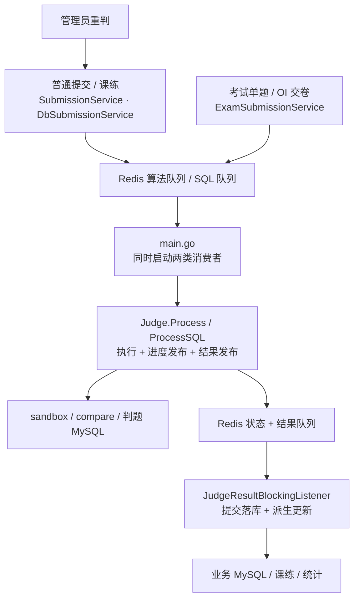
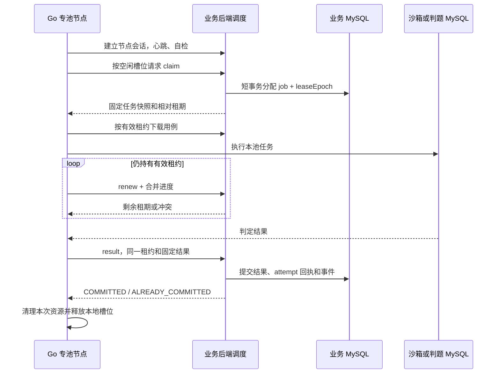

# KECE 评测机代码抽离与分池改造落地方案

本文承接 [评测机分池与扩容实施方案](./评测机分池与扩容实施方案.md)，将其中的目标拆成可以逐批开发、验证、上线和回滚的代码改造任务。

核查基线为仓库提交 `c15dfe0`。文中的现状和源码索引以该提交为准，实施进度见第 9.1 节。

后续接入改造以 [评测机 API 唯一接入改造落地方案](./评测机API唯一接入改造落地方案.md) 为准，其中列出了 URL 唯一入口、自动绑定和分组、旧节点迁移及接入码退役的具体修改。新方案开发中，本文既有 PR-00～PR-10 记录保持历史含义。

阅读入口：[文件与职责清单](#2-当前代码链路与抽离点) · [开发批次](#9-按提交批次执行的开发计划) · [灰度与回滚](#11-灰度切换与回滚操作清单) · [验收矩阵](#12-测试与验收矩阵) · [旧代码清理](#13-旧代码与残留的删除条件)

## 1. 最终要抽离成什么

保留一个代码仓库和一套 Go 执行内核，部署成 C++、Java、Python、ArkTS、MySQL 五个独立的评测池。每个节点只接一种运行时的任务，同池可以添加多个节点，后台负责注册、验证、启用和排空。

这里有三个不同的工作，必须分开完成。

| 工作 | 完成后的变化 | 可以验证的结果 |
| --- | --- | --- |
| 代码抽离 | 业务服务不再各自拼队列消息；评测内核不直接写 Redis 或业务成绩 | 不连接 Redis，也能用固定输入调用 Go 内核完成一次评测 |
| 运行分离 | 一个 Go 进程只启动本池所需的执行器和依赖 | Python 节点不需要判题 MySQL 凭据，MySQL 节点不检查 Java 镜像 |
| 调度扩容 | 后端保存任务、租约和结果；节点通过内部协议领单 | 后台新增第二台 Python 节点后，新任务能分配给两台，无须重发前后端 |

**实施顺序：先抽离现有职责并保持旧链路可用，再增加持久调度，最后逐池切换。** 不复制五份判题项目，也不在第一批重写比较算法、改评分标准或引入 Kubernetes。相同物理机上多开进程只提供隔离，增加实际吞吐仍取决于可用 CPU、内存和磁盘。

### 1.1 范围与保留项

| 纳入本次 | 保持现有行为 | 后续独立考虑 |
| --- | --- | --- |
| 编程题与 SQL 的普通提交、课练、考试、重判 | 提交 ID、对外查询接口、题目权限、成绩发布规则 | 业务后端与业务 MySQL 自身的多副本容灾 |
| Go 执行器与队列解耦、租约、节点管理、用例分发 | C++/Java/Python/ArkTS 的既有编译及判定语义 | 热容器复用、编译缓存、复杂公平调度算法 |
| 首页和顶栏真实状态、部署模板、旧代码清理 | SQL 的 SELECT/DML 和结果集比较语义 | 新的语言、新 SQL 方言、前端 AI 评测调度 |
| 持久任务、失败恢复、可追溯结算 | 客观题继续由 Java 业务侧同步判分 | 把 `judger/` 再拆为独立 Git 仓库 |

旧的 [算法优化方案](./算法优化与高可用高容错架构方案.md) 曾提出 Redis Streams 等路线。本次以 MySQL 持久任务为准，Redis 只用于新链路的唤醒和缓存；不要同时实现两套任务真相源。

## 2. 当前代码链路与抽离点



### 2.1 现有文件处理清单

下面路径均相对仓库根目录。实施时先按符号定位，避免依赖会变化的行号。

| 现有文件或位置 | 保留 | 抽出或替换 | 完成条件 |
| --- | --- | --- | --- |
| `backend/.../submission/service/SubmissionService.java` | 提交可见性、语言校验、用户上下文、查询权限 | 任务组装、Redis 投递、状态读写路由 | 普通提交和重判通过统一入口，类内不再拼评测队列 JSON |
| `backend/.../database/service/DbSubmissionService.java` | SQL 题权限、SQL 请求校验、对外 VO | SQL 任务快照、投递和评测状态适配 | 与代码题共享任务生命周期，保留 SQL 专属内容 |
| `backend/.../exam/service/ExamSubmissionService.java` | ACM/OI 规则、交卷和考生权限、分数换算 | `enqueueCode`、`enqueueDb` 的重复组装与队列操作 | 单题评测和交卷派单都能选新旧链路 |
| `backend/.../submission/listener/JudgeResultBlockingListener.java` | 迁移期旧队列消费、待结算恢复 | 成绩落库规则抽至业务结算实现 | 监听器只解释旧消息并调用结算，不成为新 HTTP 结果处理器 |
| `backend/.../practice/service/LessonPracticeService.java` | 作答次数、最佳分、排名业务规则 | 最近提交 ID 查询加 Redis 上下文兜底，改为持久关联 | A、B 两次提交倒序完成且 Redis 不可用时仍各有稳定关联 |
| `backend/.../question/service/TestCaseStorageService.java` | 公开样例读取和现有文件兼容 | 可覆盖文件路径作为新任务输入的方式 | 新任务引用不可变清单与内容摘要 |
| `judger/cmd/judger/main.go` | 配置装配、信号与日志入口 | 两类消费循环、租约、重投、心跳等运行逻辑 | 入口只选择 `legacy` 或 `pool` 模式并调用应用启动函数 |
| `judger/internal/judge/judge.go` | 用例执行与结果汇总规则 | `queue` 依赖、进度与终态写 Redis | 变成可独立调用的代码执行器 |
| `judger/internal/judge/sqljudge.go` | SQL 隔离和比较规则 | 与混合 Judge 的共享配置、结果发布 | 变成仅依赖专用判题 MySQL 的 SQL 执行器 |
| `judger/internal/queue/queue.go` | 灰度期旧链路所需能力 | 新模式对其的依赖 | 仅 `legacy` 模式引用，最终退役 |
| `judger/internal/sandbox/`、`internal/compare/` | 编译运行、判定、资源统计和比较测试 | 补取消、输出限制和租约归属清理 | 抽离后判定结果一致，失租后能停掉真实沙箱 |
| `judger/internal/model/model.go` | 旧 JSON 契约作为兼容模型 | 传输模型、内部输入、业务 VO 混用 | 旧消息、新机器协议、执行模型分别命名且显式转换 |
| `backend/.../system/service/SystemStatusService.java` | 旧状态接口兼容 | 固定算法/SQL 展示逻辑 | 新接口聚合已注册池和持久任务 |
| `frontend/src/components/ClusterConsole.vue`、`layouts/DefaultLayout.vue` | 黑白灰直角设计与布局位置 | 模拟状态、固定数量、重复轮询 | 首页和顶栏读同一份状态源 |

### 2.2 迁移前必须建立的入口账本

不能只改普通题库的“提交代码”。下列每条链路都要在测试和灰度记录中有独立结果。

| 业务入口 | 新建任务的时机 | 必须一起持久化的业务信息 |
| --- | --- | --- |
| 普通编程题 / SQL 题 | 新提交记录插入后、事务提交前 | 提交类型、ID、原始代码、题目版本 |
| 带课练上下文的提交 | 作答权限校验后，同一事务内 | 课练 ID、作答记录 ID、此次业务提交的稳定关联 |
| ACM 考试单题评测 | 考试状态及考生锁内 | 考试、考生、题目、试卷分值与提交关联 |
| OI 交卷批量派单 | 确认交卷的事务内 | 同次交卷生成的任务及完整题目关联 |
| 后台单条 / 批量重判 | 锁定可重判提交后 | 新 generation、当前任务指针、结果清空 |
| 删除题目 / 考试等清理 | 删除提交或引用之前 | 对应任务取消或不可再结算的标记 |
| 状态轮询 / 成绩与榜单读取 | 不产生任务 | 先鉴权，再按持久指针读当前任务状态 |

## 3. 目标目录与依赖方向

### 3.1 后端新增 `judging` 模块

以下为拟议目录。每个子目录按职责承载实现，不要求为每个类再建一层接口。

```text
backend/src/main/java/com/kece/
├── judging/
│   ├── contract/       SubmissionRef、JudgeRequest、JudgeReceipt、业务结算接口
│   ├── application/    任务创建、领取、续租、结算、回收、状态查询
│   ├── domain/         任务/池/节点状态、重试规则、运行时匹配
│   ├── persistence/    Mapper、实体及持久任务/租约/事件实现
│   ├── node/           注册、会话、凭据、自检、宿主机额度
│   ├── artifact/       清单发布、内容摘要存储、授权下载、回收
│   ├── api/admin/      后台节点与任务运维接口
│   ├── api/internal/   机器领单、续租、回传接口
│   ├── api/public/     公开池状态摘要
│   └── legacy/         旧 Redis 投递、状态读取及消息转换适配
├── submission/judging/   编程提交结果落库实现
├── database/judging/     SQL 提交结果落库实现
├── exam/                 考试规则、考生锁、幂等交卷仍留此处
└── practice/             课练规则、稳定提交关联、结算事件消费仍留此处

backend/src/main/resources/mapper/judging/  新增 Mapper XML
backend/src/main/resources/db/migration/  追加迁移，不改已执行迁移
```

业务层调用 `judging.contract`；调度实现只通过约定的结算接口更新业务结果，不反向调用整个 `SubmissionService` 或 `ExamSubmissionService`。编程题与 SQL 提交各提供一个结算实现，避免 Spring Bean 循环依赖。

### 3.2 Go 目录

```text
judger/
├── cmd/judger/main.go       选模式并启动
├── internal/
│   ├── app/                RunLegacy、RunPool，装配依赖
│   ├── worker/             领单循环、租约、执行槽位、结果确认、排空
│   ├── control/            后端 HTTP 客户端、机器协议 DTO、错误映射
│   ├── engine/             ExecutionTask、Verdict、Progress、Executor
│   │   ├── code/           从 judge.go 抽出的代码执行器
│   │   └── sql/            从 sqljudge.go 抽出的 SQL 执行器
│   ├── artifact/           摘要校验、下载、原子缓存、引用保护
│   ├── workspace/          本次租约目录、沙箱/临时资源登记与清理
│   ├── health/             内网健康端点及本池自检
│   ├── legacy/             旧消费循环、旧 Task/VO 转换和结果发布
│   ├── config/             公共配置 + 按运行模式/运行时校验
│   ├── queue/              暂留，仅旧模式引用
│   ├── sandbox/            复用并补齐取消和资源保护
│   └── compare/            复用现有比较实现和测试
└── docker/                 按运行时固定版本的镜像定义
```

最初可以保留原 `judge/` 文件位置，先改依赖再移动；“改行为”和“重命名文件”分提交，方便审查差异。旧 `model/` 中仍被兼容链路使用的类型不能提前删除。

### 3.3 前端新增位置

```text
frontend/src/
├── api/judgers.ts
├── features/judging/
│   ├── composables/useSubmissionMonitor.ts  保留用户评测轮询
│   ├── composables/useJudgeCluster.ts       新增共享集群状态
│   └── types.ts                            池/节点/快照类型
├── views/admin/AdminJudgersView.vue         节点管理
├── components/admin/judgers/
│   ├── JudgeNodeTable.vue
│   ├── JudgeNodeForm.vue
│   └── JudgeNodeDetail.vue
└── components/ClusterConsole.vue            原位置替换为真实池状态
```

浏览器始终访问业务后端。节点 URL、密钥、用例下载入口和机器认证不进入公开页面；管理员录入的地址也由后端探测。

## 4. 先定义四个稳定接口

### 4.1 业务提交调用接口

拟议 Java 入口如下，类型表达含义，具体命名在第一批实现时冻结。

```java
JudgeReceipt enqueue(JudgeRequest request);
JudgeReceipt rejudge(SubmissionRef ref, RejudgeRequest request);
JudgeStatus getStatus(SubmissionRef ref);
void cancel(SubmissionRef ref, CancelReason reason);
```

- `SubmissionRef` 固定为 `(ALGO | DATABASE, submissionId)`，不以单个数字 ID 标识任务。池名中的 `mysql`、业务类型 `DATABASE`、旧消息 `type=sql` 通过适配器明确转换。
- `JudgeRequest` 包含已校验的题目快照、提交引用、业务场景关联；客户端不得决定 pool、节点或资源上限。
- `enqueue/rejudge/cancel` 必须加入调用方当前事务，缺事务时明确失败。独立 Spring Bean 使用事务传播约束，不能靠同类方法自调用触发事务。
- `JudgeReceipt` 记录选中的 `LEGACY/POOL` 链路。新路径返回 `jobId` 和 `generation`，旧路径不伪造新任务指针。
- `getStatus` 只负责评测状态解析；对外查询仍先执行现有归属、考试发布等鉴权。
- 队列路由由一处配置决定，普通提交、课练、考试和重判不能各写一套开关判断。

Spring 默认代理模式下，同类自调用不会重新应用 `@Transactional`；新增事务入口要由外部 Bean 调用并用真实数据库测试验证。[Spring 事务说明](https://docs.spring.io/spring-framework/reference/data-access/transaction/declarative/annotations.html)

### 4.2 业务结算接口

结算由调度事务驱动，业务实现只操作自身提交表并返回派生事件，不负责 Redis 确认或租约重试。

```text
lockSubmission(ref) -> locked submission + currentJobId
applyResult(locked submission, validated verdict) -> settlement events
```

两种提交实现必须复用现有结果字段、考试原始百分制和分值换算口径。课练与每日通过统计通过持久事件处理，事件消费者负责自身幂等；不要把不同业务规则放进 Go 节点。

### 4.3 Go 执行接口

```go
type Executor interface {
    Execute(ctx context.Context, task ExecutionTask, report ProgressSink) (Verdict, error)
}
```

| 接口部分 | 明确规则 |
| --- | --- |
| `ExecutionTask` | 包含已解析的本地输入、运行时规格、限制、用例及权重；不含用户 JWT、Redis Key、业务数据库配置 |
| `Verdict` | 正常判定结果，包括 AC、WA、CE、TLE、MLE、RE；保留现有评分和详情结构 |
| `error` | 数据损坏、Docker/数据库不可用、失租取消等基础设施错误；由 worker 分类决定回传或等待回收 |
| `ProgressSink` | 仅报告阶段与完成用例数，支持合并和节流；其网络故障不能被解释为用户答案错误 |
| `ctx` | 覆盖下载后执行、编译和每个用例；取消后必须终止外部进程或 SQL，并等待受控清理 |

有两个真实执行实现：代码沙箱与 SQL。不要仅为 C++/Java/Python 各复制一个 `Execute`；四种代码运行时沿用共享流程，编译命令、入口文件和运行命令通过经过校验的运行时配置区分。

### 4.4 传输适配接口

`legacy` 负责把旧 Redis Task 转成 `ExecutionTask`，将进度和 `Verdict` 转回旧 VO；`worker + control` 负责新 HTTP 协议、租约和结果确认。内核对两者无感知。

这两个适配器必须用同一批固定样例验证结果一致。不要为兼容旧发布逻辑而让新执行器继续调用 `queue.PushResult`。

## 5. 数据与事务如何落地

### 5.1 新增持久记录

当前最新迁移为 `V25`。下表为迁移分组，实际文件版本在开发时取下一个空号，不预占版本。

| 迁移组 | 拟议内容 | 关键字段 / 约束 |
| --- | --- | --- |
| 节点与配置 | `judge_host_group`、`judge_node`、接入码及操作记录 | pool、host_group_id、期望状态、revision、session_epoch、运行时、自检版本、凭据摘要；URL 与凭据不得进入公共响应 |
| 自检 | `judge_node_check` | node_id、配置/镜像版本、分项结论、诊断任务引用；与业务成绩分开 |
| 任务与当前指针 | `judge_job`；两张 submission 表新增 `current_judge_job_id` | 唯一 `(submission_type, submission_id, generation)`；旧记录指针为 NULL |
| 尝试记录 | `judge_job_attempt` | 唯一 `(job_id, lease_epoch)`；node_id、session_epoch、开始/结束、失败分类、回执摘要；用于故障追踪与重复回传确认 |
| 下游事件与关联 | `judge_settlement_event`、稳定课练提交关联、每日统计贡献记录 | 事件唯一 `(job_id, event_type)`；关联/贡献以业务提交类型 + ID 唯一，不被“最新提交”覆盖 |
| 不可变用例 | `judge_manifest`、`judge_artifact`；题目当前清单引用 | 清单固定题目版本、限制、用例权重和文件摘要；文件按 SHA-256 索引，大小必须匹配 |
| 路由与幂等 | 持久池路由配置、考试路由快照、考试请求幂等记录及考生锁行 | `pool + route_revision`；幂等键绑定考生、考试、动作、正文摘要与响应；锁行以考试+考生唯一 |

`judge_job_attempt` 与清单元数据是对总方案的实现补充，用于回答“在哪台节点失败过”和“这次到底用了哪版用例”。无需再增加第三方消息中间件。

`judge_job` 的最小字段集应包含以下几组。

| 字段组 | 建议字段 |
| --- | --- |
| 身份 | `id BIGINT`、`submission_type VARCHAR(16)`、`submission_id BIGINT`、`generation INT` |
| 任务类别 | `kind` 为 `SUBMISSION` 或 `CHECK`，诊断任务另有 `check_id`、`required_node_id` |
| 路由 | `pool VARCHAR(16)`、`runtime_spec VARCHAR(64)`、`scene`、`route_revision` |
| 不可变输入 | `manifest_id`、`request_snapshot JSON`、`request_digest` |
| 状态 | `state`、`status_version BIGINT`、当前阶段/进度、`available_at DATETIME(6)`、`attempt_count`、`max_attempts` |
| 所有权 | `node_id`、`host_group_id`、`session_epoch BIGINT`、`lease_epoch BIGINT`、`lease_until DATETIME(6)` |
| 结果 | `result_json`、`result_digest`、`last_error_code`、`created_at`、`finished_at` |

调度时间统一用数据库 UTC；不要直接把现有以北京时间展示的业务时间字段改语义。Java/Go 时间转换和序列化要写兼容测试。

诊断复用 job、attempt 和租约机制，但 `kind=CHECK` 只关联 `judge_node_check`，提交类型/ID/代次为空；业务任务则要求这些字段非空。以数据库约束和应用校验禁止两类身份混用。诊断任务绑定指定节点、消耗同一宿主机额度，不产生用户成绩或结算事件。未启用但已认证的节点只可领取自己的诊断任务；公开排队数只统计 `SUBMISSION`。

### 5.2 索引和配额

至少建立 `(pool, state, available_at, id)`、`(state, lease_until, id)`、`(node_id, state)`、`(host_group_id, state)` 索引。运行时规格筛选是否进入领取索引，根据实际 `EXPLAIN` 与数据分布确定。

领取只扫描当前池可执行任务，事务隔离采用明确的读已提交语义。对队列表使用 `FOR UPDATE SKIP LOCKED` 可以跳过已被其他领取事务锁定的行；该用法适合队列，不作为普通业务一致性读取的替代。[MySQL 锁定读取说明](https://dev.mysql.com/doc/refman/8.0/en/innodb-locking-reads.html)

首期用已持久化在途任务计数和行锁控制额度，不维护另一份容易漂移的 Redis 活跃计数。限额为 `min(节点报告空位, 节点配置余量, 宿主机余量, 协议批量上限)`，过期但尚未回收的任务也占位。下调额度不杀正在执行的任务。

### 5.3 五个事务边界

| 事务 | 原子内容 | 事务外行为 |
| --- | --- | --- |
| 接收提交 | 提交记录 + 课练/考试关联 + job + 当前 job 指针 | 提交后发唤醒和写缓存，失败不撤销已接收任务 |
| 领取 | 锁分组/节点，校验容量和状态，锁 job，增加 lease_epoch，插 attempt | 下载、编译、执行、等待长轮询 |
| 续租 | 校验节点会话与 job 所有权，更新 lease_until | 节流发布进度 |
| 结算 | 锁节点、提交、job，验证所有权与当前指针，写结果/终态/attempt 回执/事件 | 发布终态缓存，异步派生更新 |
| 重判 / 取消 | 锁提交后锁关联 job，更新代次或取消标记及当前指针 | 通知节点尽快停止，最终由续租/到期约束兜底 |

全局锁顺序为宿主机分组 → 节点 → 业务提交 → job → attempt。每条路径只取需要的锁。回收器先无锁或短读找候选 ID，再逐个按该顺序复核，不得拿着 job 锁反向申请提交锁。

Redis 通知不是接收成功的依据。唤醒可能丢失，新节点仍需周期性补领；事务提交后通知失败不能对用户返回“提交失败”而诱发重复提交。[Redis Pub/Sub 投递语义](https://redis.io/docs/latest/develop/pubsub/#delivery-semantics)

### 5.4 结果、重判和缓存防覆盖

1. 结算核对 `(jobId, nodeId, sessionEpoch, leaseEpoch)`，再核对业务提交的 `current_judge_job_id`。源代码和题目编号不能用作结算身份。
2. 重复回传相同已确认结果返回 `ALREADY_COMMITTED`；服务端规范化并计算摘要，冲突结果返回 `409`。已确认回执的检查先于“租约已过期”检查，但仍校验身份与当前任务归属。
3. 编译错误或答案错误进入 `COMPLETED` 并携带相应 verdict；基础设施失败退避重试，耗尽后 job 为 `FAILED`、业务状态为 `SYSTEM_ERROR`。
4. 基础设施重试沿用同一 job 和快照，增加 lease_epoch；人工重判创建新 job 和 generation。不要把两者混成一次新业务提交。
5. 新缓存使用 `judge:status:{type}:{submissionId}:{jobId}`。查询先拿持久当前指针再读对应缓存，旧 Redis Key 不作为新链路依据。状态变更和进度确认产生单调 `status_version`，缓存附 jobId/leaseEpoch/version，以条件写入拒绝较旧版本；数据库已终态时直接以持久结果为准，防止延迟的 PENDING/进度刷新覆盖终态。
6. 旧监听器锁定提交并确认当前指针为 NULL 后才写结果。已经迁入新链路的提交，即使收到旧结果也不能被覆盖。新结果入库前校验允许的终态、分数范围、用例 ID/数量与 manifest 对应关系及日志长度，拒绝格式异常或越界回传。
7. 正确性优先保留持久指针读取；后续若缓存指针，必须补齐版本与一致性设计，不能仅依赖“删除缓存应该成功”。

### 5.5 课练、考试与统计的补充改造

| 位置 / 现状 | 具体改法 | 验收 |
| --- | --- | --- |
| `AlgoQuestionStrategy.extractJudgeInfo`、`DbQuestionStrategy.extractJudgeInfo` 也读取旧状态缓存 | 改读统一 `JudgeStatus`，保持策略返回类型；`findLatestContestSubmission` 的考试范围继续保留 | 题库结果页、课练回调、考试成绩查询得到同一有效结果 |
| `LessonPracticeService` 先查提交 ID，再用有时效的 Redis 上下文兜底 | 建立“每次提交 → 作答”的稳定关联；事件以该关联定位，行锁下重算最佳分、最佳提交及首次达成时间 | A 后 B、B 先完成，A 的结果不丢；Redis 丢失不丢关联，重复事件不增加尝试次数 |
| 考试结果通过 `myResults` 等查询关联最新考试提交 | 保留现有查询口径，明确关联实际提交 ID 和题目；不新增另一套相互覆盖的考试异步成绩表 | ACM 已评测题交卷不重复派单，OI 一次交卷每题只创建一个 job |
| `saveAnswer`、`submitQuestion`、`submit` 都会影响同一考生 | 使用数据库中的考试+考生锁行，按同一顺序串行化；交卷标记与任务同事务；请求幂等键相同且正文不同返回冲突 | 保存与交卷竞态、重复交卷、网络重试不会覆盖已交卷答案或重复派单 |
| `UserDailyAcService` 当前只增量加一并捕获异常 | 增加按 `(submission_type, submission_id)` 唯一的成绩贡献记录，与每日聚合修正同事务；异常保留可重试事件 | 同一提交重复回传、反复重判 AC 不重复增加；AC 改判 WA 能修正贡献 |
| 题集进度等派生更新 | 在持久事件处理中读取当前有效提交结果，按用户+题目锁或原子更新；事件处理完成标记与持久变化一同提交 | 多份提交同时 AC、旧事件晚于重判事件均不产生重复或回退 |

每日统计建议继续以业务提交的原创建日期归属，重判不改变日期。新判定完成前保留该提交上一份已确认贡献，终态到达后再做 0/1 差额更新。回填已有贡献记录并重算聚合后才能切换消费者，不能在原计数上无账本地再次累加。现有客观题统计不改；若共用聚合表，需保留其数据列。这里修复的是重复计数和恢复能力，不将“AC 提交数”悄悄改成“去重通过题数”。

事件消费先定位业务对象，再按约定锁业务行和事件行；不要先长期持有事件锁，再回调持提交锁的结算路径。使用可过期的事件处理租约或条件更新，多后端实例也只能产生一次有效持久变更。缓存失效仍可重试，不能在数据库更新失败后把事件标为已完成。

### 5.6 用例版本发布与删除

1. 代码题保存、编辑、导入先将输入/标准输出写入摘要存储，关闭并校验文件后再发布 manifest。数据库事务只发布完整清单引用；失败文件由延迟 GC 回收。
2. SQL 清单同时冻结 DDL、seed、参考 SQL、验证 SQL、排序要求与预计算输出，不能只给 SQL 用例编号。
3. 已提交任务引用原 manifest，题目修改生成新版本。缺文件或摘要错误属于系统故障，不能回退成空标准答案。
4. `TestCaseStorageService.init` 当前从 `@PostConstruct` 调用带事务标注的迁移方法。新回填改为独立受控命令或 Bean，分批、可续跑、输出缺失文件清单；不把全量迁移挂在应用启动中。
5. 删除题目、考试前先锁提交并取消相关任务，然后按原权限执行删除。仅删除课练或移除课练题目时，通常是移除关联，不应连带取消仍可在题库查询的业务提交；事件消费者将已删除关联记为完成且不再更新。
6. manifest 和 artifact 的 GC 只回收没有存量任务/历史保留引用的版本，给在途下载留保护期。保存题目的失败清单和任务引用都必须可对账。

### 5.7 状态迁移与失败处理

| 当前状态 | 触发条件 | 新状态与副作用 |
| --- | --- | --- |
| 无任务 | 业务接受事务成功 | `QUEUED`，固定快照和当前指针 |
| `QUEUED` | 可用时间已到，节点/运行时/额度符合 | `RUNNING`，增加租约代次并记录 attempt |
| `RUNNING` | 同一有效租约续租 | 保持 `RUNNING`，延长截止时间，进度只能向前 |
| `RUNNING` | 合法判定结果，包括 CE/WA/TLE | `COMPLETED`，同事务写业务终态和结算事件 |
| `RUNNING` | 基础设施失败或租约过期，仍可重试 | `QUEUED`，结束本次 attempt，设置退避时间，下一次领取产生新租约 |
| `RUNNING` | 基础设施失败/过期且尝试耗尽 | `FAILED`，业务显示 `SYSTEM_ERROR`，保留错误和人工重判入口 |
| `QUEUED/RUNNING` | 关联业务被删除或明确取消 | `CANCELLED`，后续续租/回传拒绝，节点清理资源 |
| 业务终态 | 管理员重判 | 新建 generation，不修改旧 job 的历史终态 |

`COMPLETED/FAILED/CANCELLED` 记录不可重新领取。首次业务状态映射为 `PENDING`，运行阶段为 `COMPILING/JUDGING`；临时退避仍可显示 `PENDING` 并附原因。取消首期只用于业务删除等后台流程，保持现有用户状态枚举，不新增一个无法被结果页识别的终态。

诊断任务走同样的执行和尝试状态，结算只写 check 记录。节点配置态与观测健康分开：`PENDING_VERIFICATION → ENABLED → DRAINING → DISABLED`，健康变化不自动覆盖管理员配置；失效自检或运行时版本变化暂停正式领取并要求重新验证。

## 6. Go 抽离的具体做法

### 6.1 第一批只解耦执行与发布

按以下次序拆 `Judge`，每步保持旧模式可运行。

1. 把 `model.Task` 转换为内部 `ExecutionTask`；明确代码任务与 SQL 任务的必填字段，拒绝混合或未知任务。
2. `Process` 的 `publish/writeStatus` 改为调用 `ProgressSink`；`finish*` 改为返回 `Verdict`。评分汇总、权重、入口文件提取先保持原实现。
3. `ProcessSQL` 同样返回结果，SQL 连接池、凭据和临时资源由 SQL 执行器单独持有。代码执行器只取得本池运行时与沙箱配置。
4. 旧消费循环负责 `Task → ExecutionTask → Verdict → SubmissionVO` 转换，继续使用现有 `PublishTerminal` 协议。只有结果发布成功才确认旧 processing 项。
5. 把消费、续租、心跳、reaper 和关闭逻辑从 `main.go` 搬到 `legacy`；加入模式选择，迁移期默认仍为 `legacy`。
6. 使用同一组固定输入验证搬迁前后 verdict、score、用例报告一致。耗时、内存等测量值按合理区间比较，不要求逐字节相等。

不设计把旧 Redis ACK 和新租约混为一体的“万能队列接口”。两条链路共享执行内核，但各自保留清楚的生命周期适配。

### 6.2 专池 worker 生命周期



每个节点至多挂一个领单长轮询，请求等待期间不占数据库事务或连接。响应丢失时不假定已领单任务已释放；后端在途额度继续占用，最终到期回收。worker 不在不知道任务身份时启动执行。

| 配置 | 联调初值 | 行为 |
| --- | --- | --- |
| 心跳 / 离线判断 | 10 秒 / 30 秒 | 存活与可接单健康分开，依赖故障时可以在线但不可接单 |
| 租约 / 续租 | 60 秒 / 15 秒 | 使用服务端剩余租期与本地单调时钟，续租失败进入有界停止期限 |
| 回收扫描 | 5 秒 | 小批找过期任务，条件更新复核，不全表扫描 |
| claim 等待 | 最长 15 秒 | HTTP 超时略大于等待值，空响应之后带抖动重试 |
| 最大执行尝试 | 3 次 | 仅基础设施故障重试，指数退避并限定最大延迟 |
| 任务总时限 | 按运行时/用例规模配置 | 单独约束下载、编译、全部测试与清理，不能以单个测试点时限替代 |

以上是实现与故障测试初值，不是现网性能承诺。本地截止点保守地由本次请求发出时的单调时钟加服务端剩余租期、再减安全余量计算，不能从收到延迟响应时重新计算完整租期。剩余时间不足或续租失败达到安全余量后，worker 必须停止真实执行。仅触发 Go context 取消不会等待外部工作结束，需要显式等待与清理。[Go context 文档](https://pkg.go.dev/context)

### 6.3 沙箱与 SQL 的必改项

| 问题 | 改造要求 | 放行证据 |
| --- | --- | --- |
| 停止 Docker CLI 不等于容器已停止 | 编译/运行容器登记 ID，附 node/job/lease 标签；失租显式停止和删除；清理用独立有界 context | 租约失效后确认容器进程消失，旧结果被拒绝 |
| 先完整收集输出再截断仍可占满内存 | stdout/stderr 在采集阶段限流、截断或停止超量执行，结果 JSON 也限体积 | 大输出任务不拖垮 worker，判定与约定一致 |
| 任务目录和统计文件信任混合 | 源码/产物可写区与受信输入、标准输出、资源统计分离；拒绝符号链接、管道等非普通文件 | 用户程序不能读取标准答案或伪造统计文件 |
| 工作目录当前按提交 ID 组织 | 改为节点 + jobId + leaseEpoch 的目录与资源归属 | ALGO 与 SQL 同 ID、重判、接管没有文件串用 |
| Docker/运行时错误可能混入普通退出码 | 保留现有退出码分类，另区分镜像缺失、daemon 故障、节点内存不足等基础设施错误 | Docker 停止时不把全部任务判为学生 CE/RE |
| SQL 临时库/账号仅依赖延迟清理 | 建受信资源登记，绑定 job/epoch、创建时间和实例；重启后 janitor 逐项复核清理 | 强杀节点后没有永久遗留账号或库，不误删新租约资源 |
| SQL 多节点共享实例可能过量连接 | 首版每个 MySQL 节点绑定专用判题实例，连接池预留清理额度；共享实例必须另有统一连接/资源总预算才允许启用 | SQL 失效不占用其他语言节点的执行额度或业务库连接 |
| 所有镜像一起预热 | 按本池检查镜像摘要、编译器/运行时版本 | Python 节点没有 Java 镜像仍能正常注册和自检 |

worker 使用宿主 Docker socket 时，实际沙箱是宿主机上的其他容器；需要限制这些沙箱的 CPU、内存、进程和父 cgroup。只限制 worker 容器不够。新生产模板不继承旧开发 Compose 的 `privileged: true`。[Docker 资源限制](https://docs.docker.com/engine/containers/resource_constraints/)

## 7. 机器协议与后台接入

### 7.1 先冻结协议，再同时开发两端

新增 `docs/contracts/judger-v1.openapi.yaml` 和固定 JSON 样本，用 Java/Go 契约测试读取同一批样本。下表省略共同前缀 `/api/v1`；实现时核对现有 servlet context，防止重复添加前缀。

| 接口 | 请求重点 | 成功 / 失败行为 |
| --- | --- | --- |
| `POST /internal/judgers/join` | 一次性接入码、节点协议及运行时 | 返回只展示一次的节点凭据；码过期或已消费拒绝。响应丢失由管理员重新发码，不能匿名取回原凭据 |
| `POST /internal/judgers/session` | 节点凭据、bootId | 相同 bootId 重试返回同一会话。新启动产生新代次；旧进程不得因一次 409 自动重建会话与新进程争抢 |
| `POST /internal/judgers/heartbeat` | 当前会话、运行时版本、依赖健康、本地限制 | 返回期望状态和配置版本；心跳时间取服务端收到请求的时间 |
| `POST /internal/judgers/jobs/claim` | 可用槽位、等待毫秒数 | 无任务返回空数组；节点身份、池和资源组从认证上下文确定 |
| `POST /internal/judgers/jobs/renew` | jobId、leaseEpoch、进度序号 | 逐项返回续租成功或过期/取消，旧进度不得覆盖新阶段 |
| `GET /internal/judgers/jobs/{id}/artifacts/{digest}` | 节点会话与租约头 | 只返回该任务清单允许的内容，流式下载、有大小与摘要校验 |
| `POST /internal/judgers/jobs/{id}/result` | 租约、判定或基础设施错误 | 200 确认已落库/重复确认/已安排重试；409 明确失去归属；5xx 才按有界策略重传 |
| 节点 `GET /healthz` | 独立探测身份 | 只展示协议、节点身份、本池运行时和依赖健康；不开放任意命令或任意评测入口 |

上述表格路径以 `/api/v1` 为共同前缀，省略重复书写。机器协议采用明确 HTTP 状态和结构化错误码，管理与公共接口继续使用项目已有 `ApiResponse`。协议主版本不兼容就拒绝启用；向后兼容的可选字段不得改变旧字段含义。

首版领取响应示例，代码在本例中以内联小文件给出，用例通过 manifest 授权下载。

```json
{
  "protocolVersion": 1,
  "jobs": [{
    "jobId": "381",
    "submissionType": "ALGO",
    "submissionId": "204",
    "generation": 1,
    "pool": "python",
    "runtimeSpec": "python-runtime-r1",
    "leaseEpoch": 2,
    "leaseRemainingMs": 59000,
    "manifestId": "301",
    "codeContent": { "main.py": "a, b = map(int, input().split())\nprint(a + b)\n" },
    "limits": { "timeLimitMs": 1000, "memoryLimitMb": 256 }
  }]
}
```

新机器与管理协议的 BIGINT 标识按字符串传输，避免浏览器整数精度问题；现有对用户提交 API 的数字 ID 暂保持兼容，转换集中在边界。源码、结果、日志、批量个数与下载均设上限。上限需覆盖存量合法题目，超限不能静默截断成一个可能错误的判题任务。

客户端错误处理一并冻结：401/403 停止领取并报告认证问题；409 终止对应失效租约；413/422 表示请求不合约，不原样无限重试；429 按服务端建议退避；网络故障/5xx 仅在合法租约和重试期限内重传同一份结果。失去会话后先停止旧执行，不靠重新登录继续使用旧租约。

### 7.2 节点管理必须包含的操作

管理路径为 `/api/v1/admin/judgers`，宿主机分组使用 `/api/v1/admin/judge-host-groups`。

| 操作 | 具体交互与约束 |
| --- | --- |
| 新增节点 | 填名称、池、批准内网 HTTPS 地址、宿主机分组、槽位；初态 `PENDING_VERIFICATION`；生成 10 分钟有效的接入码 |
| 连通与自检 | 异步生成 checkId；区分 TLS/身份、协议、运行时、资源限额、清理几个步骤；诊断任务只允许目标节点领取，并占本机额度 |
| 启用 | 自检通过、心跳新鲜、配置/镜像版本一致后转 `ENABLED`；未验证节点不能领正式任务 |
| 调整槽位 | revision 乐观锁；上调不能突破宿主机总额，下调自然收敛；展示实际配置与本地硬上限 |
| 排空 | 转 `DRAINING`，停止新领取，续租和结果仍有效；显示剩余任务，归零后才提示可以停机 |
| 停用 / 吊销 | 正常停用只允许无在途租约；紧急吊销凭据使旧会话失效，旧任务按恢复规则处理，独立记录操作原因 |
| 重置接入码 / 轮换凭据 | 不显示旧凭据；明确单节点影响，记录操作人及凭据版本；优先排空后轮换 |
| 节点详情 | 运行时、宿主机、配置态、观测健康、有效租约、近期尝试与错误、自检、审计记录 |

同一 nodeId 首版不允许克隆为两个独立进程；新增实例必须新登记节点。session 重新建立也不立即释放旧任务配额，等旧租约按期限结束或完成确认清理，防止双实例挤占宿主机。

### 7.3 机器鉴权与探测范围

`AuthInterceptor` 当前对没有 `RequireRole` 的方法放行，不能直接承担机器鉴权。新增专用拦截器匹配 `/internal/judgers/**`，除受限的 join 外默认拒绝无机器凭据请求；用户 JWT 不可替代节点凭据，凭据只从请求头读取。

后台 API 必须 `ADMIN`；前端父后台路由也允许教师，新增页要单独声明 ADMIN，不能只隐藏菜单。`WebConfig` 明确用户/机器拦截器覆盖范围，并测试“漏注解的内部方法也拒绝匿名”。公开反代封闭内部路径，内网监听或 VPN 提供机器访问；生产 Nginx 规则需要上线时实查，本次没有据此假定规则已经存在。

后台添加 API 地址会让服务器发起探测，必须限制批准域名/网段和端口，固定探测路径、校验全部 DNS 结果并绑定实际连接地址，保留证书校验，关闭重定向、限制响应大小和超时。探测凭据与领单凭据分开，不能向用户填写的 URL 发送通用管理密钥。[OWASP SSRF 防护指南](https://cheatsheetseries.owasp.org/cheatsheets/Server_Side_Request_Forgery_Prevention_Cheat_Sheet.html)

## 8. 前端如何跟随抽离

### 8.1 首页与顶栏

新增 `/api/v1/system/judgers/summary`，固定含 `asOf`、`freshness`、`readyPools`、`totalPools`、每池状态和排队数。不把物理节点数量和运行时池数量混在一个分母里。

`DefaultLayout` 创建唯一状态源，通过 typed provide/inject 给顶栏和 `ClusterConsole`。页面可见时约 30 秒刷新，隐藏暂停；只允许一个请求在途，卸载取消，迟到响应不能覆盖新数据。成功收到旧快照不能把 `asOf` 改成客户端当前时间。

| 原文件 | 具体变更 |
| --- | --- |
| `frontend/src/api/system.ts` | 保留旧 `getClusterStatus` 至观察期结束；新增摘要契约时保留同文件演示代码 API |
| `ClusterConsole.vue` | 移除预填 2/2 在线、两个 8 槽节点、6 秒倒计时、扫描线/倾斜及旧 CSS；保留原布局位置，改为五池条状列表 |
| `DefaultLayout.vue` | 删除写死 `CLUSTER: 2/2 ONLINE`，与首页显示相同可用池数和过期状态 |
| `HomeView.vue` | 只改组件连接与响应式容器，不触碰演示代码或其他首页模块 |

首次加载显示等高骨架；失败且没有旧数据时显示“状态暂不可用”；有旧数据时显示“数据已过期”和真实快照时间。未切换池标为“待切换”，不将旧混合 worker 心跳冒充五个独立健康池。

### 8.2 管理页

在“评测与内容”加入“评测机管理”，使用独立服务器图标。复用现有 `DataTable`、`FormField`、`Pagination`、`usePagedQuery`、确认框和 toast，不再建立一套通用后台 UI。

节点列表列出：节点、池、宿主机、配置状态、健康、执行中/上限、最后心跳、运行时、操作。健康与配置分列，能清楚表达“已启用但离线”和“健康但排空”。节点详情展示近期 attempt 和自检，不把内部堆栈显示给公开用户。

### 8.3 提交结果页兼容

保留 `submissionId/status/result/progress`。可以新增 `waitReason`，但不能把 job 的 `QUEUED/COMPLETED` 直接替换用户看到的 `PENDING/ACCEPTED`。

顺带修复 `useSubmissionMonitor` 的现有竞态：定时请求发出后会再次比较已改变的 `activeId`，A 的响应可能覆盖新选择的 B。每次请求捕获 targetId 和 generation，切换、stop、卸载使 generation 失效；响应、异常、后续定时安排都重新验证。补 A→B、A→B→A、停止后迟到响应测试。

页面轮询超过当前两分钟提示，只表示页面停止自动查询，不能把后台持久任务判为失败。页面应保留“查看提交记录/重新查询”，排队提示不自动再次提交源代码。

## 9. 按提交批次执行的开发计划

每批以可独立审查的代码提交或 PR 交付，包含迁移、必要测试和运行说明。下面的顺序避免第一批就同时更换数据库、协议和运行模式。

### PR-00 · 固定现状和协议样本

- **改动位置**：`judger/internal/judge/*_test.go`、现有后端 submission/exam 测试、新增 `docs/contracts/`。
- **工作**：保存五个运行时的合法任务与结果样本；覆盖有权重/无权重、SQL SELECT/DML、空输出、代码与 SQL 同数字 ID；记录旧 Redis 结果的 `submissionId + 换行 + JSON` 格式。
- **额外交付**：列出所有投递、状态读、结果落库、重判、删除调用点，确认 Go 依赖和本机开发启动方式。
- **验收**：基线测试能复现当前行为，关键样例可在隔离的真实 Linux Docker/MySQL 环境运行；缺环境的项明确标为未验证。
- **上线影响**：无运行行为改变，后续批次共同依赖这一批。

### PR-01 · Go 执行内核与传输解耦

- **改动位置**：`main.go`、`judge.go`、`sqljudge.go`、`model.go`，新增 `engine/`、`legacy/`、`app/`。
- **工作**：按第 6.1 节抽离，保留旧消费者；拆代码和 SQL 配置，给执行输入和结果加类型；移动测试而非丢弃已有评分回归。
- **验收**：执行内核不 import `queue` 或 `control`；旧后端配新兼容 worker 能正常完成任务；两个数字相同但类型不同的提交不串结果。
- **回滚**：恢复旧 worker 版本即可；这一批不切队列、不新增正式分池任务。

### PR-02 · Java 统一入口与业务结算

- **改动位置**：三个提交 Service、旧结果 Listener、两种 `QuestionStrategy`；新增 `judging/contract`、`application`、`legacy` 与业务结算实现。
- **工作**：提取代码/SQL 快照组装公共逻辑，普通、课练、考试、重判统一调用；状态查询统一；旧监听改调用业务结算实现。先运行旧路由，避免同时改变投递可靠性和调用结构。
- **验收**：旧队列协议不变；所有业务入口回归通过；原始分值、隐藏用例脱敏与考试成绩发布行为一致；没有 Bean 循环依赖。
- **限制**：这一批仅抽代码，不能据此宣称 MySQL/Redis 双写窗口已经解决。可靠性保证在持久任务批完成。

### PR-03 · 持久任务、关联和事务

- **改动位置**：Flyway、submission/db_submission 实体与 Mapper、新 `judging/persistence`、课练/考试关联、每日统计贡献记录。
- **工作**：新增第 5 节数据；事务内写 job 与当前指针；实现逐池/场景路由配置；旧监听加当前指针保护；完善课练稳定关联和考试幂等；引入结算事件及贡献回填。
- **验收**：任一写入失败全部回滚；新事务提交后 Redis 不可用仍能查询已接收任务；在新路由无节点时返回持久 `PENDING` 和明确等待原因；重复交卷不创建额外任务。
- **发布规则**：可先发布兼容 schema 与代码，所有正式池保持旧路由；新任务只对测试请求开放，不能让正式任务进入没有可用执行节点的新链路。

### PR-04 · 用例版本化与跨机交付

- **改动位置**：`TestCaseStorageService`、题目保存/导入/删除路径；新增 `judging/artifact` 和 Go `artifact/`。
- **工作**：可续跑回填已有题目；发布完整 manifest；实现租约授权下载、同摘要下载合并、临时文件原子发布、活跃引用保护及 GC；SQL 固定全部参考输入。
- **验收**：节点无后端本地目录挂载也能评测；修改题目不改变在途任务；损坏或缺失用例拒绝执行，合法空输出仍正确；断点/重试下载不发布半文件。
- **依赖**：新池正式使用前必须完成此批。先在一台机器共享可变目录跑通不能代替跨机验收。

### PR-05 · 节点控制与调度后端

- **改动位置**：`judging/node`、内部/管理 Controller、`WebConfig`、专用机器拦截器、领取/续租/结算/回收事务。
- **工作**：注册与会话、host group、健康、自检、节点状态机；租约 epoch、幂等回执和事件重试；安全探测；异步有界 claim 等待。
- **验收**：两个模拟节点争抢同任务只产生一个有效租约；同宿主机两池不超总额；迟到结果与越权访问拒绝；两个后端实例同时扫描可安全工作。
- **放行范围**：接口和调度通过真实 MySQL 锁测试，正式流量仍未切换。

### PR-06 · Python 双节点闭环

- **改动位置**：Go `worker`、`control`、`health`、`config`、`workspace`、沙箱取消与输出限制、分池部署模板。
- **工作**：先实现一个完整 Python 池。两个独立 nodeId 领单、下载、续租、回传、排空；正常退出与强杀清理分别验证。
- **验收**：两节点真实执行；丢 claim 响应、丢结果 ACK、断续租、强杀节点后任务能收敛；旧租约不改变有效成绩；达到期限时真实容器已停止。
- **优先目标**：做到“普通 Python 提交 → 持久任务 → 任一节点 → 正确落库”，再覆盖课练与考试；这是一条完整闭环，不用五个只显示在线的节点代替。

### PR-07 · 后台节点管理与公开状态

- **改动位置**：`AdminJudgersView.vue`、节点组件/API、`AdminLayout.vue`、router、共享状态 composable、`ClusterConsole.vue`、`DefaultLayout.vue`。
- **工作**：注册→检查→自检→启用→排空；host group 配置与节点详情；真实池摘要；修复用户提交轮询竞态。
- **验收**：管理员从界面新增第二台 Python 节点后自动分单；教师不能管理；过期摘要与真实离线分得清；390/1280/1703 px、100% 缩放无溢出。
- **依赖**：可在 PR-05 的契约冻结后并行开发，但必须连真实后端完成验收。

### PR-08 · 其余运行时与全部业务入口

- **改动位置**：运行时规格、SQL 执行器与清理、配置、五池镜像/节点模板、各业务回归。
- **工作**：依次接 C++、Java、ArkTS、MySQL。每池核对编译/运行版本、时限/内存、比较逻辑；MySQL 专测权限、连接预算和崩溃清理。
- **验收**：各运行时覆盖适用的普通、课练、ACM、OI、重判入口；已删除业务不被迟到结果复活；异构主机同题判定一致，性能阈值有基线。
- **限制**：不能因为共用代码执行器就跳过 Java/ArkTS 的编译和资源测试。SQL 最后切，独立处理其外部状态清理。

### PR-09 · 灰度、对账与真实容量报告

- **改动位置**：持久路由配置、对账命令、隔离压测脚本、部署操作手册及报告。
- **工作**：按第 11 节逐池切换；每次记录 route revision、节点版本、job 范围；在隔离环境跑 30/100/300 次同池与混合突发，核对接收和终态。
- **验收**：业务与任务可逐单追溯，无跨池执行、无重复有效成绩；故障测试符合第 12 节；给出实测吞吐、排队和末单完成时间，而非只报 HTTP 接收速度。
- **回滚**：使用已验证的兼容发布包；已有新任务继续由新链路处理，禁止复制进旧队列。

### PR-10 · 退役旧代码与交付

- **改动位置**：旧 Redis 适配与配置、旧监听/遥测、Go 依赖、启动脚本、文档与架构图。
- **工作**：按第 13 节逐项清理；保留历史提交结果的数据库读取能力，保留必要审计数据。
- **验收**：代码中没有有效旧队列生产者或消费者；后台增加、排空和重启一个节点不影响其他池；开发、测试、部署文档与实际一致。
- **交付**：完成清单、测试结果、切流记录、回滚版本、压测报告。到这一步才称本次抽离完成。

### 9.1 依赖关系与第一批开工范围

```text
PR-00 → PR-01（Go 抽离）
      → PR-02 → PR-03 → PR-04（用例）
                     → PR-05（控制面）
PR-01 + PR-04 + PR-05 → PR-06（Python 闭环）
PR-05 → PR-07（管理与状态，可与 Go 开发并行）
PR-06 + PR-07 → PR-08 → PR-09 → PR-10
```

第一批实际开发范围限定为 PR-00、PR-01、PR-02：交付可复用执行器和统一后端入口，旧模式完整运行。第二批再引入数据库与机器协议。这样代码审查能区分“搬移行为是否一致”和“新调度是否正确”两类问题。

第一批已落地。Go 执行器保留在 `internal/judge`，代码和 SQL 各有独立输入与配置；PR-01～PR-09 过渡期的 `internal/legacy` 已在 PR-10 退役，跨语言机器协议规范与固定契约样本保存在 [judger-v1.openapi.yaml](./contracts/judger-v1.openapi.yaml) 与 [contracts/samples](./contracts/samples/)。Java 由 `JudgeDispatch` 集中组装任务及读取状态，编程和 SQL 各自的结算类负责写入业务结果。

第一批使用隔离 Redis、MySQL 和真实 Docker 镜像验证了四种编程运行时及 SQL SELECT/DML，覆盖相同数字提交 ID、答案错误、编译错误和 SQL 权限隔离。

PR-03 增加 V26～V28 迁移。提交、持久任务和当前任务指针共用一个事务。轮询先读取指针；持久任务等待执行时返回 `PENDING` 和 `WAITING_FOR_WORKER`。旧结果落库前检查指针，同一持久提交重判时递增代次。

持久派单默认关闭。隔离测试需要同时设置 `kece.judging.persistent-ingress-enabled=true`，并在 `judge_pool_route` 为目标运行时与场景设置 `PERSISTENT`。没有匹配记录的首次派单走旧队列。OI 交卷使用同一事务的路由视图。考试保存、单题提交和交卷可通过 `Idempotency-Key` 重放原回执。课练按提交类型和 ID 保存作答绑定，每日 AC 统计按同一标识记录贡献。

V26 已建立结算事件表。事件生产、节点领单及回传在控制面批次接入，正式切流前还需完成不可变用例清单和删除取消链路。

PR-04 增加 V29。编程题与 SQL 题保存时发布用例清单，持久任务固定引用清单 ID。文件按 SHA-256 存放在 `kece.judging.artifacts-dir`（默认 `data/judge-artifacts`）。新任务的请求快照仅含提交源码及路由所需字段。V29 前的测试任务未保存清单，后续领取必须排除这些任务。

存量回填通过管理员接口 `POST /api/v1/admin/judging/manifests/backfill?type=ALGO&afterId=0&limit=5` 执行，SQL 使用 `type=DATABASE`。用 `nextAfterId` 继续，按 `failures` 修复缺失文件后可重跑原游标。每题独立提交；同一版本重复发布会复用清单。新版用例回填由该接口触发。

下载接口校验当前任务、租约期限及清单中的文件归属。PR-05 领单时为每次租约生成 32 字节随机值，采用不带填充的 Base64URL 编码，数据库仅存 SHA-256 摘要。Go 客户端用这枚凭据通过 HTTPS 下载，缓存按长度和摘要校验后原子发布。任务持有缓存引用期间会跳过淘汰。后端现阶段保留已发布版本，历史文件的回收随任务归档规则接入。

PR-05 增加 V30 迁移。落地 `judge_node`、`judge_host_group`、`judge_node_boot` 与 `judge_node_check`，实现节点会话代次认证拦截器、宿主机槽位行锁配额控制、领单长轮询与异步唤醒、续租单调推进与幂等结算确认。通过真实 MySQL 测试 `JudgeControlIntegrationTest` 验证了多节点争抢单租约、宿主机配额超限保护、失租 409 拒绝与重复确认。

PR-06 落地专池 Go 执行进程。实现 `internal/control` 客户端与 `internal/worker` 生命周期管理，支持接入码入网注册与持久化会话凭据、定时心跳与沙箱自检、基于单调时钟的租约续期及失租停机、通过不可变缓存下载用例执行 Python 代码并提交结果、排空（DRAINING）停止新领单。编写并通过 `internal/control` 与 `internal/worker` 单元测试，交付 `deploy/judger/` 容器化部署模板。

PR-07 落地后台节点管理与公开分池集群状态。后端新增 `/api/v1/system/judgers/summary` 提供快照时间（`asOf`）、数据新鲜度及五大专池（C++、Java、Python、MySQL、ArkTS）真实就绪节点与排队指标；`JudgeNodes` 扩展详情接口返回沙箱自检、审计追踪与执行 Attempt；前端实现 `useJudgeCluster` 统一状态源（30s 周期自适应轮询、页面可见性挂起与单在途请求防并发），替换 `DefaultLayout.vue` 顶栏写死 2/2 状态与 `ClusterConsole.vue` 旧版 3D/6s 倒计时模拟器为直角五池条状工业面板，修复 `useSubmissionMonitor` 在快速 A→B→A 切换及手动 stop 场景下的迟到响应竞态并补齐单元测试；交付管理端 `AdminJudgersView.vue`、`judgersApi`、宿主机配额管理、节点状态调配与入网接入码一次性颁发，通过后端 `JudgeControlIntegrationTest` 及前端 103 项单元测试全量验证。

PR-08 落地五大运行时（C++、Java、Python、MySQL、ArkTS）与全部业务场景（普通做题、随堂课练、ACM/OI 考试、重判）闭环。新增 `AllPoolsBusinessIntegrationTest` 覆盖五池派单与结算、课练分数沉淀、考试交卷幂等、重判代次递增及旧租约 409 拦截、题目/考试强制删除后孤儿任务取消与迟到结果拦截、MySQL 专池崩溃后残留临时库与临时账号对账清理；交付五池独立环境变量模板（`node.cpp.env.example`、`node.java.env.example`、`node.python.env.example`、`node.mysql.env.example`、`node.arkts.env.example`）。

PR-09 落地持久路由控制面、只读对账服务与真实压测工具。新增 `JudgeRouteService`（`/api/v1/admin/judge-routes`）与 `JudgeReconciliationService`（`/api/v1/admin/judgers/reconciliation`，支持 JSON 与 CSV 导出），覆盖提交指针一致性、租约与代次排他性、终态判定一致性、结算事件健康度、节点槽位容量约束及队列积压分布 6 大核心不变量；交付 `scripts/reconcile-judge.py`、`scripts/benchmark-judge.py` 与 `docs/评测机容量与灰度对账报告.md`，并通过 `JudgeReconciliationIntegrationTest` 验证。

PR-10 完成旧 Redis 队列链路退役与最终工程交付。后端移除 `JudgeResultBlockingListener`、旧 Redis 队列投递（`judge:queue`、`judge:sql:queue`）、旧状态缓存读写（`sub:status:*`、`dbsub:status:*`）及固定两节点遥测（`ClusterStatusVO`、`JudgerNodeVO`、`/api/v1/system/judgers`），保留历史无指针（`current_judge_job_id IS NULL`）终态记录从数据库直读与演示代码 API；题库/考试强制删除时联动取消孤儿 `QUEUED` 任务；Go 端移除 `internal/legacy`、`internal/queue`、混合 `internal/model` 与 `github.com/redis/go-redis/v9` 依赖，成为纯专池 worker；前端移除 `system.ts` 中废弃的 `getClusterStatus`；补齐 `deploy/judger/verify-node.sh`、`deploy/nginx/internal-judgers.example.conf`，更新 `deploy/docker-compose.yml`、`deploy/start.sh`、`deploy/stop.sh`、`deploy/start.ps1`、`deploy/stop.ps1` 与 `.github/workflows/ci.yml`。

## 10. 部署文件与运行配置

### 10.1 新增文件

```text
deploy/judger/
├── compose.pool.yml                单节点模板，按实例运行
├── node.env.example                无真实密钥的字段示例
├── kece-judger@.service.example     需要原生进程时使用的实例单元
├── verify-node.sh                  只检查指定 nodeId 的健康、自检和资源
└── README.md                       注册、配置、升级、排空、恢复
deploy/nginx/
└── internal-judgers.example.conf    内部路由的监听/访问控制模板
```

生产选 Compose 实例或 systemd 实例中的一种管理方式，不同时管理同一个节点。一个 worker 镜像供多个池复用，运行时沙箱镜像分别固定版本/摘要。MySQL worker 不授予 Docker socket，也不装载代码池的凭据。

### 10.2 配置责任

| 所属 | 拟议配置 / 内容 | 校验方式 |
| --- | --- | --- |
| 控制面 | 每池路由及 revision、节点/宿主机限额、租期、重试策略 | 数据库存储路由与管理配置，多后端实例不能各自持有不同静态开关 |
| 节点公共 | `JUDGE_MODE=pool`、`JUDGE_POOL`、`JUDGE_CONTROL_URL`、`JUDGE_CREDENTIAL_FILE` | 未知池、空凭据路径、无效 TLS/协议直接拒绝启动 |
| 节点本地 | `JUDGE_LOCAL_SLOTS`、`JUDGE_WORKSPACE`、缓存目录、监听地址 | 正整数、唯一目录/端口、可用盘空间；不得静默回退到 8 |
| 代码池 | 本池镜像摘要、入口规格、编译/运行/输出限制、父 cgroup | 真实编译/执行自检；只校验本池镜像 |
| SQL 池 | 专用判题 MySQL 地址、受信管理凭据文件、连接及清理预算 | 禁止配置为业务库；验证临时账号权限和清理 |
| 旧模式 | Redis 地址、旧队列和租约 key | 仅 legacy 加载；pool 模式不初始化 Redis 客户端 |

源码中的默认配置不等于生产资源分配。当前 `main.go` 对代码和 SQL 各启一组 `WorkerConcurrency`，默认 8 会形成两组并发；五池不能继续各默认 8 后当作总容量增加。

### 10.3 同一台 NEC 上灰度的额外约束

新调度的宿主机额度看不到旧混合 worker 正在消耗多少资源。因此灰度阶段先给旧 worker 预留独立额度，再给新池分配剩余额度；对应的真实沙箱也要限制在同一总资源预算内。不能一边保留旧 8+8，一边给新五池再各配 8。

推荐先在隔离测试机验证双 Python 节点。只有一台 NEC 时先以低并发建立基线、避开考试，记录业务延迟、CPU、内存和磁盘，再逐步增加；同机两个 Python 进程只能验证进程接管，不能证明物理机故障容灾。

旧 `start.sh/start.ps1` 按 judger 进程名判断启动，`stop.sh/stop.ps1` 按名整体停止。新模板必须按 nodeId/Compose project/systemd instance 控制，不复制五份这样的脚本。宿主 Docker 挂载路径也必须与 worker 看到的路径一致，文档明确这是使用宿主 Docker socket。

## 11. 灰度切换与回滚操作清单

### 11.1 切换前

1. 部署兼容后端和新增表，正式路由仍为 LEGACY；保存可回退的后端/worker 构建版本。
2. 完成用例回填与摘要校验。不能构造完整 manifest 的题目列出原因并阻止进入新池。
3. 注册两个独立 Python 节点，确认同物理机归组正确、版本一致、自检通过且配额受控。
4. 用专门测试账号和题目跑通普通、课练、考试与重判；测试故障不得直接在正式考试期间注入。
5. 核对迁移前遗留课练提交关联。存量数据未保存全部历史绑定时只能可靠回填当前/最佳提交等可证明关系，其余列为待核对；不能猜测并写入错误课练成绩。旧在途任务先排空，稳定关联从兼容发布起覆盖所有新提交。
6. 快照旧队列、processing、待落库/失败结果与业务 PENDING 清单，建立可对账起点。

### 11.2 一次只切一个池

按测试账号 → 普通题库 → 课练 → 非进行中考试的顺序扩大范围，每次持久记录路由 revision。一次 OI 交卷在事务内读取固定路由快照，不让同次交卷被后台开关变化切成不可解释的版本。

| 对象 | 路由规则 |
| --- | --- |
| 新提交 | 按已校验语言/题型、场景和当前路由快照选一次链路 |
| 已进入旧队列的任务 | 原路执行与结算，不复制进新任务表重复跑 |
| 已进入新任务表的任务 | 永远保留 job 所有权规则，池回滚不把它们移入旧队列 |
| 新链路提交的重判 | 继续新链路，保持 current job 指针；节点暂不可用则持久等待 |
| 旧提交转新链路重判 | 先确认旧提交终态，再在提交行锁内创建新代次并更新指针 |
| 正在进行的考试 | 不改其评测路由；预先冻结考试所用配置或安排在考试结束后切换 |

暂时没有可用节点时，已接受的新任务保持队列状态并给出等待原因。新提交是否暂缓接收取决于显式背压策略：若拒绝必须在接受事务前返回明确错误；一旦响应“已接收”，后端就负责保存和后续恢复，不能要求用户重复提交。

### 11.3 回滚

出现判定不一致、重复成绩、跨池执行或资源失控，立即停止扩大流量。将后续新提交路由切回 LEGACY，保留能理解新表和 current job 指针的兼容后端。

新任务继续由已验证新节点排空；如果所有新节点故障，则保留任务/用例，恢复节点后处理。不能回退到不知道新任务表的旧后端，也不能批量把 RUNNING 改成已完成。先停新领取，再排空或到期回收，最后停指定节点。未通过的发布包保留调查信息，不继续作为新节点模板。

### 11.4 对账规则

新增可重复运行的只读对账命令，按池、时间与 route revision 过滤，输出 CSV/JSON。检查至少包括：

- 每个成功接受的新提交都有且只有一个当前 job，类型、提交 ID 与指针一致。
- 每次重判的 generation 单调增长，运行中 job 有唯一有效 attempt；不会同时由两个有效租约结算。
- 终态 job 与业务提交的 verdict/score 一致，已删提交有明确取消记录。
- 结算事件没有被静默丢弃，过期事件、失败事件有可恢复状态。
- `RUNNING` 的有效数量不突破节点/宿主机额度；下调额度期间只允许已有任务自然收敛。
- 所有旧待判、处理中、待落库、失败结果都有归宿，不能只看待判列表为空。

示例校验 SQL，面向拟议字段，实施时随 Mapper 一起维护，不直接拿到当前数据库执行：

```sql
SELECT s.id AS submission_id, s.current_judge_job_id
FROM submission s
LEFT JOIN judge_job j ON j.id = s.current_judge_job_id
WHERE s.current_judge_job_id IS NOT NULL
  AND (j.id IS NULL OR j.submission_type <> 'ALGO' OR j.submission_id <> s.id);

SELECT pool, state, COUNT(*) AS jobs, MIN(created_at) AS oldest_created_at
FROM judge_job
GROUP BY pool, state;

SELECT event_type, state, COUNT(*) AS events
FROM judge_settlement_event
GROUP BY event_type, state;
```

`db_submission` 需要同样的指针检查，不能以第一条查询无结果代替全部校验。验收不变量查询应返回零条异常；业务上合法的队列积压则单列数量和最老等待时间。

## 12. 测试与验收矩阵

### 12.1 必须完成的场景

| 编号 | 输入 / 故障 | 预期结果 | 批次 |
| --- | --- | --- | --- |
| T01 | 固定五运行时任务分别走旧适配和新执行内核 | verdict、分数、用例结果语义一致 | 00–01 |
| T02 | 保存提交后、保存 job 前抛异常 | 提交、业务关联、job、指针全部回滚 | 03 |
| T03 | 新任务事务成功后 Redis 不可用 | 返回已接收，数据库状态可查，补领后完成 | 03、05 |
| T04 | 多节点同时领取同一任务 | 一个有效租约，不突破宿主机/节点上限 | 05 |
| T05 | 两种业务提交恰好同一个数字 ID | 各自结果、缓存、目录、统计完全隔离 | 03、06 |
| T06 | claim 响应丢失 | 不凭空执行未知任务；预留槽位到期回收，无丢单 | 06 |
| T07 | 结果已入库，但 ACK 丢失后重复上传 | 返回重复确认，成绩/课练/日统计只生效一次 | 05–06 |
| T08 | 旧节点超时后恢复并回传旧结果 | 409 拒绝，不能覆盖新租约结果；容器已停止或被受控清理 | 06 |
| T09 | kill 节点 / 断续租 | 备用节点接管；每次 attempt 可追溯；超过尝试上限显式系统异常 | 06 |
| T10 | 排空、下调配额、重启同一节点 | 不再补新任务，已有任务按规则完成；会话不争抢 | 06–07 |
| T11 | 题目编辑、用例丢失/损坏、空输出、跨机运行 | 旧 job 仍用旧版本；错误文件不执行；空输出合法 | 04、08 |
| T12 | A/B 课练提交倒序完成、重复事件、重判改分 | 尝试次数正确，最佳分/最佳代码一致，旧事件不覆盖新有效状态 | 03、08 |
| T13 | ACM 单题后交卷、OI 并发交卷、保存与交卷竞态 | 不重复派单、不覆盖已交卷答案、分值换算正确 | 03、08 |
| T14 | AC 重判 AC、AC 重判 WA、同题另一次有效 AC | 贡献记录幂等且能修正，题集/榜单按当前有效提交口径一致 | 03、08 |
| T15 | SQL SELECT/DML、越权查询、超时、节点强杀 | 权限隔离保持，遗留账号/库清理；业务数据库不受测试数据影响 | 08 |
| T16 | Docker 失效、大输出、资源超限、失租取消 | 基础设施错误与用户判定分清，宿主机与 worker 不被拖垮 | 06、08 |
| T17 | 学生/教师访问节点管理、伪造机器池、过期接入码 | 服务端拒绝，浏览器隐藏入口之外仍有权限校验 | 05、07 |
| T18 | 地址重定向、DNS 更换到不批准地址、超大探测响应 | 有界失败，不访问未批准目标、不泄露机器密钥 | 05 |
| T19 | 用户结果轮询切换 A→B→A，卸载后旧请求返回 | 无串结果、无已停止轮询复活 | 07 |
| T20 | 首页无节点、部分池离线、慢请求、快照过期 | 首页/顶栏一致，没有虚构在线数或重叠请求 | 07 |
| T21 | 删除题目/考试，迟到结果与事件继续到达 | 无已删除数据复活，取消和事件收敛可审计 | 08 |
| T22 | 老结果队列残留 + 新任务重判并存 | 旧消息无法越过 current job 指针修改新成绩 | 03、09 |
| T23 | 两个后端实例同时回收/处理事件 | 无双重有效结果，锁顺序一致，死锁可有界重试 | 05、09 |
| T24 | 正式任务与节点自检同时争抢容量 | 自检也占配额，只绑定目标节点，诊断结果不进入学生成绩 | 05、07 |

“不会重复有效结算”是必须满足的条件；网络超时后可能重复执行同一任务，这是租约恢复的正常代价，不能承诺执行恰好一次。允许执行重试，但只有当前合法租约的结果可以影响成绩。

### 12.2 测试如何运行

复用已有测试与 Testcontainers，给新链路增加行为测试，而不是只验证私有方法被调用次数。

| 层 | 现有基础 | 新增验证 |
| --- | --- | --- |
| Java | `SubmissionIntegrationTest`、`SubmissionContestScopeTest`、`JudgeResultBlockingListenerTest`、`ExamSubmissionIntegrationTest` 等 | MySQL 真事务/行锁、多领取线程、结果幂等、事件恢复、机器鉴权；不能用 H2 代替领取锁行为 |
| Go | `judge_test.go`、文本/SQL compare、sandbox classify/memprobe | 内核与适配器契约、可控 HTTP 故障、`go test -race`、真实 Docker 生命周期 |
| SQL | `sql_isolation_test.go` | 显式配置测试 MySQL，验证没有因缺少 `KECE_TEST_MYSQL_PORT` 而跳过；加强强杀后的资源清理 |
| 前端 | `useSubmissionMonitor.spec.ts`、`admin-shell.spec.ts`、已有分页测试 | 请求代次、状态共享、ADMIN 权限、管理动作失败与配置冲突 |
| 端到端 | 新建隔离后端、两节点、专用测试库 | 一次真实提交到有效终态；排空一个节点后另一节点继续服务 |

CI 在原有 lint/build/test 之外新增契约检查、明确启用的 MySQL/Docker 集成任务和 `deploy/judger/**`、`docs/contracts/**` 路径触发。当前 Go 格式检查的 shell 表达式可能把失败吞掉，应改为有明确非零退出码的检查，防止检查项仅显示成功。

建议实现批次执行的命令如下；本次文档编写没有执行这些应用测试。

```text
frontend/  npm run lint
frontend/  npm run test:unit -- --run
frontend/  npm run build

backend/   ./mvnw -B spotless:check
backend/   ./mvnw -B test
backend/   ./mvnw -B package -DskipTests

judger/    go vet ./...
judger/    go test ./...
judger/    go test -race ./...
judger/    go build ./cmd/judger
```

完整沙箱与 `-race` 验证在支持的 Linux 测试环境运行。报告中分别写“通过、失败、跳过、未运行”，常规 `go test` 全绿不代表真实 Docker/SQL 集成已验证。

### 12.3 真实容量报告

使用独立负载端、测试用户与可清理测试数据，分别运行单语言和混合语言的 30、100、300 次突发。每轮显式记录唯一请求数及幂等重试数，不能把 HTTP 重试误当作新的用户提交。

| 必须报告 | 含义 |
| --- | --- |
| 接收成功、拒绝、失败、未知确认数 | 先确认“提交保存成功”，再谈判题吞吐 |
| 接收 P50/P95/P99、排队 P95、执行 P95 | 区分业务 API、等待、评测执行三个阶段 |
| 首单/末单完成时间、每秒有效完成数 | 回答一批提交多久判完，不以入队 QPS 代替 |
| 每池槽位、物理宿主、镜像及硬件 | 结果可复现，不把同机多个进程当多台机器 |
| CPU、内存、磁盘、业务数据库连接与锁等待 | 判断瓶颈和扩容位置 |
| 重试、基础设施失败、未终态数、重复有效结算 | 正确性与吞吐一起验收 |
| 故障接管耗时、资源清理耗时 | 从最后成功续租到重新可领，与排队后真正开始分别记录 |

不预先宣称支持 300 人同时执行。若平均执行耗时为 T、有效槽位为 C，理想完成速率约为 C/T；最终以真实用例和现有 NEC 的测量结果配置额度。300 人提交被可靠保存与 300 个程序同时执行是不同验收项。

## 13. 旧代码与残留的删除条件

清理集中在 PR-10，但每批抽离完的无调用函数/重复类型及时删除。旧兼容路径的生命周期明确到退役门槛，不永久藏在业务 Service 的分支里。

| 待删除 / 改写项 | 删除前必须满足 |
| --- | --- |
| 三个提交 Service 内旧 task JSON 组装、Redis key 常量 | 统一入口覆盖全部提交与重判，类型/语言校验仍保留 |
| Go `legacy`、旧 `queue`、混合 model、旧 reaper/heartbeat | 正式路由全部新池；旧待判、处理中、待落库结果全部对账；没有旧 worker 运行 |
| `JudgeResultBlockingListener` 及旧结果发布约定 | `judge:results` / `judge:sql:results`、各自 `:pending`、`:failed` 已逐条处理或明确归档，不仅是待判队列为空 |
| `judge:lease:*`、`judge:sql:lease:*`、旧 workers/heartbeat 数据 | 老消费者停用且记录审计；只清理核对过的命名空间，不能全库清 Redis |
| `sub:status:*`、`dbsub:status:*` 的新写入与旧读取分支 | 当前指针读取已覆盖所有新任务；历史无指针终态提交仍可直接读数据库 |
| `go-redis` 依赖和 Redis 环境变量 | 全仓确认仅旧 worker 使用的部分已无引用；后端仍用 Redis，不能删除后端依赖 |
| 固定两节点 `ClusterStatus`/`JudgerNode` DTO 与旧前端样式 | 新前后端和顶栏完成切换，旧资源缓存兼容观察期结束；演示代码 API 保留 |
| 单进程 start/stop 假设与跨机同步用例依赖 | 新模板能按 nodeId 运维，pool 完全使用 manifest；旧开发模式如仍保留要清楚命名用途 |
| 临时迁移/压测脚本 | 有持续运维价值的移入明确目录；一次性产物清理；账号、密钥、学生代码不留在仓库日志 |

退役之前连续一个约定观察窗口没有新旧路由冲突，且完成一次正常排空升级和一次受控恢复演练。观察窗口长度由上线安排确定，不以“运行几分钟看起来正常”替代必要场景。

建议最后做引用审计，区分运行代码与允许保留的历史文档/迁移测试：

```text
rg -n 'judge:queue|judge:sql:queue|judge:processing|judge:sql:processing' backend/src/main judger
rg -n 'sub:status:|dbsub:status:|judge:workers|judge:heartbeat:' backend/src/main judger
rg -n 'PublishTerminal|ProcessSQL|renewLease|reapLoop' judger
rg -n '2/2 ONLINE|mockNodes|pollInterval' frontend/src
```

有命中不等于一律删除，要核对是否为合法兼容或测试用途；在最终发布清单中注明每处保留原因。

## 14. 源码定位索引与完成定义

这些链接指向本次实际检查的文件，方便直接从方案进入改造位置。

| 文件 | 首先定位的符号 |
| --- | --- |
| [SubmissionService.java](../backend/src/main/java/com/kece/submission/service/SubmissionService.java) | `submit`、`get`、`rejudge` |
| [DbSubmissionService.java](../backend/src/main/java/com/kece/database/service/DbSubmissionService.java) | 两个 `submit`、`get`、`rejudge` |
| [ExamSubmissionService.java](../backend/src/main/java/com/kece/exam/service/ExamSubmissionService.java) | `saveAnswer`、`submit`、`submitQuestion`、`enqueueCode`、`enqueueDb`、`myResults` |
| [JudgeDispatch.java](../backend/src/main/java/com/kece/judging/JudgeDispatch.java) | `enqueueCode`、`enqueueSql`、`persistentStatus`、`cancelOrphanedQueued` |
| [LessonPracticeService.java](../backend/src/main/java/com/kece/practice/service/LessonPracticeService.java) | 提交绑定、`findBySubmissionIdAndType` 调用处、`extractJudgeInfo`、`onPracticalJudgeCompleted` |
| [AlgoQuestionStrategy.java](../backend/src/main/java/com/kece/question/strategy/AlgoQuestionStrategy.java) / [DbQuestionStrategy.java](../backend/src/main/java/com/kece/question/strategy/DbQuestionStrategy.java) | `extractJudgeInfo`、`findLatestContestSubmission` |
| [UserDailyAcService.java](../backend/src/main/java/com/kece/user/service/UserDailyAcService.java) | `syncJudgeContribution`、`recordAlgoAc`、`recordDbAc` |
| [TestCaseStorageService.java](../backend/src/main/java/com/kece/question/service/TestCaseStorageService.java) | `init`、`migrateLegacyCases`、`writeCaseFiles`、`importZip`、`deleteQuestionDir` |
| [QuestionService.java](../backend/src/main/java/com/kece/question/service/QuestionService.java) / [DbQuestionService.java](../backend/src/main/java/com/kece/database/service/DbQuestionService.java) / [ExamService.java](../backend/src/main/java/com/kece/exam/service/ExamService.java) | 保存/修改用例与 `deleteByQuestionId`、`deleteByContest`、`cancelOrphanedQueued` 调用处 |
| [main.go](../judger/cmd/judger/main.go) / [worker.go](../judger/internal/worker/worker.go) / [server.go](../judger/internal/health/server.go) | `runPool`、`NewWorker`、`Run`、`HealthSnapshot`、`Handler` |
| [judge.go](../judger/internal/judge/judge.go) / [sqljudge.go](../judger/internal/judge/sqljudge.go) | `Execute`、`runSQLCase`、`getSQLAdminPool`、`CleanupOrphanDatabases` |
| [sandbox.go](../judger/internal/sandbox/sandbox.go) | `Compile`、`Run`、`runDocker`、`PrewarmPool` |
| [client.go](../judger/internal/control/client.go) / [config.go](../judger/internal/config/config.go) | `Join`、`Heartbeat`、`Claim`、`Renew`、`Result`、`Load` |
| [judger-v1.openapi.yaml](./contracts/judger-v1.openapi.yaml) / [JudgeProtocolContractTest.java](../backend/src/test/java/com/kece/judging/control/JudgeProtocolContractTest.java) / [contract_test.go](../judger/internal/control/contract_test.go) | 机器控制面 OpenAPI v1 规范与 Java/Go 双端共享 JSON 契约校验 |
| [SystemStatusService.java](../backend/src/main/java/com/kece/system/service/SystemStatusService.java) | `getClusterSummary`、`getDemoSnippet` |
| [AuthInterceptor.java](../backend/src/main/java/com/kece/common/security/AuthInterceptor.java) / [WebConfig.java](../backend/src/main/java/com/kece/common/config/WebConfig.java) | `preHandle`、`addInterceptors` |
| [ClusterConsole.vue](../frontend/src/components/ClusterConsole.vue) / [DefaultLayout.vue](../frontend/src/layouts/DefaultLayout.vue) | 五池实时状态条、新鲜度标识、顶栏就绪池摘要 |
| [useSubmissionMonitor.ts](../frontend/src/features/judging/composables/useSubmissionMonitor.ts) | `scheduleNext`、`stop`、目标 ID 的 watch 与请求代次隔离 |
| [AdminLayout.vue](../frontend/src/layouts/AdminLayout.vue) / [router/index.ts](../frontend/src/router/index.ts) | 管理菜单与 ADMIN 子路由 |
| [docker-compose.yml](../deploy/docker-compose.yml) / [start.sh](../deploy/start.sh) / [stop.sh](../deploy/stop.sh) | 专池节点环境变量、按节点实例启动/停止 |
| [ci.yml](../.github/workflows/ci.yml) | 分路径触发、Go 格式强校验与全量单元/集成测试任务 |

本次工程完成需要同时达到以下状态：

- [x] 后端全部实际提交入口通过统一调度，业务权限和评分语义回归通过。
- [x] Go 执行内核不依赖 Redis 或业务成绩库，一节点一池且只加载本池依赖。
- [x] 后台可注册、验证、启用、调整和排空节点，同池第二节点无需重发前后端即可使用。
- [x] 已接收任务、租约尝试、当前结果和派生事件可追溯，故障与迟到结果测试通过。
- [x] 用例支持跨机不可变交付，Docker/SQL 遗留资源可受控清理。
- [x] 首页和顶栏展示真实、可识别过期的池状态。
- [x] 旧队列生产者和消费者已从源码移除，历史终态仍从数据库读取。
- [ ] 在目标服务器完成生产切流对账、存量用例回填以及旧队列排空，记录发布和回滚产物。
- [ ] 在目标服务器完成真实题型组合、独立负载端压测及原生 Linux systemd／父 cgroup 演练。

本地验证结果和目标环境门禁见[评测机容量与灰度对账报告](./评测机容量与灰度对账报告.md)。
