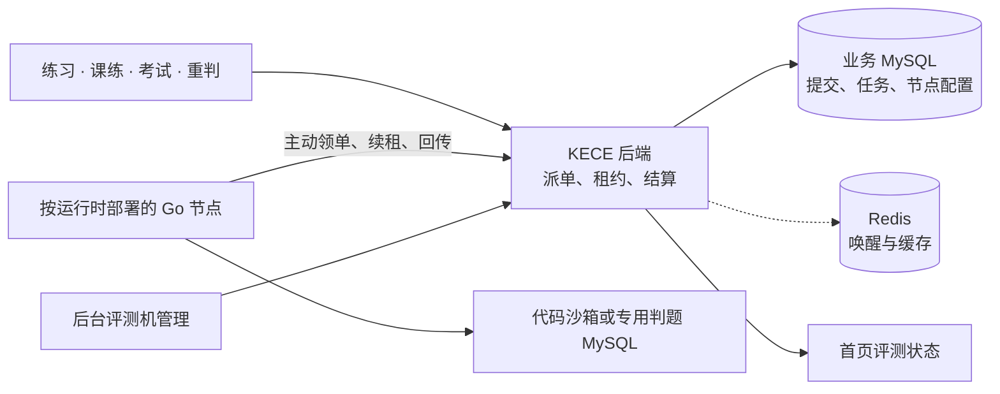

# KECE 评测机分池与扩容实施方案

## 1. 交付目标

C++、Java、Python、MySQL、ArkTS 各有独立评测池。一个 Go 节点只服务一个池，同池可以部署多台。管理员登记节点内网 API，完成验证后即时启用。节点可排空升级，首页按运行时展示真实状态。首期覆盖节点故障恢复。跨物理机接管以同池至少两台机器为前提，业务 MySQL 仍是接收提交的核心依赖。

| 对象 | 首期规则 |
| --- | --- |
| 评测池 | `cpp`、`java`、`python`、`mysql`、`arkts`。池由服务端按题型和已校验语言确定。客观题在应用内判分 |
| 评测节点 | 独立进程、凭据、心跳、工作目录、运行时规格与并发上限 |
| 宿主机分组 | 同机节点共享宿主机槽位预算，各自受本地上限及沙箱资源限额约束 |
| MySQL 池 | 节点使用专用判题 MySQL、临时库及受限用户，业务数据库继续承担任务与成绩存储 |
| 提交与成绩 | 沿用现有提交 ID、鉴权、查询接口与评分口径，逐池切换派单方式 |

## 2. 代码改造范围

| 现有入口 | 改造内容 |
| --- | --- |
| [SubmissionService](../backend/src/main/java/com/kece/submission/service/SubmissionService.java) · [DbSubmissionService](../backend/src/main/java/com/kece/database/service/DbSubmissionService.java) | 普通提交、带课练上下文的提交和重判均接入统一派单。沿用语言、可见性、归属和重判状态校验 |
| [ExamSubmissionService](../backend/src/main/java/com/kece/exam/service/ExamSubmissionService.java) | `enqueueCode` 与 `enqueueDb` 接入同一派单入口，覆盖 ACM 单题及 OI 交卷流程。保留既有题目与提交关联、分值换算和发布约束 |
| [JudgeResultBlockingListener](../backend/src/main/java/com/kece/submission/listener/JudgeResultBlockingListener.java) · [LessonPracticeService](../backend/src/main/java/com/kece/practice/service/LessonPracticeService.java) | 迁移期消费旧结果，新结果通过租约校验后直接结算。课练同步通过持久事件重试 |
| [Go 启动入口](../judger/cmd/judger/main.go) · [沙箱](../judger/internal/sandbox/sandbox.go) · [SQL 评测](../judger/internal/judge/sqljudge.go) | 现有进程同时启动算法和 SQL 循环。新增专池模式，复用各运行时的编译、运行和对拍逻辑 |
| [SystemStatusService](../backend/src/main/java/com/kece/system/service/SystemStatusService.java) · [ClusterConsole](../frontend/src/components/ClusterConsole.vue) · [DefaultLayout](../frontend/src/layouts/DefaultLayout.vue) | 用节点注册数据和任务快照替换固定的两个评测展示项、前端模拟值及顶栏固定在线数 |



第一版在现有 Spring Boot 服务内实现控制接口与调度。业务 MySQL 保存提交和任务，Redis 发送唤醒并缓存快照。唤醒丢失时由按池限频的查询补领，数据库事务决定任务归属和结果是否生效。 [MySQL 锁定读取](https://dev.mysql.com/doc/refman/8.0/en/innodb-locking-reads.html) · [Redis Pub/Sub 投递语义](https://redis.io/docs/latest/develop/pubsub/#delivery-semantics)

## 3. 持久任务与调度

### 3.1 数据表

Flyway 追加迁移，版本号取实施时的下一个空号。旧提交的当前任务指针为 NULL。

| 表或变更 | 字段与约束 |
| --- | --- |
| `judge_host_group` | ID、名称、物理机标识、总槽位、状态、配置版本。管理员维护物理机归属 |
| `judge_node` | ID、池、分组、名称、规范化 HTTPS 基址、期望状态、配置和本地槽位、心跳接收时间、版本、自检结论、会话代次。节点凭据存摘要并可轮换 |
| `judge_job` | ID、提交类型与 ID、重判代次、池、用例清单、任务快照、课练关联、状态、可领取时间、节点与分组 ID、会话代次、租约代次与截止时间、尝试次数、结果摘要、错误及时间戳 |
| `judge_job` 索引 | 唯一键 `(submission_type, submission_id, generation)`。用 `(pool, state, available_at, id)` 领取，`(state, lease_until, id)` 回收，`(node_id, state)` 和 `(host_group_id, state)` 统计槽位 |
| `submission` 与 `db_submission` | 增加 `current_judge_job_id`。两张表的数字 ID 可以相同，提交以类型加 ID 标识 |
| `judge_settlement_event` | 终态事务内保存下游更新事件。按 `(job_id, event_type)` 唯一，记录重试时间和处理状态 |

快照记录源代码引用、题型、语言、资源限制、评分权重、运行时规格和用例清单。SQL 另固定方言、DDL、参考答案、校验语句及 seed 版本。基础设施重试沿用快照，管理员重判生成新代次。同池仅调度到符合任务运行时规格的节点。

### 3.2 写入与领取

1. **提交事务。** 现有业务校验通过后，在同一事务保存提交、课练或考试关联、任务和当前任务指针。提交成功后返回已接收，再尽力写 Redis 初始状态并发唤醒。状态查询保留归属鉴权，缓存不可用时回源数据库。
2. **领取事务。** 锁宿主机分组，再锁节点。校验状态、心跳、会话与运行时，读取当前已提交的在途计数。按本地空闲数、节点余量与宿主机余量的最小值，使用 `FOR UPDATE SKIP LOCKED` 在本池按 `available_at, id` 领取，写入归属及递增的租约代次。使用短事务与明确的读已提交语义，核对 MySQL 实际执行计划。已过期但尚未回收的任务仍计入槽位。
3. **等待与并发。** 一个有空位的节点至多挂一个异步领单请求，首版建议等待 15 秒后带抖动重试。等待和沙箱执行期间释放数据库连接。领取响应丢失时，任务由租约回收，节点上限继续约束在途任务数。下调上限时，在途完成后自然降到新配额。
4. **背压。** 按池监控最老等待时间和积压。练习和批量重判可限流，用户编辑内容保留在客户端。考试交卷与任务在事务内确认，只有已成功保存才显示已交卷。高峰保障策略先以真实压测定阈值。

### 3.3 续租、结算和恢复

任务以 `QUEUED` 入库，获租约后进入 `RUNNING`。正常判题进入 `COMPLETED`，基础设施失败可退避回 `QUEUED`，超过上限进入 `FAILED`。业务删除触发 `CANCELLED`，取消与回收均保留可审计记录。

| 操作 | 约束 |
| --- | --- |
| 续租 | 事务内先锁节点校验当前凭据和会话，再检查对应任务的租约代次。以数据库 UTC 时间判断有效期。进度合并上报，拒绝过期进度 |
| 回收 | 按到期索引小批扫描，条件更新校验原代次和到期时间，再退避回队列。过期任务获得新租约时递增代次 |
| 结算 | 读取任务元数据定位提交，事务内依次锁节点、提交和任务。复核当前任务指针、节点凭据、会话、租约和到期时间，再写终态、成绩与下游事件 |
| 幂等确认 | 已提交的同一租约及结果摘要重复回传时返回已确认。拒绝旧租约、被替代的任务和冲突结果。结果缓存只在事务成功后发布 |
| 重试上限 | 编译错误、超时和答案错误是有效判题结果。节点、沙箱、数据或网络故障按退避重试，达到上限标记系统异常并保留后台重投入口 |

全局加锁顺序为宿主机分组、节点、业务提交、任务。每条路径仅锁它需要的行。重判、删除及最终失败等同时写业务提交和任务时，先锁提交。回收器按索引找候选，进入终态事务后重新校验，避免持任务锁反向申请提交锁。排空、换会话和吊销与领单、续租、结算共用节点锁。

联调默认值建议为心跳 10 秒、离线阈值 30 秒、租约 60 秒、续租 15 秒、过期扫描 5 秒、基础设施故障最多尝试 3 次。节点用单调时钟和安全余量管理本地停止期限，续租失败时在期限前停掉沙箱。另设覆盖编译、执行与清理的任务总时限。同池有空闲节点且控制面健康时，掉线任务从最后一次成功续租到重新可领取的目标为 65 秒内。实际开始时间还受队列影响。

### 3.4 业务兼容与防重复

- **课练。** 提交事务保存稳定的课练作答关联。连续提交 A、B 乱序完成时，都能找到原绑定并按已有最佳分规则更新。持久事件按任务及代次去重，更新同一作答时采用行锁或原子条件更新。
- **考试。** 同一考试和考生的保存、单题评测及交卷在服务端序列化。交卷重复请求返回已确认结果，单题提交用请求幂等键识别网络重试，主动提交使用新键。事务内复核交卷状态，保留 ACM 已判题跳过、OI 交卷批判和客观题同步评分。
- **派生统计。** 区分成绩落库与课练榜、每日通过统计、题集进度。需要重试的更新通过结算事件处理，事件去重与对应持久变更一起提交。校验同一用户多个任务同时结算时的累加和完成状态。
- **旧路径。** 新路径使用含任务 ID 的独立状态缓存，并校验当前任务指针。旧监听在提交行锁内确认记录仍属于旧路径才结算。已进入旧队列的任务原路跑完。新路径的提交后续重判继续走新路径。旧提交转新路径重判须先达到终态并原子切换指针。

调度状态与用户判题状态分开。等待、退避和暂时无节点映射到现有 `PENDING`，可附等待原因。运行阶段沿用 `COMPILING` 或 `JUDGING`，耗尽重试映射到 `SYSTEM_ERROR`。对删除题目或考试触发的提交清理，先撤销关联任务或标记取消，迟到回传统一拒绝。每日通过统计以有效业务提交为准，同一提交的多次重判共享通过统计口径。

## 4. 后台节点管理

在「评测与内容」下加 **评测机管理**，路由 `/admin/judgers`。复用后台的表格、筛选和分页。列表展示节点、池、宿主机、状态、执行中／上限、末次心跳、运行时版本及操作。详情侧栏展示自检、近期错误和操作记录。按池筛选后展示待评测数、最老等待和可接单节点数，便于定位该给哪个池加机。

### 4.1 添加与下线

| 步骤 | 界面与服务端行为 |
| --- | --- |
| 登记 | 填节点名、运行时池、批准网络中的 HTTPS API 基址、宿主机分组和槽位上限。保存为待验证，生成一次性接入码。建议 10 分钟过期，摘要存储、原子消费、只展示一次 |
| 启动 | 在目标主机启动对应 Go 评测容器。通过受保护配置文件传入控制面地址和接入码。接入码换取可吊销的单节点凭据，节点获得当前会话代次 |
| 连通 | 后台访问固定健康路径，验证 TLS、节点身份、协议和运行时版本。检查异步执行，页面逐项返回失败原因 |
| 自检 | 节点在本机配额内领取绑定自身的诊断任务。编译型运行时验证编译和执行，Python 验证运行和资源限制，MySQL 验证 SELECT、DML、权限及临时资源清理。诊断结果与配置、镜像版本绑定，成绩只写自检记录 |
| 启用 | 自检通过且心跳新鲜时才能启用。配置即时生效，节点开始领本池正式任务 |
| 排空 | 停止新领取，已有任务继续续租和回传。活跃租约归零后可以停机。遇到异常节点可立即吊销凭据，相关任务按租约回收 |

配置态为待验证、启用、排空、停用。观测态根据心跳、自检和依赖健康得出，健康但槽位满显示繁忙。改地址、池或镜像要重新验证，更换池或资源组先排空再登记。一个节点仅允许一个活动会话，领取、续租和结算均校验会话代次。启用、排空和修改额度与领单共用节点行锁。

### 4.2 接口契约

| 拟议接口 | 核心请求和返回 |
| --- | --- |
| `GET /api/v1/admin/judgers`、`GET /{id}` | 按池、状态分页返回配置、健康、运行槽位与诊断结果 |
| `POST /api/v1/admin/judgers` | 接受 `name, pool, baseUrl, hostGroupId, maxSlots`，返回节点 ID 和一次性接入码 |
| `POST /api/v1/admin/judgers/{id}/checks` | 启动连通检查和评测自检，返回 `checkId`，由详情接口查询结果 |
| `PATCH /api/v1/admin/judgers/{id}` | 更新允许的配置字段或申请启用、排空、停用，带 `revision` 防止配置覆盖。凭据轮换和立即吊销独立记录 |
| `POST /api/v1/internal/judgers/join`、`POST /session` | 接入码绑定，或以节点凭据建立新的会话。返回节点 ID、会话代次与支持的协议版本 |
| `POST /api/v1/internal/judgers/heartbeat` | 上报版本、本地上限与健康，返回期望状态。使用服务端接收时间判断存活 |
| `POST /api/v1/internal/judgers/jobs/claim` | 节点提交可用槽位数。服务端从认证信息确定节点和池，返回任务批次与相对租期 |
| `GET /api/v1/internal/judgers/jobs/{id}/artifacts/{digest}` | 按当前租约读取清单允许的文件。校验节点与租约，返回字节长度和内容摘要 |
| `POST /api/v1/internal/judgers/jobs/renew` | 批量续租和更新进度，逐项返回剩余租期或冲突 |
| `POST /api/v1/internal/judgers/jobs/{id}/result` | 提交租约代次与判题结果，区分已提交、重复确认、失效和可重试失败 |
| `GET /api/v1/system/judgers/summary` | 返回 `asOf, freshness, readyPools, totalPools, pools[]`。公开条目含运行时、状态和待评测数 |

领取响应返回任务快照、资源限制和用例清单。下面省略源代码与清单明细，路径与字段在 Python 试点前冻结。

```json
{
  "jobs": [
    {
      "jobId": 381,
      "submissionType": "ALGO",
      "submissionId": 204,
      "generation": 1,
      "pool": "java",
      "leaseEpoch": 2,
      "leaseRemainingMs": 59000,
      "manifestId": "manifest-301",
      "runtimeSpec": "java17-r1",
      "limits": { "timeLimitMs": 1000, "memoryLimitMb": 256 }
    }
  ]
}
```

管理端路由和控制器都限制 ADMIN，保留现有 `ApiResponse` 及分页契约。机器接口需要专用拦截器，凭据只从请求头读取，未通过校验时拒绝访问，公开反代封闭内部路径。机器接口使用明确的 HTTP 状态，分别处理认证失败、越权、租约冲突和临时故障。当前 [AuthInterceptor](../backend/src/main/java/com/kece/common/security/AuthInterceptor.java) 的用户规则不能承担机器鉴权。 [后台导航](../frontend/src/layouts/AdminLayout.vue) · [后台路由](../frontend/src/router/index.ts)

内网 API 地址用于固定 HTTPS 路径探测，派单由节点主动领。限制批准域名或网段与端口，校验全部解析地址并固定实际连接 IP，保留证书校验，关闭重定向，限制响应体和超时。探测使用独立身份验证，节点领单凭据留在节点认证通道。审计记录操作人、节点、配置版本和时间。 [OWASP SSRF 防护指南](https://cheatsheetseries.owasp.org/cheatsheets/Server_Side_Request_Forgery_Prevention_Cheat_Sheet.html)

## 5. 节点部署与用例同步

### 5.1 运行模式

| 拟议配置 | 用途 |
| --- | --- |
| `JUDGE_MODE=pool`、`JUDGE_POOL=java` | 选择专池模式和运行时。灰度期间保留旧运行模式 |
| `JUDGE_CONTROL_URL`、`JUDGE_CREDENTIAL_FILE` | 控制面内网地址及受保护的注册和凭据文件 |
| `JUDGE_LOCAL_SLOTS`、`JUDGE_WORKSPACE` | 节点并发硬上限和独立工作目录 |
| 镜像版本及资源配置 | 固定镜像摘要或兼容版本，启动时只检查本池镜像。分别限定编译、运行、临时盘和进程数 |

先在 NEC 上逐池单槽跑基线，再尝试同机总并发为 1 或 2，结合业务延迟与 CPU、内存、磁盘实测调整。编译和运行容器由宿主机 Docker 启动，实际沙箱也要进入对应的父 cgroup。专用 MySQL 实例有独立连接和资源上限，并预留清理能力。跨机时按兼容运行时和同一题集复测时间、内存与判题结果。 [Docker 资源限制](https://docs.docker.com/engine/containers/resource_constraints/) · [Docker 父 cgroup](https://docs.docker.com/reference/cli/docker/container/run/#specify-custom-cgroups)

生产节点使用受控 Linux 环境，Docker 控制面与用户沙箱隔离。用户代码只看得到本次执行所需文件，节点凭据、标准输出缓存和 Docker 套接字留在受信侧。沙箱输入以受信只读文件交付，结果与资源统计通过受控路径读取，对共享目录里的符号链接、管道和超量输出做处理。容器和工作目录按任务及租约代次标记，超过租约且确认归属后清理遗留资源。SQL 临时库和账号也要标记归属和有效期，以覆盖节点被杀后无法执行延迟清理的情况。 [开发 Compose](../deploy/docker-compose.yml) · [Docker 安全机制](https://docs.docker.com/engine/security/)

### 5.2 用例版本

现有本地用例文件可能被编辑或导入覆盖。迁移时在保存或导入题目阶段生成不可变清单，记录用例版本、输入与输出摘要、字节数和权重。文件先落入按摘要保存的存储，再发布版本引用。已提交任务引用的版本保留到任务和所需回放窗口结束，旧题在开放新调度前完成回填。 [当前用例存储](../backend/src/main/java/com/kece/question/service/TestCaseStorageService.java)

首期由后端通过内网提供授权下载。节点只能读取有效租约关联的文件，校验大小和摘要后原子写入本机缓存。提交时只记录版本引用。缺失文件、摘要不符及读权限错误均归为基础设施异常，合法空输出由清单确认。前端按现有权限展示公开样例和允许的结果信息。

## 6. 首页状态模块

右侧使用一个直角浅灰面板，黑白为主，五个运行时用分隔线排成列表。桌面目标行高约 40 px，窄屏移到主介绍下方。状态用文字和颜色共同表达，排队数右对齐。移除光标倾斜、倒计时和预填在线值。

```text
评测服务状态                       部分不可用
4 / 5 个运行时可用                 更新于 16:10

运行时           状态                   待评测
C++              正常                        0
Java             排队中                      8
Python           正常                        0
MySQL            暂不可用                    2
ArkTS            正常                        0
```

一个运行时至少有一个启用且健康的节点就计为可用。满载可用但可能排队。排空节点退出可接单容量。待评测包括已保存、尚未领单的任务，后台可细分可领和退避中。读不到快照时显示状态暂不可用及上次成功时间，首次加载使用等高占位。过渡期未切换的池标记「待切换」，首页整体可用比例在分池统计完整后启用。保留原接口供旧前端迁移。

首页和顶栏共享一个布局级状态源，页面可见时约 30 秒刷新，隐藏时暂停。后端聚合并缓存公开快照，访客请求复用该结果。正式页面用 100% 缩放检查 1280 px、1703 px 与 390 px，验证故障、空状态和更新时间在各尺寸可读。

## 7. 开发与上线顺序

| 阶段 | 实现项 | 放行条件 |
| --- | --- | --- |
| A · 事务和数据 | 追加 Flyway、统一派单、当前任务指针、旧结果防覆盖、状态回源、用例版本化 | 开关关闭时原路径正常。提交和任务事务失败可整体回滚。练习、课练、考试、重判各入口通过回归 |
| B · Python 双节点 | 专池 Go 进程、内部接口、注册自检、租约回收与结算、后台节点管理 | 后台添加第二节点后即时分单。模拟掉线与确认丢失，逐单对账，无重复成绩 |
| C · 其余评测池 | C++、Java、ArkTS 接入现有沙箱，MySQL 验证隔离和清理，补齐跨主机用例分发 | 代表题结果与旧判题一致，多池混合负载满足宿主机配额，跨机任务通过 |
| D · 灰度和首页 | 按池切新派单、发布状态接口与页面、排空旧队列 | 对账覆盖待判、处理中、待结算和课练事件。连续观察无新旧路径冲突后，低峰停旧进程并清理旧遥测 |

第一批开发可以拆成四项。后端新增任务调度模块和 Flyway 迁移，统一接入现有提交入口。Go 新增专池启动模式和节点客户端，复用现有评测逻辑。前端先交付节点列表、接入、自检和排空操作。最后用真实 MySQL、Redis 和两个独立 Python 进程跑通提交、结算及接管，再把同一协议推广到其余池。

每池独立切换后续新任务，已进旧队列的任务在旧路径跑完。回滚先切回该池新任务的路由，现有新任务由兼容后端和已验证新节点排空。新节点全故障时保留任务与用例，恢复后续跑。尚有新任务时，回退到理解新表和任务指针的兼容版本。旧 Redis 处理列表、待结算结果和派生事件都完成对账后再退役。避开正在进行的考试切换。

## 8. 验收与容量

| 场景 | 放行检查 |
| --- | --- |
| 业务入口 | 各运行时验证适用入口，尤其是并发重复 OI 交卷、ACM 先判后交卷、课练连续提交乱序完成、同数字 ID 的代码与 SQL、后台重判 |
| 注册与排空 | 验证教师权限、过期或重复接入码、跨池领取及重复会话均被拦截。探测成功但自检失败时仍待验证。排空期间仅现有租约可续租和回传 |
| 故障接管 | 终止一个节点、丢弃领取响应、丢弃结算确认，检查回收与幂等。旧租约结果不能覆盖有效成绩。备用节点有空位时按租约目标复核接管时延 |
| 数据和隔离 | 题目编辑后旧任务仍读取原版本，损坏文件按系统异常处理。暂停判题 MySQL 后其他池继续评测。检查遗留沙箱、临时库和账号清理 |
| 状态与保护 | 断 Redis 通知时已入库任务可恢复。首页和顶栏的快照及过期状态一致。节点探测拦截跨网段、重定向与超大响应 |
| 对账 | 每个已接收任务都有可追溯状态。重复生效和跨池执行均为 0，作答与成绩能回溯到任务和代次 |

压测在隔离环境从独立负载端进行，先 30、100，再跑 300 次同语言突发与 300 次混合突发。题集覆盖轻、中、重题及冷缓存的大用例。扩容前后记录接收成功数、接收 P95、每池排队 P95、评测 P95、落库延迟、最后一单完成时间、每秒完成数、资源峰值和系统异常数。首页的公开读压测单列。

单池理想吞吐约等于有效槽位数除以平均评测秒数。若 Java 实测平均 2 秒、实际有 4 槽，约为每秒 2 单，300 单理论耗时约 150 秒。若希望同样负载 60 秒完成，理论上至少需要 10 个有效槽位，实际还要预留长尾和资源开销。以现有 NEC 和目标机器的压测结果确定最终槽位与扩容优先级。
