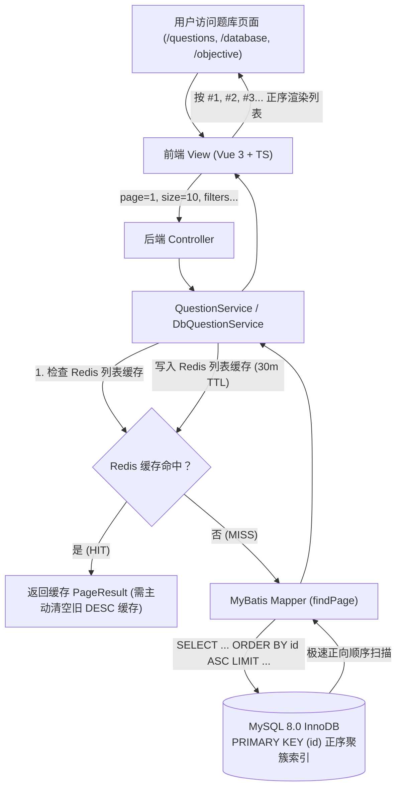

# 题库题目按题号升序排序改造技术方案

## 1. 方案背景与目标

### 1.1 现状与痛点
KECE OJ 平台现有三大题库子模块：
- **算法编程**（Algorithm OJ）
- **数据库题**（Database SQL OJ）
- **客观题库**（Objective Question Bank）

当前后端 MyBatis Mapper XML 中的分页查询语句均硬编码为：
```sql
ORDER BY id DESC
LIMIT #{offset}, #{size}
```
导致用户首次进入题库时，第 1 页展示的均为最新录入的高编号题目（例如 `#830 魔法骰子`、`#829 音乐节拍器` 等）。这与主流评测系统（如 LeetCode、洛谷、Codeforces 等）从题号 `#1` 起步、由浅入深的刷题认知存在偏差。

### 1.2 改造目标
- 将算法编程、数据库题、客观题库列表默认排序全部调整为**按题号正序递增**（`id ASC`，即从 `#1, #2, #3...` 起始）。
- 确保服务端分页在正序下的边界行为与状态过滤（已解答/未解答）完全一致。
- 保证前后端数据契约无损、MySQL 聚簇索引效率最优、Redis 缓存精准清理。

---

## 2. 影响链路与技术评估



### 2.1 前端影响评估：零修改
- [QuestionsView.vue](file:///c:/Users/zco/Desktop/KECE/frontend/src/views/QuestionsView.vue)：
  采用 `const displayedList = computed(() => list.value)` 直接绑定后端 `res.list`。
- [DatabaseQuestionsView.vue](file:///c:/Users/zco/Desktop/KECE/frontend/src/views/DatabaseQuestionsView.vue)：
  直接将 `res.list` 赋给 `list.value` 进行卡片渲染。
- [ObjectiveQuestionsView.vue](file:///c:/Users/zco/Desktop/KECE/frontend/src/views/ObjectiveQuestionsView.vue)：
  采用服务端分页直出，状态过滤模式下基于返回列表本地过滤与切片，依然严格保持输入的顺序。
- **结论**：前端所有组件均自然遵循后端返回序列，**无需修改前端代码**。

### 2.2 数据库存储引擎与索引评估
- 数据表 `question`、`db_question`、`objective_question` 的主键均为 `id BIGINT AUTO_INCREMENT PRIMARY KEY`。
- InnoDB 聚簇索引物理结构是天然按 `id ASC` 排列的 B+ 树。
- 原先的 `ORDER BY id DESC` 在底层执行的是**逆序索引扫描**（Backward Index Scan）；改为 `ORDER BY id ASC` 则直接转为**正向顺序扫描**（Forward Index Scan），在大数据量深度分页及冷启动阶段性能有微小提升。

### 2.3 缓存层评估
- [QuestionService.java](file:///c:/Users/zco/Desktop/KECE/backend/src/main/java/com/kece/question/service/QuestionService.java) 与 [DbQuestionService.java](file:///c:/Users/zco/Desktop/KECE/backend/src/main/java/com/kece/database/service/DbQuestionService.java) 对公共无状态列表开启了 Redis 缓存（前缀分别为 `question:cache:list:*` 与 `db:question:cache:list:*`，TTL 为 30 分钟）。
- 后端更新部署后必须立即执行 Redis 清理，避免客户端读到倒序旧缓存。

---

## 3. 涉及修改的文件与代码 Diff

### 3.1 文件清单
1. `backend/src/main/resources/mapper/QuestionMapper.xml`
2. `backend/src/main/resources/mapper/DbQuestionMapper.xml`
3. `backend/src/main/resources/mapper/ObjectiveQuestionMapper.xml`

---

### 3.2 详细代码修改对照

#### ① 算法题库 [QuestionMapper.xml](file:///c:/Users/zco/Desktop/KECE/backend/src/main/resources/mapper/QuestionMapper.xml#L43-L49)
```xml
<<<<
    <select id="findPage" resultMap="BaseResultMap">
        SELECT * FROM `question`
        <include refid="filters"/>
        ORDER BY id DESC
        LIMIT #{offset}, #{size}
    </select>
====
    <select id="findPage" resultMap="BaseResultMap">
        SELECT * FROM `question`
        <include refid="filters"/>
        ORDER BY id ASC
        LIMIT #{offset}, #{size}
    </select>
>>>>
```

#### ② 数据库题库 [DbQuestionMapper.xml](file:///c:/Users/zco/Desktop/KECE/backend/src/main/resources/mapper/DbQuestionMapper.xml#L46-L52)
```xml
<<<<
    <select id="findPage" resultMap="BaseResultMap">
        SELECT * FROM `db_question`
        <include refid="filters"/>
        ORDER BY id DESC
        LIMIT #{offset}, #{size}
    </select>
====
    <select id="findPage" resultMap="BaseResultMap">
        SELECT * FROM `db_question`
        <include refid="filters"/>
        ORDER BY id ASC
        LIMIT #{offset}, #{size}
    </select>
>>>>
```

#### ③ 客观题库 [ObjectiveQuestionMapper.xml](file:///c:/Users/zco/Desktop/KECE/backend/src/main/resources/mapper/ObjectiveQuestionMapper.xml#L32-L38)
```xml
<<<<
    <select id="findPage" resultMap="BaseResultMap">
        SELECT * FROM `objective_question`
        <include refid="filters"/>
        ORDER BY id DESC
        LIMIT #{offset}, #{size}
    </select>
====
    <select id="findPage" resultMap="BaseResultMap">
        SELECT * FROM `objective_question`
        <include refid="filters"/>
        ORDER BY id ASC
        LIMIT #{offset}, #{size}
    </select>
>>>>
```

---

## 4. 实施与部署规范

### 4.1 本地编译与测试验证
1. 执行代码替换后，在工程根目录运行后端测试与打包：
   ```bash
   mvn clean package -DskipTests
   ```
2. 运行相关集成测试套件验证：
   ```bash
   mvn test -Dtest=QuestionIntegrationTest,DbQuestionIntegrationTest,ObjectiveQuestionIntegrationTest
   ```

### 4.2 现网集群部署与生效
1. 将打包生成的新 JAR 包部署至后端服务所在主机（`10.56.40.238`）。
2. 重启 `kece-backend` systemd 服务或 Docker 容器。
3. 执行 Redis 缓存清理命令（通过 SSH 或自动化脚本）：
   ```bash
   redis-cli -h 10.56.40.238 KEYS "question:cache:list:*" | xargs -r redis-cli -h 10.56.40.238 DEL
   redis-cli -h 10.56.40.238 KEYS "db:question:cache:list:*" | xargs -r redis-cli -h 10.56.40.238 DEL
   redis-cli -h 10.56.40.238 DEL question:cache:list_keys db:question:cache:list_keys
   ```

---

## 5. 验收测试用例

| 编号 | 测试场景 | 预期结果 |
| :--- | :--- | :--- |
| **TC-01** | 打开 `/questions` 第一页 | 首条题目为 `#1`（或最小 ID 题），卡片按 `#1, #2, #3...` 递增排列 |
| **TC-02** | 算法题库翻页至第二页 | 题号顺延递增（例如第 11 题至第 20 题），无断层或重复 |
| **TC-03** | 算法题库难度过滤（如选择 EASY） | 返回的所有简单题目按 `id ASC` 升序排列 |
| **TC-04** | 打开 `/database` 第一页 | 数据库题目按 `id ASC` 递增显示 |
| **TC-05** | 打开 `/objective` 第一页 | 客观题按 `id ASC` 递增显示 |
| **TC-06** | 登录状态做题后过滤（未解答/已通过） | 过滤后的题目子集依然严格保持题号升序 |

